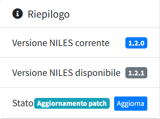
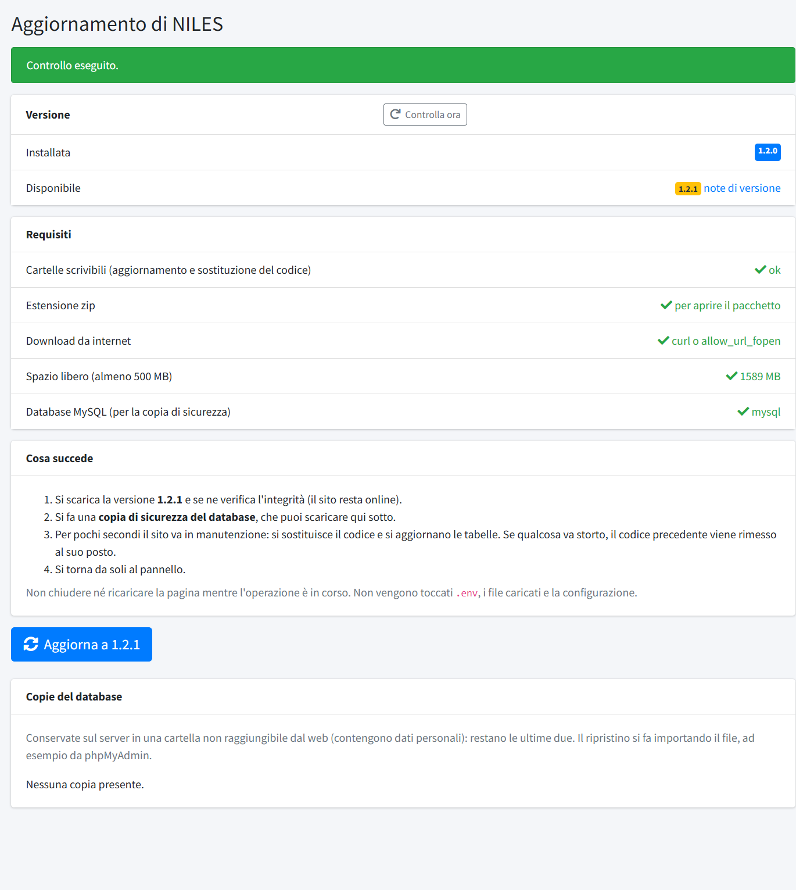
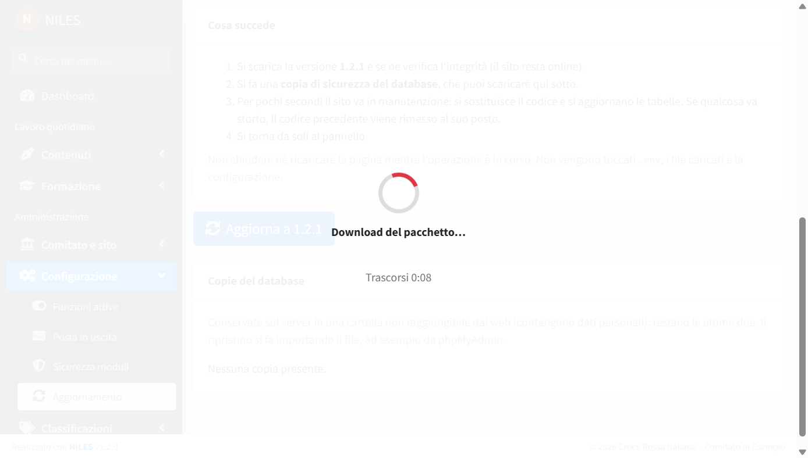
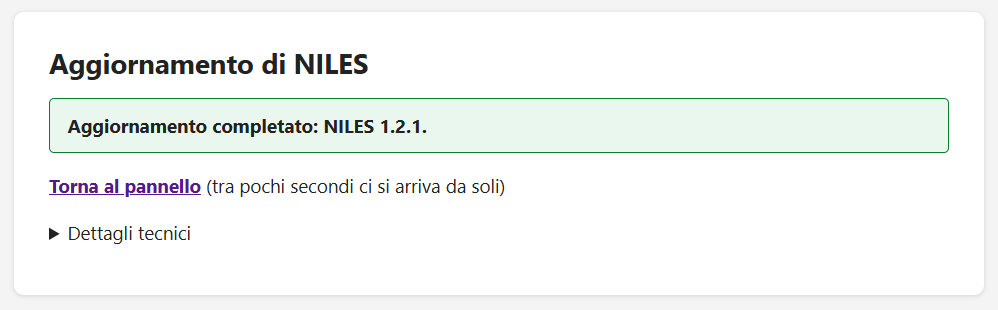

# Aggiornamento e backup

NILES si aggiorna scaricando il codice nuovo dal repository e rilanciando alcuni passi di costruzione. Il repository include due script per
farlo in sicurezza: [`scripts/backup.sh`](../../scripts/backup.sh) per la copia di sicurezza e [`scripts/deploy.sh`](../../scripts/deploy.sh)
per l'aggiornamento. Vanno lanciati dall'utente con cui gira il sito, come spiegato in
[Installazione su un server](02-installazione-su-server.md#con-quale-utente-lanciare-i-comandi).

## Quando aggiornare

Le versioni pubblicate, con le note di ciascuna, sono nella pagina **Releases** del repository. Il numero di versione ha tre parti
(`1.2.3`): le versioni che cambiano solo l'ultima parte correggono errori o rifiniscono, quelle che cambiano la seconda aggiungono funzioni; un
cambio della prima parte può richiedere interventi manuali, segnalati nelle note.

Nel pannello, la dashboard mostra la **versione installata** e, se il controllo è attivo (`NILES_UPDATE_CHECK`, vedi
[Configurazione del file .env](03-configurazione-env.md)), segnala quando ne esiste una più recente.

## 1. Fare il backup

`deploy.sh` salva da solo il database prima di aggiornare (vedi sotto). Per una copia a mano:

```bash
cd /var/www/niles
bash scripts/backup.sh          # solo il database
bash scripts/backup.sh --all    # database e file
```

Lo script crea nella cartella `~/niles-backups/<data_ora>/`, con la versione di NILES nel nome:

- `db_vX.Y.Z.sql.gz`: la copia completa del database (sempre);
- `files_vX.Y.Z.tar.gz`: solo con `--all`, i file del progetto (compresi il `.env` e i file caricati dal pannello), senza `vendor`,
  `node_modules` e `.git`. Il codice si recupera comunque da git o dal pacchetto della versione; questo archivio serve per il `.env` e i
  file caricati, che non sono nel repository.

Lo script conserva gli **ultimi 10 backup** (automatici e manuali insieme) e cancella i più vecchi.

> Il backup con `--all` contiene il `.env`, quindi anche le password: tienilo fuori dalla cartella pubblica del sito e, per sicurezza, copia ogni tanto i
> backup anche su un altro computer o servizio, perché sullo stesso server non proteggono da un guasto del server.

**Verifica:** al termine lo script mostra le dimensioni dei file creati e il percorso della cartella.

## 2. Aggiornare

```bash
bash scripts/deploy.sh
```

Per un sito in produzione, sul ramo `main`, lo script esegue in ordine:

1. `bash scripts/backup.sh`: copia di sicurezza del database, prima di qualsiasi modifica. Se il backup non riesce il deploy
   si ferma;
2. `git pull`: scarica il codice nuovo;
3. `composer install --no-dev --optimize-autoloader`: aggiorna le librerie;
4. `npm ci` e `npm run build`: ricostruisce gli stili e gli script;
5. `php artisan migrate --force`: aggiorna il database alla nuova struttura;
6. `php artisan niles:seeders`: esegue i **seeder di aggiornamento** non ancora eseguiti, cioè i contenuti da portare ai siti già in
   uso (testi di default, pagine nuove). Ogni seeder viene eseguito una sola volta: il suo nome e la data di esecuzione si registrano nella
   tabella `seeders_eseguiti`. Con `php artisan niles:seeders --stato` si vede l'elenco, con quelli ancora da eseguire;
7. svuota e ricrea le cache (`config:cache`, `route:cache`, `view:cache`);
8. controlla il collegamento `public/storage`.

Se l'aggiornamento non cambia librerie, struttura del database né contenuti (le note della versione lo dicono), `bash scripts/deploy.sh --quick`
esegue solo il `git pull` e il rinnovo delle cache, in pochi secondi, senza backup.

**Verifica:** lo script termina con «Deploy completato.»; aprendo il sito e la dashboard del pannello, la **versione corrente** è quella
nuova.

### Aggiornare senza lo script

Chi non usa `deploy.sh` (ad esempio perché il codice arriva in un altro modo) esegue gli stessi passi a mano, dalla cartella del sito
e con l'utente che gestisce il sito:

```bash
git pull
composer install --no-dev --optimize-autoloader
npm ci && npm run build
php artisan migrate --force
php artisan niles:seeders
php artisan optimize:clear
php artisan config:cache && php artisan route:cache && php artisan view:cache
[ -e public/storage ] || php artisan storage:link
```

Il passo `php artisan niles:seeders` non va saltato: senza, i contenuti di aggiornamento previsti dalla nuova versione non vengono applicati. È
sicuro rilanciarlo: se non c'è niente da eseguire, termina con «Nessun seeder da eseguire.».

**Verifica:** aprendo il sito e la dashboard del pannello, la **versione corrente** è quella nuova.

Note utili:

- Lo script cambia comportamento in base al ramo: sul ramo `dev` installa anche le librerie di sviluppo. **In produzione resta sempre sul
  ramo `main`.** Il parametro `--dev` forza l'installazione delle librerie di sviluppo anche su un ramo diverso da `dev`: **non va mai
  usato in produzione**, dove le librerie di sviluppo non servono e ampliano inutilmente il codice presente sul server.
- Con più versioni di PHP sul server, lo script usa `php8.4` per Composer se esiste; per i comandi `artisan` vale il `php` del terminale
  (vedi [Requisiti](01-requisiti.md#più-versioni-di-php-sullo-stesso-server)).
- Dopo una modifica al file `.env` basta `php artisan config:cache`, senza rifare l'aggiornamento.
- Se durante l'aggiornamento il sito non deve essere raggiungibile, `php artisan down` lo mette in manutenzione e `php artisan up` lo riapre.
- Dove non c'è la riga di comando (hosting condiviso con solo FTP) la manutenzione si attiva creando il file
  `storage/framework/maintenance.php` con il contenuto seguente, e si disattiva cancellandolo. Finché il file esiste anche il pannello di
  amministrazione non è raggiungibile.

  ```php
  <?php http_response_code(503); header('Retry-After: 60'); echo 'Sito in manutenzione'; exit;
  ```

## Aggiornare dal pannello (hosting condiviso)

Le installazioni fatte con l'[installer per hosting condiviso](05-installazione-su-hosting-condiviso.md), senza accesso da riga di comando,
si aggiornano dal pannello. Il pulsante è disponibile solo su queste installazioni; sulle altre si usa `deploy.sh` (sezione 2).

1. Quando esiste una versione più recente, nella dashboard il riquadro **Riepilogo** mostra la versione disponibile e il pulsante
   **Aggiorna**. La verifica si fa una volta al giorno: se una release è appena uscita e il pulsante non compare, la pagina
   *Configurazione → Aggiornamento* ha il pulsante **Controlla ora**.

   

2. La pagina **Aggiornamento** controlla i requisiti (cartelle scrivibili, estensione zip, download, spazio libero, database), spiega cosa
   succederà e propone il pulsante **Aggiorna a X.Y.Z**, con un collegamento alle note di versione. Dopo la conferma l'operazione parte.

   

3. Una schermata di attesa mostra la fase in corso e il tempo trascorso: download e verifica del pacchetto, copia di sicurezza del
   database, poi qualche secondo di manutenzione mentre si sostituisce il codice e si aggiornano le tabelle. **Non chiudere né ricaricare
   la pagina.**

   

4. Alla fine compare «Aggiornamento completato» con la nuova versione, e dopo pochi secondi si torna da soli al pannello.

   

**Verifica:** nella dashboard la versione corrente è quella nuova.

L'aggiornamento non tocca il file `.env`, i file caricati dal pannello né la configurazione. La **copia del database** fatta prima di
sostituire il codice resta sul server, in una cartella non raggiungibile dal web, e si scarica dalla pagina Aggiornamento (si conservano le
ultime due): per ripristinarla si importa il file, ad esempio con phpMyAdmin. Se qualcosa va storto durante la sostituzione, il codice
precedente viene rimesso al suo posto da solo e il messaggio spiega cosa è successo.

## Ripristinare un backup

Se qualcosa va storto si torna alla copia di sicurezza. Il percorso esatto dei file compare alla fine dell'esecuzione di `backup.sh`.

**Database**:

```bash
gunzip -c ~/niles-backups/<data_ora>/db_vX.Y.Z.sql.gz | mysql -h 127.0.0.1 -u niles -p niles
```

(con host, utente e nome del database del proprio `.env`).

**File**, solo se serve ripristinare anche i file caricati o il `.env` (backup fatto con `--all`): l'archivio contiene i percorsi completi, quindi si estrae dalla
radice del filesystem:

```bash
sudo tar -xzf ~/niles-backups/<data_ora>/files_vX.Y.Z.tar.gz -C /
```

Se si è tornati a una versione precedente del database, va riportato anche il codice alla stessa versione (con `git checkout vX.Y.Z`),
poi si rifanno `composer install --no-dev --optimize-autoloader`, `npm ci`, `npm run build` e `php artisan optimize:clear` seguito dalle cache. Le
migrazioni di una versione nuova non si annullano da sole: per questo il backup precedente all'aggiornamento è l'unica via di ritorno.
