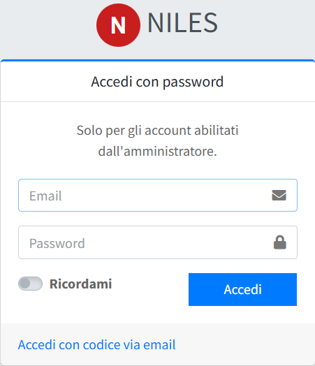

# Primo accesso al pannello

Dopo l'installazione ([su un server](02-installazione-su-server.md) o [su un hosting condiviso](05-installazione-su-hosting-condiviso.md))
il sito è già online con un menu completo, i testi di base e un primo amministratore. Questa pagina spiega come entrare, cosa si trova nel pannello e in che ordine conviene configurarlo.

## Accedere

Apri `https://<dominio>/admin/login/password` e inserisci l'email e la password del primo amministratore:

- con l'installer per hosting condiviso, quelle scelte nel modulo di installazione;
- con l'installazione su server, quelle impostate in `INITIAL_ADMIN_EMAIL` e `INITIAL_ADMIN_PASSWORD` nel file `.env` (oppure
  l'indirizzo `administrator@example.it` con la password mostrata al termine di `db:seed`).

- La pagina `/admin/login` propone invece l'accesso con il **codice via email**: funziona solo dopo aver configurato la posta in
  uscita, dal pannello ([Posta in uscita](../06-configurazione/02-posta-in-uscita.md)) o nel file `.env`. L'accesso con la password
  resta sempre disponibile per gli account in cui è abilitato.
- «Ricordami» mantiene l'accesso su quel browser più a lungo.

I due modi di accesso, l'uscita e i problemi più comuni sono descritti in [Accesso al pannello](../01-primi-passi/01-accesso-al-pannello.md).

## Cambiare la password iniziale

Se hai scelto una password provvisoria, cambiala subito: apri **Utenti** (menu *Amministrazione → Utenti e controllo*), modifica il tuo
utente, scrivi la nuova password nel campo **Password** e salva. Lasciando il campo vuoto la password non cambia.

Da qui si creano anche gli altri utenti del pannello: vedi [Utenti](../08-utenti-e-controllo/01-utenti.md).

## La dashboard e il menu

All'ingresso compare la dashboard, con il riepilogo dei contenuti del sito; a sinistra il menu con tutte le sezioni del pannello. Come sono
organizzati, e come si usano elenchi e moduli, è spiegato in [Il pannello in breve](../01-primi-passi/02-il-pannello-in-breve.md).

## Cosa trovi già pronto

L'installazione crea questi contenuti, da adattare:

- il **menu del sito** con sei voci (Chi Siamo, Cosa Facciamo, Volontariato, Sostienici, Servizi, Contatti) e le relative pagine, con
  testi standard validi per tutti i comitati; le pagine che non tutti hanno (Corpo Infermiere Volontarie, Diventa Infermiera
  Volontaria, Donazioni, Innovazione) sono create in **bozza** e vanno attivate da chi le usa;
- le **categorie** delle notizie, le **aree** della sezione Trasparenza e le **tipologie di corso** più comuni;
- la Privacy Policy e la Cookie Policy, le informative privacy per i soci e per i corsi, i testi delle email di sistema;
- una comunicazione di benvenuto nell'area soci.

Le pagine che richiedono dati del comitato (Contattaci, Dove Trovarci, il codice fiscale per il 5x1000) contengono un
segnaposto **«Da completare»**: sostituiscilo con i dati reali.

## Ordine consigliato della configurazione

1. [Dati del comitato](../05-comitato-e-sito/01-dati-del-comitato.md): denominazione, contatti, loghi e favicon, coordinate. Compaiono
   subito nel sito.
2. [Posta in uscita](../06-configurazione/02-posta-in-uscita.md): il server delle email, necessario per il codice di accesso e per le
   conferme di iscrizione ai corsi.
3. [Utenti](../08-utenti-e-controllo/01-utenti.md): cambia la password iniziale e crea gli utenti che servono.
4. *Funzioni attive* (menu *Configurazione*): accendi le funzioni facoltative che usi, come l'area soci e la gestione dei pagamenti
   dei corsi.
5. [Pagine](../02-contenuti/02-pagine.md): sostituisci i segnaposto, attiva le pagine che usi.
6. [Struttura organizzativa](../02-contenuti/03-struttura-organizzativa.md) e [Trasparenza](../02-contenuti/04-trasparenza.md).
7. [Post](../02-contenuti/01-post.md) e [Categorie](../07-classificazioni/01-categorie.md): la prima notizia.
8. [Corsi](../03-formazione/01-corsi.md), [Tipologie corso](../03-formazione/04-tipologie-corso.md) e [Membri](../04-area-soci/01-membri.md), se li usi.
9. [Informative privacy](../05-comitato-e-sito/05-informative-privacy.md), [Template email](../05-comitato-e-sito/06-template-email.md) e
   [Sicurezza moduli](../06-configurazione/03-sicurezza-moduli.md), prima di aprire le iscrizioni al pubblico.

Per formati e dimensioni di loghi, copertine e foto vedi [Immagini e file](../01-primi-passi/03-immagini-e-file.md).
