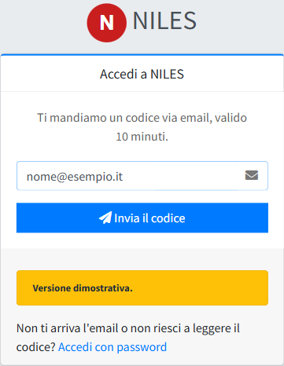
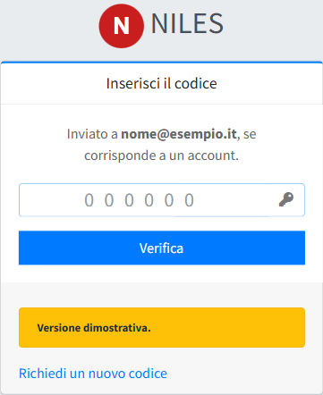
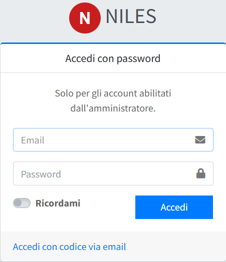

# Accesso al pannello

Il pannello si apre all'indirizzo `https://<dominio>/admin`. Ci sono due modi per entrare: con un **codice inviato per email**, il modo
normale, oppure con la **password**, per gli account in cui è abilitata.

## Con il codice via email

1. Apri `https://<dominio>/admin/login`, scrivi la tua email e premi **Invia il codice**.

   

2. Controlla la posta: arriva un codice di **6 cifre**, valido **10 minuti** e utilizzabile una sola volta.
3. Scrivi il codice nella pagina che si è aperta e premi **Verifica**.

   

La pagina risponde «Inviato a …, se corrisponde a un account» anche quando l'email non è registrata: in questo modo non rivela quali
indirizzi hanno accesso al pannello. Se il codice non arriva, controlla di aver scritto l'email giusta e guarda nella cartella della posta
indesiderata.

Il codice via email funziona solo dopo che un amministratore ha configurato la [posta in uscita](../06-configurazione/02-posta-in-uscita.md).

## Con la password

Apri `https://<dominio>/admin/login/password` (oppure, dalla pagina del codice, il collegamento **Accedi con password**), scrivi email e
password e premi **Accedi**. **Ricordami** mantiene l'accesso su quel browser anche dopo averlo chiuso: non usarlo su un computer condiviso.

L'accesso con password funziona solo per gli account in cui un amministratore l'ha abilitato (vedi [Utenti](../08-utenti-e-controllo/01-utenti.md)):
per gli altri risponde «Credenziali non valide», come per una password sbagliata. Il primo amministratore lo ha sempre, per poter entrare
prima che la posta sia configurata.

## Uscire

In alto a destra, clic sul tuo nome e poi **Esci**. Senza attività, la sessione scade da sola dopo il tempo impostato dall'amministratore
del sito (di norma due ore): a quel punto il pannello chiede di accedere di nuovo. Se scade mentre si compila un modulo, le modifiche non
salvate vanno perse: per i testi lunghi conviene salvare spesso.

## Se qualcosa non va

| Cosa si vede | Cosa fare |
|---|---|
| Il codice non arriva | Controlla l'email scritta e la posta indesiderata; dopo qualche minuto richiedine uno nuovo con **Richiedi un nuovo codice**. Se non arriva mai, la posta in uscita del sito non funziona: avvisa un amministratore, oppure entra con la password se il tuo account la prevede. |
| «Codice non valido o scaduto» | Il codice è sbagliato, è già stato usato o sono passati più di 10 minuti. Richiedine uno nuovo: vale sempre l'ultimo inviato. |
| «Credenziali non valide» | Email o password sbagliate, oppure l'accesso con password non è abilitato per il tuo account. |
| «Troppi tentativi ravvicinati» (errore 429) | Troppe richieste in poco tempo dalla stessa connessione. La pagina indica quanto attendere; poi riprova. |
