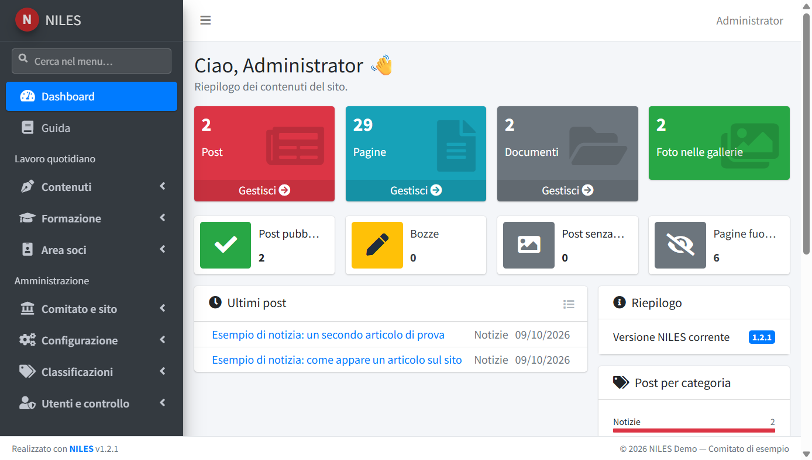
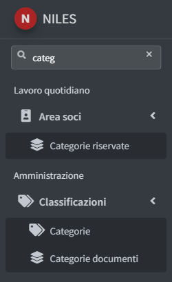
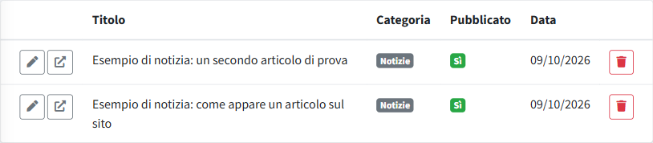
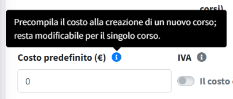
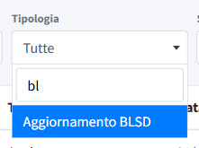

# Il pannello in breve

Come è fatto il pannello e come si usano gli elementi che compaiono in tutte le sezioni: dashboard, menu, elenchi e moduli.

## La dashboard

All'ingresso compare la dashboard, un riepilogo delle attività e dei contenuti del sito. Ognuno vede solo le parti per cui ha il
permesso, e le parti delle funzioni facoltative (pagamenti dei corsi, area soci) solo se sono attive in *Configurazione → Funzioni attive*.

- **Da fare**, in cima: compare solo quando c'è qualcosa in attesa, a chi lo può gestire: le **richieste di cancellazione dei dati**
  arrivate dalla pagina personale degli iscritti ai corsi (vedi [Persone](../03-formazione/02-persone.md)) e le **richieste di
  disattivazione** dei soci (vedi [Membri](../04-area-soci/01-membri.md)). Ogni riga apre l'elenco già filtrato; la voce sparisce quando
  la richiesta è gestita.
- **Contenuti del sito**: numero di post, pagine, documenti e foto nelle gallerie; post pubblicati, bozze, post senza copertina e pagine
  fuori dal menu; accanto il **Riepilogo** con la versione di NILES installata e, agli amministratori, se il controllo è attivo, anche se
  ne esiste una più recente.
- **Formazione**, con il permesso Corsi: corsi con iscrizioni aperte, iscritti ai prossimi corsi, iscrizioni degli ultimi 7 giorni e
  l'elenco dei **prossimi corsi** con iscritti e posti. Con i pagamenti attivi e il relativo permesso, anche il numero di pagamenti
  **da fatturare** e **da incassare** su tutti i corsi (i dettagli, compresi gli incassi in eccesso, sono in
  [Pagamenti corsi](../03-formazione/03-pagamenti-corsi.md)).
- **Area soci**, se attiva: con il permesso Membri i membri attivi divisi per ruolo e quanti sono **senza email** (non possono entrare
  nell'area riservata); con il permesso Comunicazioni soci le comunicazioni e i documenti riservati pubblicati; agli amministratori
  anche i soci entrati e i documenti aperti negli ultimi 30 giorni.
- In fondo, **Ultimi post**, **Post per categoria** e **Bozze da rivedere**: cosa è stato pubblicato di recente e come sono distribuiti i contenuti.

## Il menu laterale

In alto **Dashboard** e **Guida** (questa documentazione, per tutti gli utenti). Sotto, le sezioni sono divise in due parti, ciascuna con
gruppi che si aprono e si chiudono con un clic; il pannello ricorda quali gruppi sono aperti.

| Parte | Gruppo | Voci |
|---|---|---|
| Lavoro quotidiano | Contenuti | Post, Pagine, Struttura organizzativa, Trasparenza, Libreria documenti |
| | Formazione | Corsi, Persone, Pagamenti corsi, Tipologie corso |
| | Area soci | Membri, Comunicazioni soci, Documenti riservati, Categorie riservate |
| Amministrazione | Comitato e sito | Dati del comitato, Loghi e immagini, Coordinate e pagamenti, Link del footer, Informative privacy, Template email |
| | Configurazione | Funzioni attive, Posta in uscita, Sicurezza moduli, Aggiornamento |
| | Classificazioni | Categorie, Aree Trasparenza, Categorie documenti |
| | Utenti e controllo | Utenti, Registro accessi, Registro download |

- Ognuno vede solo le sezioni per cui ha il permesso (vedi [Utenti](../08-utenti-e-controllo/01-utenti.md)); la parte **Amministrazione**
  è riservata agli amministratori.
- **Area soci** e **Pagamenti corsi** compaiono solo dopo averle attivate in *Configurazione → Funzioni attive*.
- **Aggiornamento** compare solo nelle installazioni fatte con l'installer per hosting condiviso (vedi
  [Aggiornamento e backup](../00-installazione/04-aggiornamento.md)).
- Il pulsante ☰ in alto a sinistra riduce il menu alle sole icone, per avere più spazio.

**Cerca nel menu**, sotto il logo, trova una voce scrivendone una parte del nome: restano solo le voci corrispondenti, con il loro gruppo
aperto. La × (o il tasto Esc) svuota la ricerca.

## Gli elenchi

Ogni sezione si apre con l'elenco dei suoi elementi, con filtri e ricerca in alto e il pulsante **Nuovo** a destra del titolo. In ogni riga
i pulsanti seguono sempre la stessa regola:

- **a sinistra** le azioni sicure, solo icona (passandoci sopra compare il nome): la matita **modifica** e le altre azioni della sezione
  (per esempio l'apertura dell'elemento sul sito). Dove un utente può solo consultare, come i Corsi con il permesso di sola lettura, al
  posto della matita c'è l'occhio, che apre il **dettaglio**;
- **a destra** le azioni che cancellano o tolgono qualcosa: il cestino rosso **elimina**, sempre con una richiesta di conferma. Quando le
  azioni di questo tipo sono più di una, sono raccolte nel pulsante rosso ☰.

## I moduli

- Accanto al nome di alcuni campi c'è l'icona **«i»**: passandoci sopra con il mouse (o toccandola) compare la spiegazione del campo.

  

- Gli elenchi a tendina lunghi hanno una **casella di ricerca**: si apre la tendina e si scrive una parte del nome.

  

- Dopo **Salva** un riquadro verde conferma il salvataggio; se qualcosa non va, un riquadro rosso elenca gli errori e i campi da correggere
  sono evidenziati. I dati inseriti restano nel modulo: si corregge solo ciò che è segnalato.

## La guida

La voce **Guida** del menu apre questa documentazione, divisa come il menu del pannello. Ogni pagina si scarica in PDF con il pulsante
**Scarica PDF**. La stessa guida è pubblicata nel repository di NILES.

In fondo a ogni pagina del pannello, il footer mostra la versione di NILES installata.
