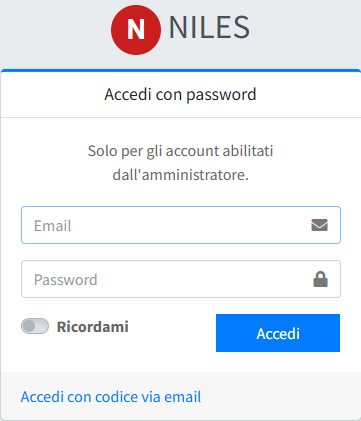
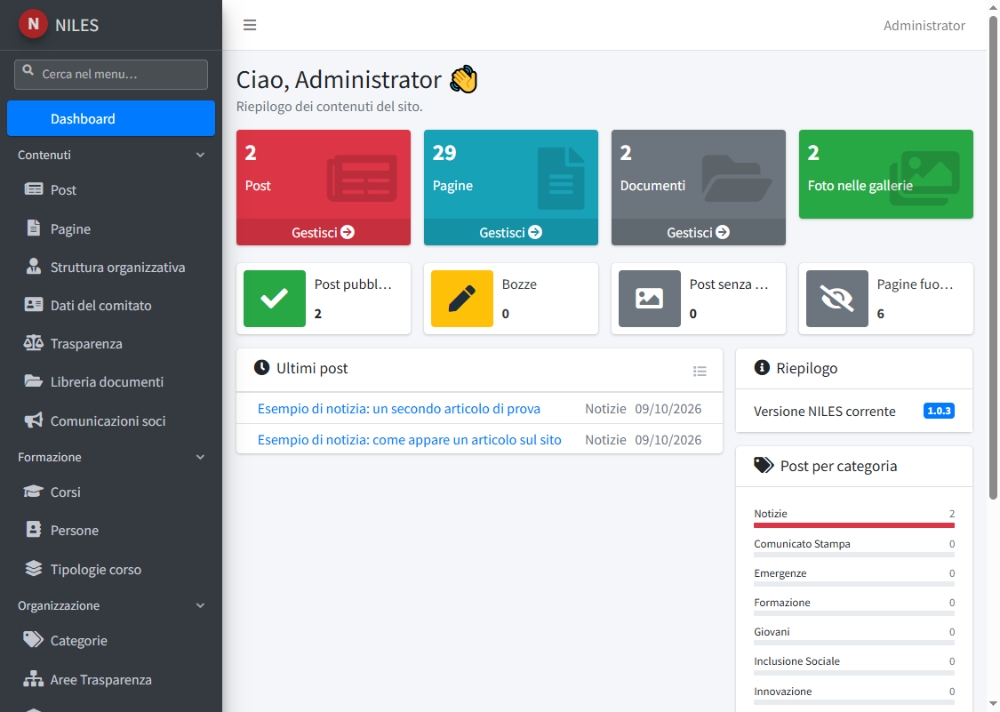

# Primo accesso al pannello

Dopo l'[installazione](../01-installazione/02-installazione-su-server.md) il sito è già online con un menu completo, i testi di base e un
primo amministratore. Questa pagina spiega come entrare, cosa si trova nel pannello e in che ordine conviene configurarlo.

## Accedere

Apri `https://<dominio>/admin/login/password` e inserisci l'email e la password del primo amministratore, quelle impostate in
`INITIAL_ADMIN_EMAIL` e `INITIAL_ADMIN_PASSWORD` nel file `.env` (oppure l'indirizzo `administrator@example.it` con la password
mostrata al termine di `db:seed`).

- La pagina `/admin/login` propone invece l'accesso con il **codice via email**: funziona solo dopo aver configurato la posta
  (vedi [Configurazione del file .env](../01-installazione/03-configurazione-env.md)). L'accesso con la password resta sempre disponibile
  per gli account in cui è abilitato.
- «Ricordami» mantiene l'accesso su quel browser più a lungo.

## Cambiare la password iniziale

Se hai scelto una password provvisoria, cambiala subito: apri **Utenti** (nel gruppo *Amministrazione* del menu), modifica il tuo
utente, scrivi la nuova password nel campo **Password** e salva. Lasciando il campo vuoto la password non cambia.

Da qui si creano anche gli altri utenti del pannello: vedi [Utenti](../03-pannello/04-amministrazione/01-utenti.md).

## La dashboard

All'ingresso compare la dashboard, un riepilogo dei contenuti del sito.

- **Riquadri in alto**: numero di post, pagine, documenti e foto nelle gallerie, ciascuno con il collegamento a «Gestisci».
- **Indicatori**: post pubblicati, bozze, post senza copertina e pagine fuori dal menu.
- **Ultimi post** e **Post per categoria**: cosa è stato pubblicato di recente e come sono distribuiti i contenuti.
- **Riepilogo**: versione di NILES installata e, se il controllo è attivo, se ne esiste una più recente
  (vedi `NILES_UPDATE_CHECK` in [Configurazione del file .env](../01-installazione/03-configurazione-env.md)).
- **Menu laterale**: le sezioni del pannello, raggruppate in *Contenuti* (post, pagine, struttura organizzativa, dati del comitato,
  trasparenza, libreria documenti, comunicazioni ai soci), *Formazione* (corsi, persone, tipologie di corso), *Organizzazione*
  (categorie, aree di trasparenza, categorie di documenti) e *Amministrazione* (utenti, membri, registro accessi, sicurezza dei
  moduli, informative privacy, template delle email). Un editor vede soltanto le sezioni per cui ha il permesso.

## Cosa trovi già pronto

L'installazione crea questi contenuti, da adattare:

- il **menu del sito** con sei voci (Chi Siamo, Cosa Facciamo, Volontariato, Sostienici, Servizi, Contatti) e le relative pagine, con
  testi standard validi per tutti i comitati; le pagine che non tutti hanno (Corpo Infermiere Volontarie, Diventa Infermiera
  Volontaria, Donazioni, Innovazione) sono create in **bozza** e vanno attivate da chi le usa;
- le **categorie** delle notizie, le **aree** della sezione Trasparenza e le **tipologie di corso** più comuni;
- la Privacy Policy e la Cookie Policy, le informative privacy per i soci e per i corsi, i testi delle email di sistema;
- una comunicazione di benvenuto nell'area soci.

Le pagine che richiedono dati del comitato (Contattaci, Dove Trovarci, il codice fiscale per il 5x1000) contengono un
segnaposto **«Da completare»**: sostituiscilo con i dati reali.

## Ordine consigliato della configurazione

1. [Dati del comitato](../03-pannello/01-contenuti/04-dati-del-comitato.md): denominazione, contatti, loghi e favicon. Compaiono subito nel sito.
2. [Utenti](../03-pannello/04-amministrazione/01-utenti.md): cambia la password iniziale e crea gli utenti che servono.
3. [Pagine](../03-pannello/01-contenuti/02-pagine.md): sostituisci i segnaposto, attiva le pagine che usi.
4. [Struttura organizzativa](../03-pannello/01-contenuti/03-struttura-organizzativa.md) e [Trasparenza](../03-pannello/01-contenuti/05-trasparenza.md).
5. [Post](../03-pannello/01-contenuti/01-post.md) e [Categorie](../03-pannello/03-organizzazione/01-categorie.md): la prima notizia.
6. [Corsi](../03-pannello/02-formazione/01-corsi.md), [Tipologie corso](../03-pannello/02-formazione/03-tipologie-corso.md) e [Membri](../03-pannello/04-amministrazione/02-membri.md), se li usi.
7. [Informative privacy](../03-pannello/04-amministrazione/05-informative-privacy.md), [Template email](../03-pannello/04-amministrazione/06-template-email.md) e [Sicurezza moduli](../03-pannello/04-amministrazione/04-sicurezza-moduli.md), prima di
   aprire le iscrizioni al pubblico.

Per formati e dimensioni di loghi, copertine e foto vedi [Immagini e file](02-immagini-e-file.md).
