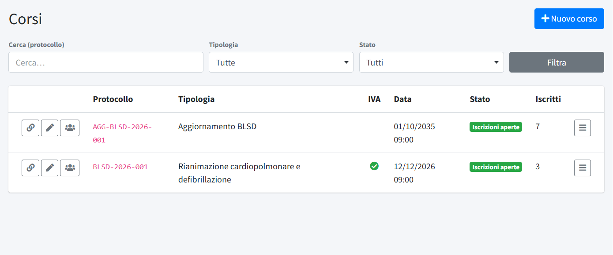
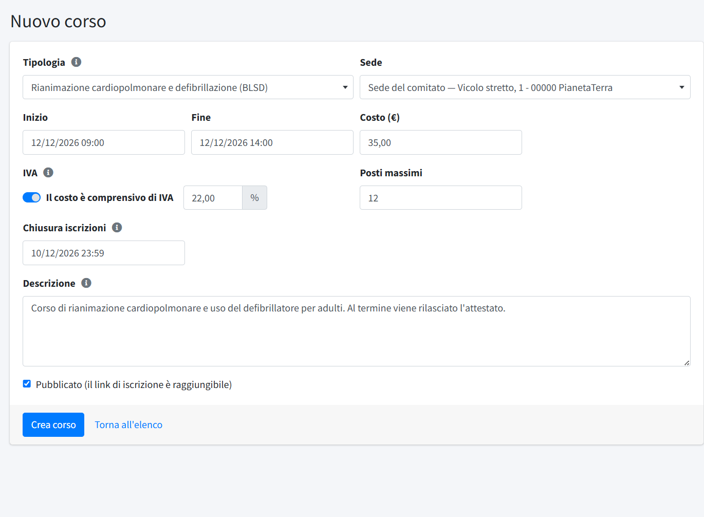
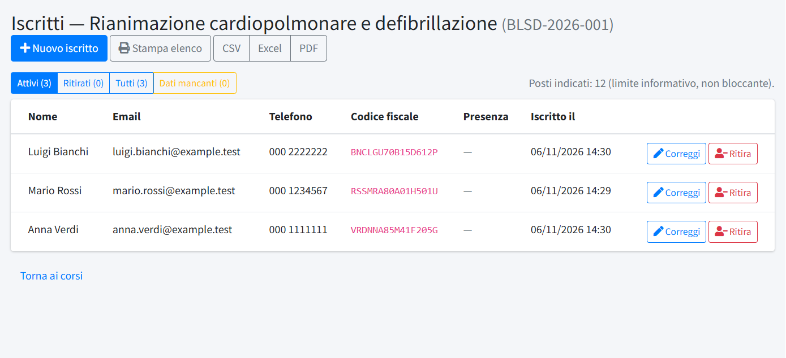
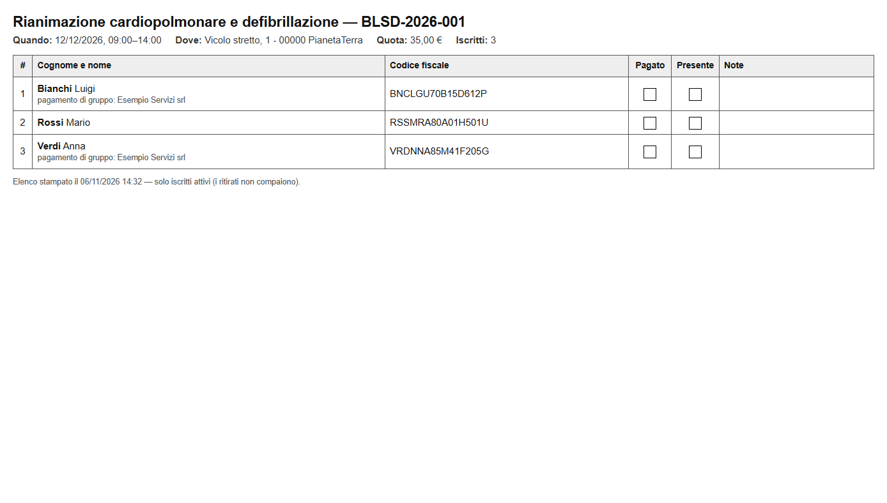
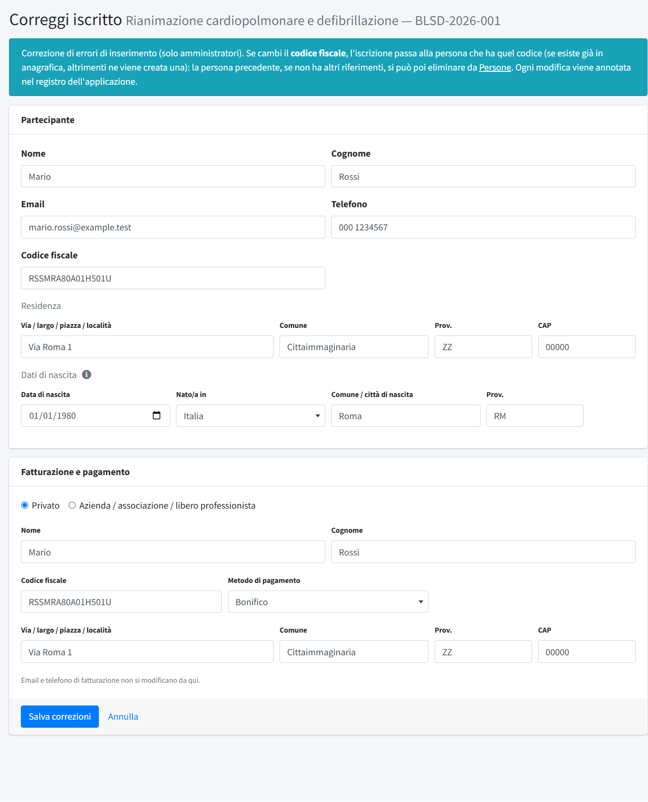
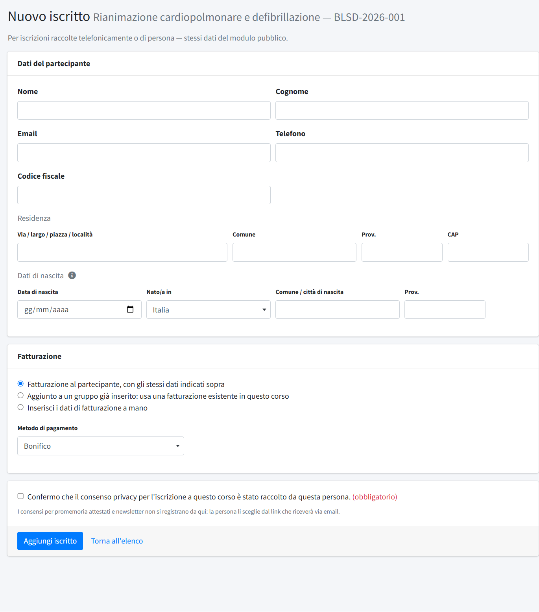

# Corsi

In **Corsi** (menu *Formazione*) si organizzano i corsi di formazione aperti alla popolazione: si crea il corso scegliendo una
[tipologia](04-tipologie-corso.md), si pubblica il link di iscrizione, si seguono gli iscritti e si esportano gli elenchi. Non c'è un
pagamento online: il comitato incassa e fattura per conto proprio, e per i corsi a pagamento il modulo raccoglie anche i dati di
fatturazione. Fatture e incassi si registrano in [Pagamenti corsi](03-pagamenti-corsi.md); come si iscrive una persona dal sito è
spiegato in [Iscrizione dal sito](05-iscrizione-dal-sito.md).

Per lavorare qui un editor ha bisogno del permesso «Corsi»: con la sola **lettura** consulta corsi, iscritti ed elenchi; con la **scrittura**
crea e modifica i corsi, gestisce gli iscritti e vede anche [Persone](02-persone.md).

## L'elenco dei corsi

L'elenco mostra **Protocollo**, **Tipologia** (con l'aliquota, se il corso prevede l'IVA), **Data**, **Stato** e numero di **Iscritti**. In alto si cerca per protocollo e si filtra per
**Tipologia** e per **Stato** (tutti, attivi, annullati, chiusi). **Nuovo corso** ne crea uno.

A ogni riga:

- **Copia link**: copia negli appunti l'indirizzo pubblico di iscrizione da incollare in un post, in un'email o su un social;
- **Modifica** e **Iscritti**;
- **Azioni**: un menu con *Chiudi* o *Riapri*, *Annulla* o *Riattiva*, ed *Elimina*.

## Creare o modificare un corso

- **Tipologia**: sceglie il tipo di corso; precompila il costo con quello predefinito della tipologia. **Non si può cambiare dopo la
  creazione**, perché il protocollo è già assegnato.
- **Protocollo**: lo assegna il sistema alla creazione (`SIGLA-ANNO-NNN`, per esempio `BLSD-2026-001`, con numerazione progressiva
  annuale per tipologia) e non cambia più. È anche la parte finale dell'indirizzo di iscrizione.
- **Sede**: «Sede del comitato» (l'indirizzo di *Dati del comitato*), una sede già usata in passato oppure **+ Nuova sede…**, che
  apre i campi per nome, via, comune, provincia e CAP; la nuova sede resta poi disponibile per i corsi successivi. Non c'è una sezione
  separata per le sedi.
- **Inizio** e **Fine**: data e ora, scelte con il calendario. Il corso può durare più giorni.
- **Costo (€)**: precompilato dalla tipologia, modificabile per il singolo corso. È il prezzo finale mostrato agli iscritti. Con costo
  zero il corso è **gratuito**: il modulo non chiede dati di fatturazione né metodo di pagamento.
- **IVA**: «Il costo è comprensivo di IVA» e l'aliquota, precompilati dalla tipologia. Non cambia il prezzo mostrato: serve solo a
  scorporare imponibile e imposta nella guida alla fattura (vedi [Pagamenti corsi](03-pagamenti-corsi.md)). Con costo zero non è
  attivabile; se si cambia l'IVA di un corso che ha già fatture registrate compare un avviso.
- **Posti massimi**: indicativo; il numero viene mostrato ma **non blocca** le iscrizioni oltre il limite.
- **Chiusura iscrizioni**: data e ora dopo le quali il modulo pubblico si disattiva da solo.
- **Descrizione**: mostrata nella pagina pubblica di iscrizione.
- **Pubblicato**: se spento, il link di iscrizione non è raggiungibile.

Sotto il form compare il **link pubblico di iscrizione** (`https://<dominio>/corsi/<protocollo>/iscrizione`), da incollare dove serve.

## Stati di un corso

Per i visitatori il corso è in uno di questi stati, in quest'ordine di priorità:

1. **Annullato**: la pagina mostra il messaggio di annullamento con il motivo.
2. **Concluso**: la data di fine è passata.
3. **Iscrizioni chiuse**: la data di chiusura delle iscrizioni è passata, ma il corso non si è ancora svolto.
4. **Aperto**: il modulo di iscrizione funziona.

Dal pannello:

- **Annulla corso** chiede il motivo, che compare anche nella pagina pubblica; si può **Riattivare** finché il corso non è concluso.
- **Chiudi (gestione interna)** è disponibile solo a corso concluso e serve a ordinare l'elenco (filtro «Chiusi»): non cambia
  nulla per i visitatori. **Riapri** annulla la chiusura. Con il corso annullato o chiuso, le date non si modificano.

## Gli iscritti

**Iscritti** apre l'elenco di un corso, con **Nome**, **Email**, **Telefono**, **Codice fiscale**, **Presenza** e data di iscrizione. I dati
di fatturazione e il metodo di pagamento non compaiono qui: si consultano in [Pagamenti corsi](03-pagamenti-corsi.md). I pulsanti
**Attivi**, **Ritirati** e **Tutti** filtrano l'elenco; sopra compare il numero di posti indicati.

- **Presenza**: «Confermata» compare quando la persona, dalla propria pagina personale raggiunta dal link nell'email, conferma di
  partecipare.
- **Ritira** (icona a destra della riga): chiede un motivo facoltativo e segna l'iscritto come ritirato, senza cancellarlo; dai
  **Ritirati**, **Ripristina** lo rimette tra gli attivi. Un ritirato non conta più nei totali dei pagamenti: se aveva già pagato, il
  pagamento risulta «in eccesso» e va verificato (rimborso o donazione).
- **Dati mancanti**: compare per i corsi di tipologie con *anagrafica completa* ed elenca chi non ha data o luogo di nascita (per esempio
  chi si è iscritto prima che la tipologia li richiedesse); accanto al nome c'è un'icona di avviso. Si completano con **Correggi**.
- **CSV**, **Excel** e **PDF** esportano l'elenco secondo il filtro scelto; per i corsi con anagrafica completa CSV ed Excel hanno anche
  data e luogo di nascita.
- **Stampa elenco** apre una pagina da stampare con i soli iscritti attivi, in ordine di cognome, con le caselle **Pagato** e **Presente**
  da spuntare a mano e una colonna per le note. Sotto il nome di chi è iscritto con un pagamento unico compare «pagamento di gruppo» e
  l'intestatario.

### Correggere un'iscrizione

**Correggi** (solo amministratori) modifica i dati di un iscritto e quelli di fatturazione e pagamento, per sistemare un errore di
inserimento. Se la fatturazione è condivisa con altri iscritti la modifica vale per tutti, e la pagina lo segnala. Cambiando il codice
fiscale l'iscrizione viene ricollegata alla persona giusta (vedi [Persone](02-persone.md)). Ogni correzione resta registrata.

### Iscrivere una persona a mano

**Nuovo iscritto** serve per le iscrizioni raccolte al telefono o di persona. I dati sono gli stessi del modulo pubblico: nome, cognome,
email, telefono, codice fiscale, residenza, data e luogo di nascita (per le tipologie con anagrafica completa) e, se il corso è a
pagamento, fatturazione (agli stessi dati del partecipante, con dati inseriti a mano, o con quelli di un'altra iscrizione dello stesso
corso) e metodo di pagamento. A differenza del modulo pubblico, qui non si controlla che nome e cognome corrispondano al codice fiscale. Al posto delle caselle di consenso c'è un'unica conferma obbligatoria che
il consenso privacy è stato raccolto da quella persona. I consensi per promemoria e newsletter non si registrano da qui: la persona li
sceglie dal link che riceve via email.

## Come funziona sul sito

La pagina **Servizi → Corsi di Formazione** elenca i corsi con iscrizioni aperte; ogni corso è raggiungibile anche dal solo link diretto.
Il modulo, i messaggi di errore più comuni e le email che arrivano a chi si iscrive sono descritti in
[Iscrizione dal sito](05-iscrizione-dal-sito.md). I moduli sono protetti contro i robot: vedi
[Sicurezza moduli](../06-configurazione/03-sicurezza-moduli.md).

## Eliminare un corso

**Elimina**, dal menu *Azioni*, cancella il corso, ma solo se non ha iscritti: altrimenti il pannello lo rifiuta. Per togliere dal sito un
corso con iscritti basta **annullarlo** o togliere la spunta a **Pubblicato**.
