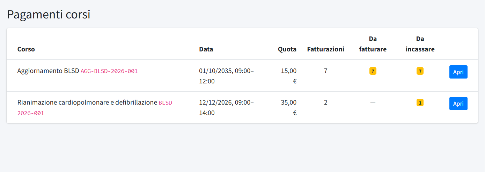
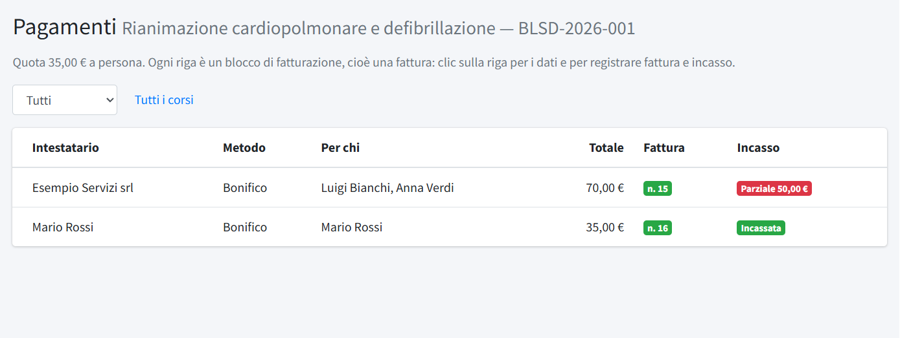
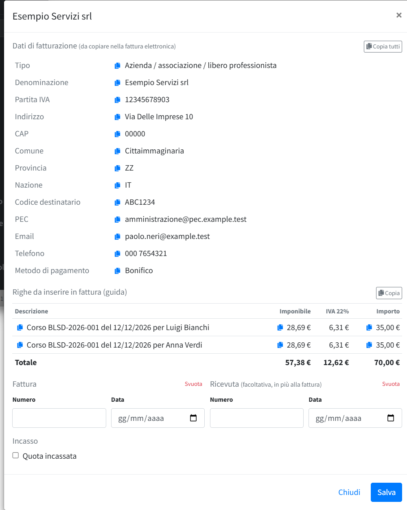
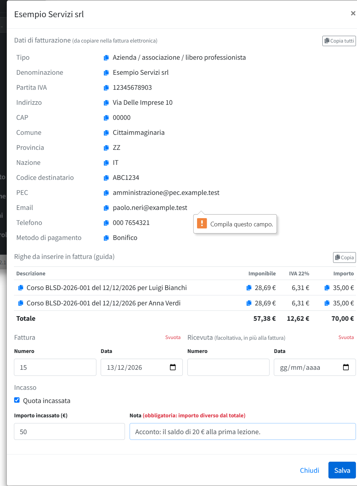
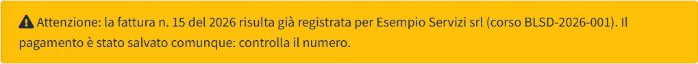

# Pagamenti corsi

In **Pagamenti corsi** (menu *Formazione*) chi tiene la contabilità registra, per ogni corso a pagamento, **fatture**, **ricevute** e
**incassi**. NILES non emette fatture e non riceve pagamenti online: la fattura si fa sul sistema dell'amministrazione, e qui si trovano
i dati da copiare e si annota che cosa è stato fatto.

La funzione è facoltativa: si accende in *Configurazione → Funzioni attive*. Per usarla un editor ha bisogno del permesso **Pagamenti
corsi**, separato da quello dei Corsi, così l'amministrazione può lavorare qui senza gestire i corsi (vedi
[Utenti](../08-utenti-e-controllo/01-utenti.md)).

## Blocchi di fatturazione

Ogni pagamento è un **blocco di fatturazione**, cioè una fattura da emettere: chi si iscrive da solo ha il proprio blocco; chi iscrive più
persone con un pagamento unico (per esempio un'azienda per i suoi dipendenti) ha un solo blocco per tutte, con il totale delle quote. Gli
iscritti ritirati non contano nel totale.

## L'elenco dei corsi

L'elenco mostra i corsi a pagamento, dal più recente, con la quota, il numero di **blocchi**, quanti sono **da fatturare** e quanti **da
incassare**; i blocchi incassati più del dovuto sono segnalati a parte («in eccesso»). **Apri** porta ai pagamenti del corso.

## I pagamenti di un corso

Una riga per blocco: **intestatario**, **metodo** di pagamento scelto, **per chi** (gli iscritti compresi), **totale**, stato della
**fattura** (numero, oppure «Da emettere»; «Ricevuta» se c'è anche quella) e dell'**incasso**:

| Incasso | Significato |
|---|---|
| Da incassare | nessun incasso registrato |
| Parziale X € | incassato meno del totale (la nota spiega perché) |
| Incassata | incassato esattamente il totale |
| In eccesso X € | incassato più del totale: da verificare. Può essere una donazione in più, oppure un iscritto si è ritirato dopo aver pagato e la sua quota va rimborsata. La nota lo spiega. |

Il filtro in alto mostra solo i blocchi **da fatturare**, **da incassare** o **in eccesso**. Se alcuni iscritti non hanno dati di
fatturazione (per esempio perché il corso era gratuito quando si sono iscritti), un avviso li conta: non compaiono nell'elenco.

## La finestra del blocco

Un clic sulla riga apre la finestra del blocco.

- **Dati di fatturazione**: tutti i dati per la fattura elettronica, con un pulsante per copiare ogni campo e **Copia tutti**. Per un
  privato cognome e nome separati, per un'azienda la denominazione; il codice destinatario, se non indicato, è `0000000` (la fattura va nel
  cassetto fiscale del cliente). Un dato necessario alla fattura ancora vuoto compare in rosso come «mancante»: va chiesto all'iscritto e
  corretto con **Correggi** nell'elenco iscritti (vedi [Corsi](01-corsi.md#correggere-uniscrizione)).
- **Righe da inserire in fattura (guida)**: una riga per iscritto, nella forma «Corso BLSD-2026-001 del 12/12/2026 per Nome Cognome»,
  con l'importo e il totale, pronte da copiare. Se il corso prevede l'IVA, ogni riga e il totale mostrano imponibile, IVA e importo
  (35 € con IVA al 22% = 28,69 € + 6,31 €).
- **Fattura** e **Ricevuta**: numero e data di ciascuna. Sono due documenti distinti e possono esserci tutti e due; la ricevuta è
  facoltativa. Numero e data vanno indicati insieme. **Svuota** cancella numero e data per correggere un inserimento sbagliato.
- **Incasso**: spuntando **Quota incassata** compare l'importo, già compilato con il totale. Se l'importo è diverso dal totale, in meno o in
  più, la **nota** diventa obbligatoria e si scrive il motivo (acconto, sconto, donazione, quota da rimborsare…).

**Salva** registra il tutto; sotto la finestra resta l'indicazione di chi ha fatto l'ultima registrazione e quando.

### Numero di fattura già usato

Se il numero di fattura è già registrato **nello stesso anno**, anche per un altro corso, il pagamento viene salvato comunque e compare un
avviso con l'intestatario e il corso dell'altra fattura, per controllare che non sia un errore. I numeri di ricevuta non vengono
controllati.

## Ritiri dopo il pagamento

Se un iscritto si ritira dal corso, il totale del suo blocco scende. Se il blocco era già stato incassato, risulta **in eccesso**: alla
modifica successiva il pannello chiede la nota, dove si annota se la quota va rimborsata o se resta come donazione.

## Corsi gratuiti

I corsi con costo zero non compaiono qui e i loro iscritti non compilano dati di fatturazione.
