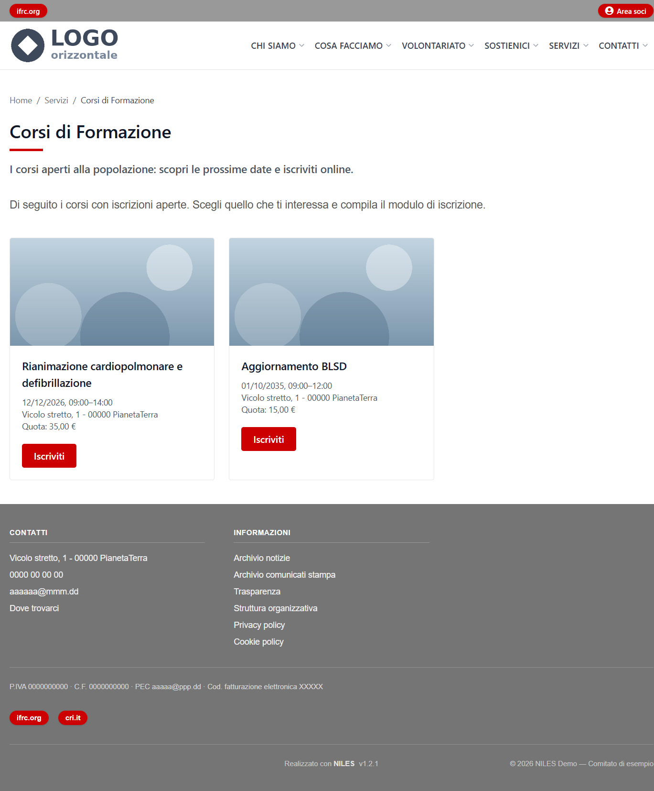
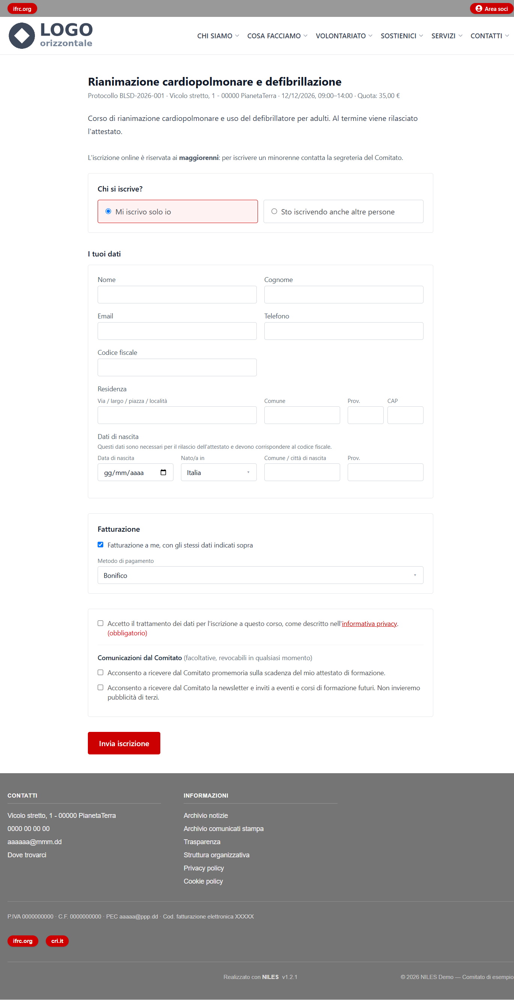
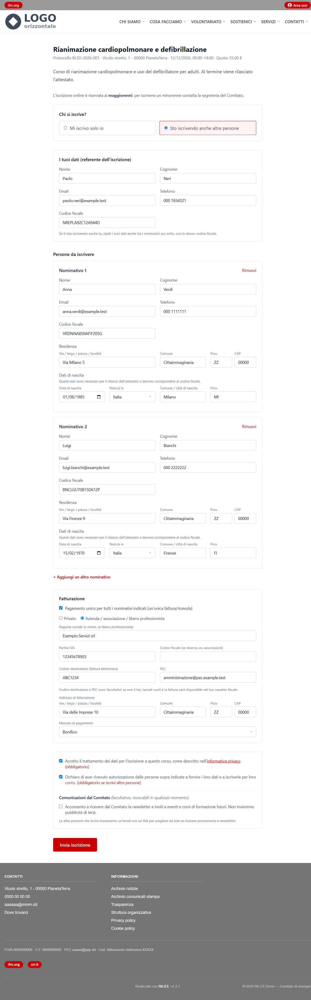
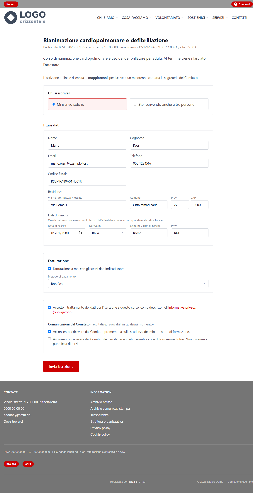
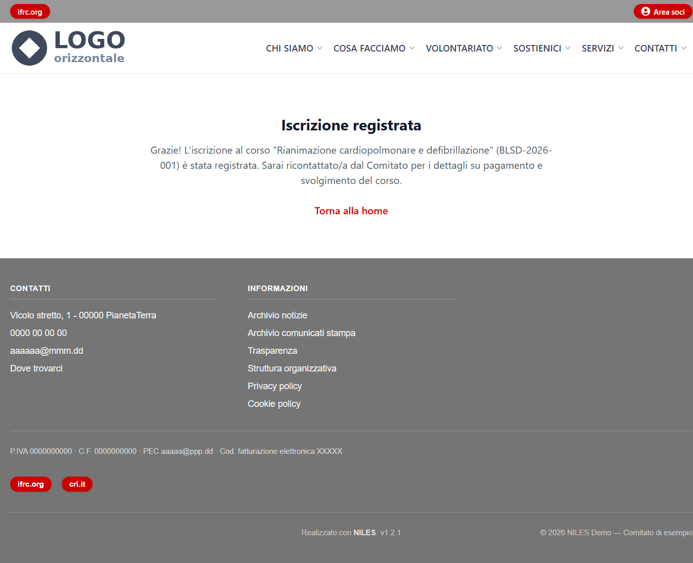
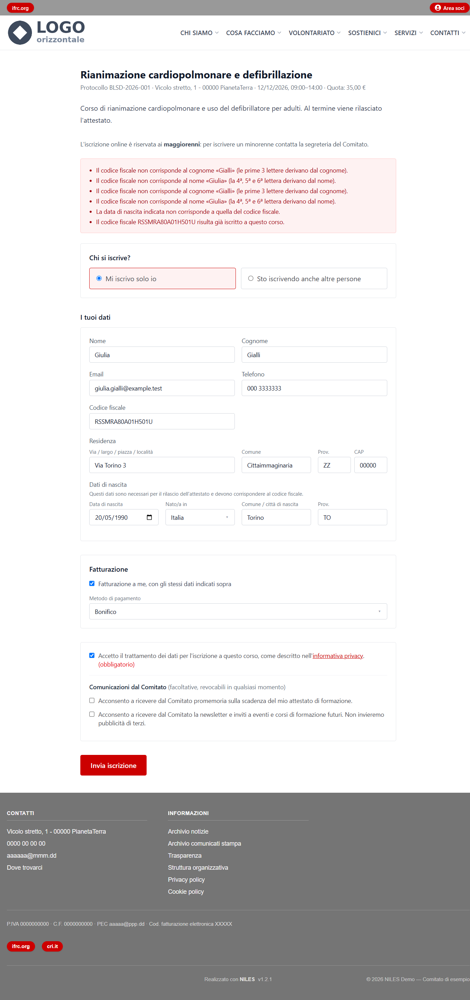

# Iscrizione dal sito

Come si iscrive a un corso una persona dal sito pubblico: cosa vede, cosa deve compilare, quali messaggi può incontrare e quali email
riceve. Serve a chi lavora in segreteria per dare indicazioni a chi telefona o scrive. I corsi si preparano in [Corsi](01-corsi.md).

## Trovare il corso

La pagina **Servizi → Corsi di Formazione** mostra una scheda per ogni corso con iscrizioni aperte: immagine della tipologia, nome, data,
sede, quota e il pulsante **Iscriviti**. Si arriva al modulo anche dal link diretto del corso (`https://<dominio>/corsi/<protocollo>/iscrizione`),
che si copia dall'elenco dei corsi nel pannello. Se il corso è annullato, concluso o con le iscrizioni chiuse, la pagina lo dice al posto
del modulo.

## Il modulo

In alto il nome del corso con protocollo, sede, date e quota, poi la descrizione. L'iscrizione online è riservata ai **maggiorenni**: per un
minorenne si contatta la segreteria, che lo iscrive dal pannello.

**Chi si iscrive?**

- **Mi iscrivo solo io**: un solo blocco con i dati della persona.
- **Sto iscrivendo anche altre persone**: chi compila è il **referente** (nome, cognome, email, telefono, codice fiscale) e sotto indica
  le persone da iscrivere, con **+ Aggiungi un altro nominativo**. Se frequenta anche il referente, ripete i propri dati tra i nominativi,
  con lo stesso codice fiscale. In fondo deve spuntare anche la dichiarazione di essere autorizzato a iscrivere le altre persone.

Per ogni persona si chiedono nome, cognome, email, telefono, codice fiscale e residenza. Se la tipologia del corso lo richiede (per il
rilascio dell'attestato), anche **data e luogo di nascita**: Italia con comune e provincia, oppure uno Stato estero dall'elenco (con
«Altro» per quelli non presenti; per l'estero la provincia è «EE»).

**Fatturazione** (solo per i corsi a pagamento):

- iscrivendosi da soli basta la spunta **Fatturazione a me, con gli stessi dati indicati sopra**; togliendola si indicano altri dati;
- iscrivendo più persone, **Pagamento unico** (spuntato di partenza) fa una sola fattura per tutti, intestata a un **privato** o a
  un'**azienda / associazione / libero professionista** (ragione sociale, partita IVA o codice fiscale, codice destinatario e PEC
  facoltativi, indirizzo). Togliendo la spunta, ogni persona indica i propri dati di fatturazione;
- il **metodo di pagamento** si sceglie tra quelli che il comitato accetta (*Comitato e sito → Coordinate e pagamenti*). Non si paga
  online: il comitato contatta gli iscritti per il pagamento.

In fondo l'accettazione dell'**informativa privacy** (obbligatoria) e due consensi facoltativi e distinti: i **promemoria** sulla
scadenza dell'attestato e la **newsletter**. Le persone iscritte da un referente scelgono i propri consensi dal link che ricevono via
email.

## Dopo l'invio

Compare la pagina «Iscrizione registrata». Poi:

- **ogni persona iscritta** riceve un'email di conferma con il riepilogo del corso, un promemoria da aggiungere al calendario e il link
  alla propria **pagina personale**. Se ha scelto il bonifico e il comitato ha indicato l'IBAN, l'email contiene già le coordinate e la
  causale. Il testo si personalizza in [Template email](../05-comitato-e-sito/06-template-email.md);
- **la segreteria** riceve un avviso per ogni iscrizione, se l'ha attivato in [Posta in uscita](../06-configurazione/02-posta-in-uscita.md).

Dalla **pagina personale** la persona conferma la propria presenza (nel pannello compare «Confermata»), rivede come pagare, sceglie o
revoca i consensi e può chiedere la cancellazione dei propri dati (vedi [Persone](02-persone.md)). Se non trova l'email, conviene
controllare la posta indesiderata: il link è personale e non si ricostruisce dal sito.

## Se il modulo segnala un errore

Il modulo torna con i campi da correggere evidenziati e un messaggio sopra ciascuno; **tutti i dati già scritti restano compilati**, si
corregge solo quanto segnalato.

| Messaggio | Cosa significa |
|---|---|
| «Il codice fiscale non corrisponde al cognome / al nome…» | Le lettere del codice fiscale non tornano con cognome o nome scritti. Spesso è un errore di battitura, oppure nome e cognome invertiti (il messaggio lo dice). |
| «La data di nascita indicata non corrisponde a quella del codice fiscale» | Solo per i corsi con anagrafica completa: la data scritta è diversa da quella contenuta nel codice fiscale. |
| «Il codice fiscale è di una persona nata in Italia, ma come luogo di nascita è indicato…» (o il contrario) | Il luogo di nascita (Italia o estero) non torna con il codice fiscale: va corretto l'uno o l'altro. |
| «Il codice fiscale … risulta già iscritto a questo corso» | La persona è già iscritta e attiva: non serve iscriverla di nuovo. Chi si era ritirato invece può iscriversi di nuovo. |
| «Troppi tentativi ravvicinati» | Molti invii in poco tempo dalla stessa connessione: si attende qualche minuto (vedi [Sicurezza moduli](../06-configurazione/03-sicurezza-moduli.md)). |

Se una persona non riesce comunque a iscriversi, la segreteria può farlo dal pannello con **Nuovo iscritto** (vedi
[Corsi](01-corsi.md#iscrivere-una-persona-a-mano)): lì nome e cognome non vengono confrontati con il codice fiscale.
