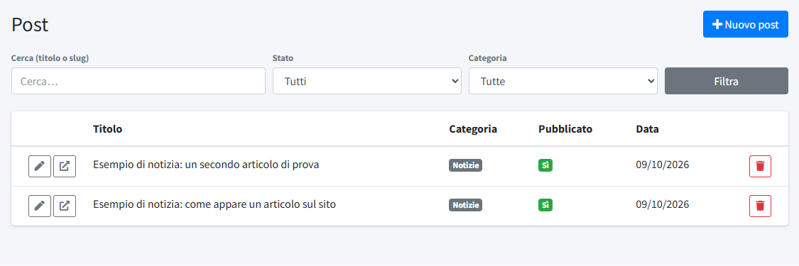
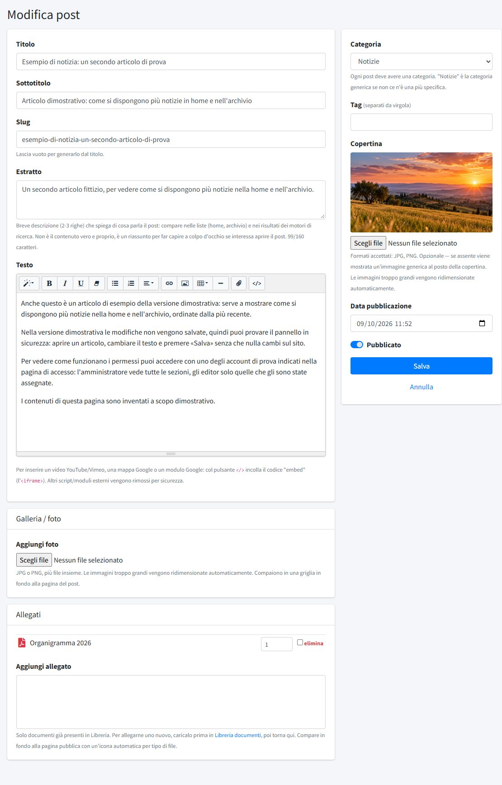
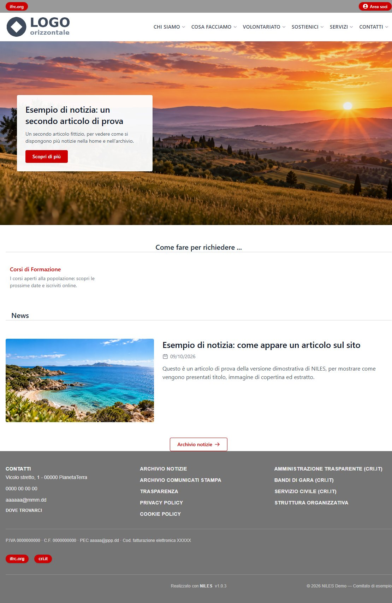
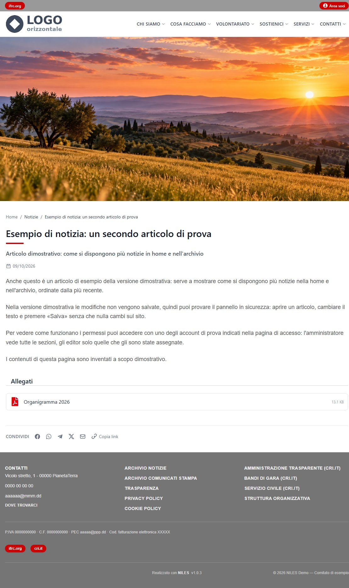

# Post

In **Post** (menu *Contenuti*) si scrivono e si pubblicano le notizie del sito: aggiornamenti, eventi, comunicati stampa. Ogni post
appartiene a una [categoria](../03-organizzazione/01-categorie.md) e compare in home, nell'archivio delle notizie e, se la categoria è legata a una sezione del sito, in quella sezione.

## L'elenco dei post

L'elenco mostra **Titolo**, **Categoria**, se è **Pubblicato** e la **Data**, dal più recente. In alto i filtri **Cerca** (nel titolo o nello slug),
**Stato** (tutti, solo pubblicati, solo bozze) e **Categoria** aiutano a ritrovare un post; **Nuovo post** ne crea uno. A ogni riga la
matita apre il post in modifica (a chi ha il solo permesso di lettura compare un occhio, che lo mostra senza poterlo cambiare), l'icona con la freccia lo apre sul sito e il cestino lo elimina. Un editor
vede e modifica soltanto i post delle categorie che gli sono state assegnate (vedi [Utenti](../04-amministrazione/01-utenti.md)).

## Scrivere un post

A sinistra il contenuto, a destra la categoria, la copertina e la pubblicazione.

- **Titolo**: l'unico campo indispensabile, insieme alla categoria.
- **Sottotitolo**: una riga facoltativa che compare sotto il titolo, nella pagina del post.
- **Slug**: la parte finale dell'indirizzo del post. Lasciandolo vuoto si crea dal titolo; lo può cambiare solo un amministratore.
- **Estratto**: un riassunto breve, fino a 160 caratteri, che spiega di cosa parla il post. Compare negli elenchi (home, archivio) e nei
  risultati dei motori di ricerca. Non è il testo del post.
- **Testo**: l'editor ha i comandi per stili di titolo, grassetto, corsivo, sottolineato, elenchi, allineamento, collegamenti, immagini,
  tabelle e linea di separazione. La graffetta inserisce nel testo un collegamento a un documento della
  [Libreria documenti](06-libreria-documenti.md). Il pulsante `</>` serve per inserire un video YouTube o Vimeo, una mappa Google o un modulo Google:
  incolla il codice «embed» (l'`<iframe>`); altri script e moduli esterni vengono rimossi per sicurezza.
- **Galleria / foto**: **Aggiungi foto** carica più immagini JPG o PNG insieme; le immagini troppo grandi vengono ridimensionate. Le
  foto compaiono in una griglia in fondo alla pagina del post, e cliccandole si aprono a tutto schermo. Dopo il salvataggio, accanto a ciascuna miniatura si possono scrivere una **didascalia** (facoltativa, mostrata sotto la foto),
  cambiare l'**ordine** o spuntare **elimina**.
- **Allegati**: si scelgono tra i documenti già presenti nella [Libreria documenti](06-libreria-documenti.md); per aggiungerne uno nuovo
  caricalo prima nella libreria. Compaiono in fondo al post con l'icona del tipo di file.

Nella colonna a destra:

- **Categoria**: obbligatoria. «Notizie» è la categoria generica se non ce n'è una più adatta.
- **Tag**: parole chiave del post, separate da virgola.
- **Copertina**: un'immagine JPG o PNG facoltativa; senza copertina compare un'immagine generica. Formati, dimensioni e come viene
  ritagliata sono in [Immagini e file](../../02-configurazione-iniziale/02-immagini-e-file.md).
- **Data pubblicazione**: è la data mostrata sul sito e usata per ordinare i post (dal più recente). Precompilata con l'ora corrente.
- **Pubblicato**: se spento il post è una bozza e non compare sul sito.

Il pulsante **Salva** (o **Crea post**) registra le modifiche.

## Dove compare un post

- **Home**: il post pubblicato **più recente** è la notizia in evidenza, a tutta larghezza, con la copertina sullo sfondo, il titolo e
  l'estratto. Sotto, le notizie successive con copertina ed estratto, e il pulsante «Archivio notizie».
- **Archivio notizie** (`/archivi/archivio-notizie`): l'elenco completo di tutti i post pubblicati, con caricamento a pagine.
- **Comunicati stampa**: i post della categoria *Comunicato Stampa* compaiono come gli altri, ma hanno anche un archivio dedicato, in
  forma di elenco senza immagini, e un blocco in home con i tre più recenti.
- **Sezioni di Cosa Facciamo**: ogni sezione collegata a una categoria mostra in fondo le ultime notizie di quella categoria, con il
  collegamento all'archivio completo (vedi [Pagine](02-pagine.md)).

La pagina del post ha un indirizzo del tipo `/<categoria>/<titolo-del-post>`.

Nella pagina compaiono la copertina a tutta larghezza (cliccandola si apre intera), il titolo con il sottotitolo e la data, il testo,
gli allegati e i pulsanti per condividere il post.

## Modificare, nascondere, eliminare

Per modificare un post si apre dalla matita dell'elenco. Togliendo la spunta a **Pubblicato** un post sparisce dal sito senza essere
cancellato e si può ripubblicare in seguito. L'eliminazione definitiva si fa dall'elenco, con il cestino, e cancella anche copertina e galleria; i documenti allegati restano nella libreria.
