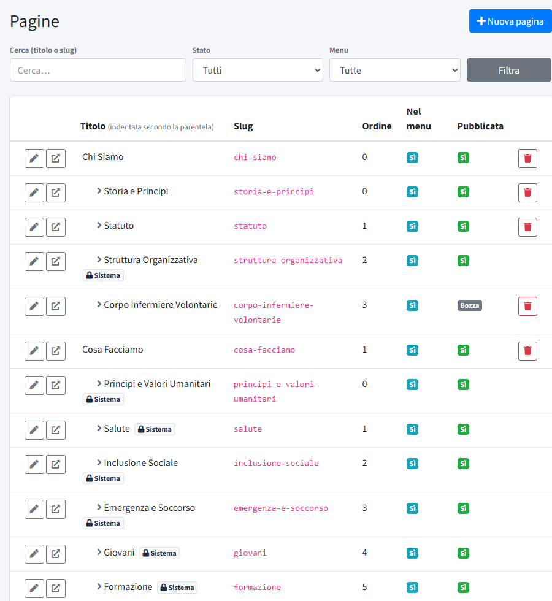
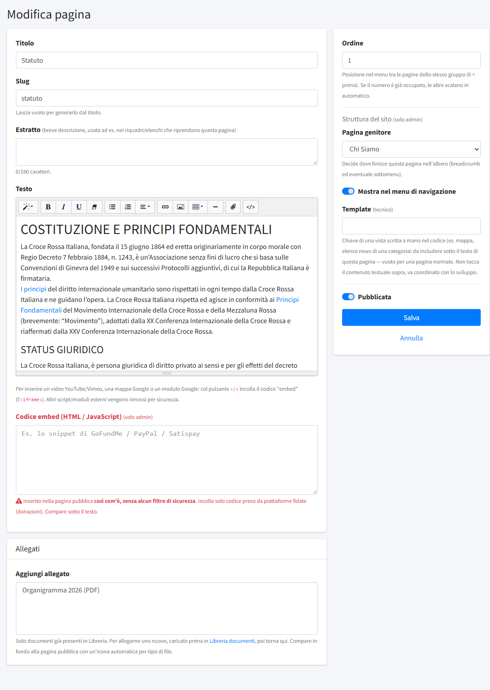
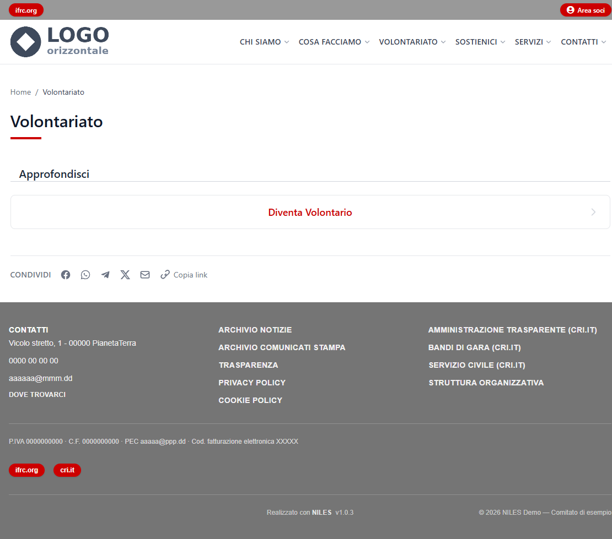
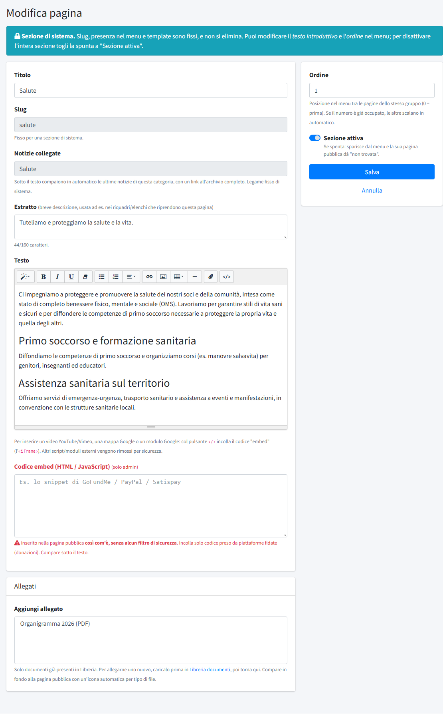

# Pagine

In **Pagine** (menu *Contenuti*) si gestiscono le pagine del sito, come Chi Siamo, Statuto o Contattaci, e con loro il **menu di
navigazione**: ogni voce del menu è una pagina, e la sua posizione nell'albero decide dove compare.

L'installazione crea già un menu completo con i testi di base: vedi [Primo accesso](../../02-configurazione-iniziale/01-primo-accesso.md).
I testi vanno adattati e le pagine segnate «Da completare» riempite con i dati del comitato.

## L'elenco delle pagine

Le pagine sono mostrate come un albero: le figlie sono rientrate sotto la pagina genitore. Le colonne sono **Titolo**, **Slug**
(l'indirizzo della pagina), **Ordine**, **Nel menu** e **Pubblicata** (le bozze sono segnate «Bozza»).

A ogni riga:

- la **matita** apre la pagina in modifica (a chi ha solo il permesso di lettura compare un occhio, che la mostra senza poterla
  cambiare);
- l'icona con la freccia **apre la pagina sul sito**, anche se è una bozza;
- il **cestino** elimina la pagina; manca sulle pagine di sistema (vedi sotto). Eliminando una pagina con figlie, queste restano
  nel sito come pagine di primo livello.

In alto, i filtri **Cerca** (per titolo o slug), **Stato** (tutte, solo pubblicate, solo bozze) e **Menu** (tutte, solo nel menu, solo
fuori dal menu) servono a trovare una pagina: mentre un filtro è attivo l'elenco diventa piatto, senza rientri. **Nuova pagina**, in
alto a destra, crea una pagina.

## Creare o modificare una pagina

A sinistra il contenuto, a destra la posizione e la pubblicazione.

- **Titolo**: compare in cima alla pagina, nel menu e nel breadcrumb.
- **Slug**: la parte finale dell'indirizzo (`/statuto`). Se lasci il campo vuoto viene creato dal titolo. Lo può cambiare solo un
  amministratore; per una pagina nuova conviene lasciarlo generare. Cambiarlo in seguito cambia l'indirizzo della pagina.
- **Estratto**: una breve descrizione, fino a 160 caratteri. Compare sotto il titolo e nell'elenco «Approfondisci» delle pagine padre
  (vedi sotto).
- **Testo**: l'editor ha i comandi per stili di titolo, grassetto, corsivo, sottolineato, elenchi, allineamento, collegamenti, immagini,
  tabelle e linea di separazione. La graffetta inserisce nel testo un collegamento a un documento della
  [Libreria documenti](06-libreria-documenti.md). Il pulsante `</>` serve per inserire un video YouTube o Vimeo, una mappa Google o un modulo Google:
  incolla il codice «embed» (l'`<iframe>`). Altri script e moduli esterni vengono rimossi per sicurezza.
- **Codice embed (HTML / JavaScript)**: solo per gli amministratori. Viene inserito nella pagina pubblica **così com'è, senza alcun
  filtro**, sotto il testo. Serve per i pulsanti delle piattaforme di donazione; incolla solo codice di servizi di cui ti fidi.
- **Allegati**: si scelgono tra i documenti già presenti nella [Libreria documenti](06-libreria-documenti.md). Per allegarne uno nuovo,
  caricalo prima nella libreria e poi torna alla pagina. Gli allegati compaiono in fondo alla pagina, con un'icona per tipo di file.
- **Ordine**: la posizione tra le pagine dello stesso gruppo (0 = prima). Se il numero è già occupato, le altre si spostano da sole.
- **Pubblicata**: se spenta la pagina è una bozza (vedi sotto).

La sezione **Struttura del sito** è riservata agli amministratori. Decide dove la pagina compare nel sito:

- **Pagina genitore**: la pagina sotto cui sta (`Chi Siamo` per Statuto). Senza genitore è una voce di primo livello.
- **Mostra nel menu di navigazione**: se spenta, la pagina esiste ma non compare nel menu.
- **Template** (tecnico): la chiave di una vista scritta nel codice che si aggiunge sotto il testo, per esempio l'elenco dei corsi.
  Va lasciato vuoto per una pagina normale.

Un editor con il permesso di scrittura sulle pagine modifica titolo, testo, estratto, ordine e pubblicazione; slug, struttura, template e
codice embed li gestisce solo un amministratore (vedi [Utenti](../04-amministrazione/01-utenti.md)).

## Il menu del sito

Il menu di navigazione si costruisce da solo con le pagine **pubblicate** e con **Mostra nel menu** attivo:

- le pagine senza genitore sono le voci principali;
- le loro figlie compaiono nella tendina sotto la voce.

Il menu ha **due livelli**: le pagine annidate più in basso non compaiono nella tendina. Per non appesantire la barra di navigazione
conviene restare intorno alle sei voci principali, come nell'installazione di partenza (Chi Siamo, Cosa Facciamo, Volontariato,
Sostienici, Servizi, Contatti).

Una voce principale **con figlie** è solo il pulsante della tendina: cliccando sul nome non si apre nessuna pagina. Una voce senza
figlie è invece un normale collegamento.

## Pagine padre

La pagina di una voce con figlie si raggiunge dal breadcrumb delle figlie, dai collegamenti diretti e dalla sitemap. Per darle un senso
anche quando è senza testo, in fondo mostra da sola l'elenco **«Approfondisci»**: un blocco a tutta larghezza per ogni figlia
**pubblicata e nel menu**, con il titolo (in rosso, centrato) e l'estratto.

Se la pagina padre ha un testo proprio, il testo compare per primo e l'elenco segue. Senza figlie visibili l'elenco non compare.
Compilare l'**estratto** delle figlie rende l'elenco più chiaro.

## Pagine di sistema

Alcune pagine sono **di sistema**, segnate con un lucchetto e il badge «Sistema»: le sezioni di Cosa Facciamo, Struttura
Organizzativa, Corsi di Formazione, Donazioni, Trasparenza, Privacy Policy e Cookie Policy. Servono a funzioni del sito, quindi:

- non si possono eliminare;
- slug, presenza nel menu, genitore e template sono fissi;
- si modificano il testo introduttivo, l'estratto e l'ordine;
- al posto di «Pubblicata» c'è **«Sezione attiva»**: togliendo la spunta la sezione sparisce dal menu e la sua pagina non è più raggiungibile.

Le sezioni di **Cosa Facciamo** (Salute, Inclusione Sociale e simili) sono collegate a una categoria di notizie, indicata nel campo
**Notizie collegate**: sotto il testo mostrano in automatico le ultime notizie di quella categoria, con un collegamento all'archivio
completo. Il legame è fisso. Vedi [Post](01-post.md) e [Categorie](../03-organizzazione/01-categorie.md).

## Bozze e pagine opzionali

Una pagina **non pubblicata** è una bozza: non compare nel menu e chi la apre dal sito vede «pagina non trovata». Gli amministratori
e gli editor con accesso al pannello possono comunque aprirla con l'icona accanto alla matita, per controllarla prima di pubblicarla.

L'installazione crea in bozza le pagine che non tutti i comitati hanno: **Corpo Infermiere Volontarie**, **Diventa Infermiera Volontaria**
(sotto Volontariato), **Donazioni** e **Innovazione**. Chi le usa le pubblica. Le pagine **Archivi** e **Notizie** sono segnaposto tecnici (gli archivi del sito hanno indirizzi
fissi): vanno lasciate in bozza.

## Pagine da completare

Alcune pagine contengono un segnaposto **«Da completare»**, che spiega cosa scrivere:

- **Contattaci**: indirizzo, telefono, email, PEC e orari degli uffici.
- **Dove Trovarci**: l'indirizzo della sede e come raggiungerla; una mappa si inserisce con il pulsante `</>` dell'editor, incollando
  il codice «embed» di Google Maps.
- **Dona il 5x1000**: il codice fiscale del comitato.

Per lo stesso motivo conviene rileggere le pagine standard (Storia e Principi, Statuto, Diventa Volontario) e adattarle se serve.
