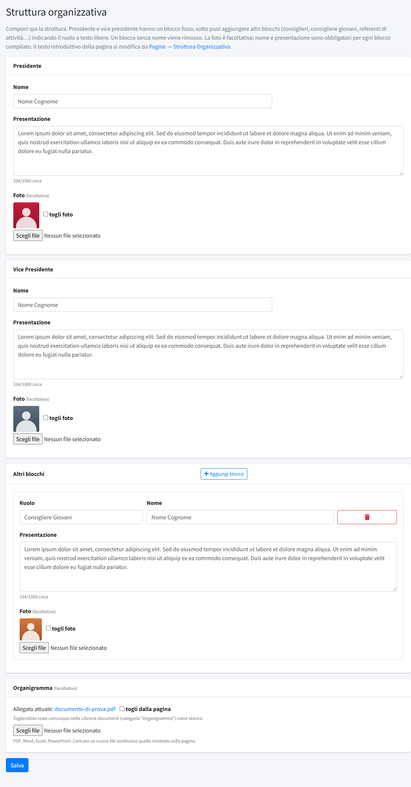
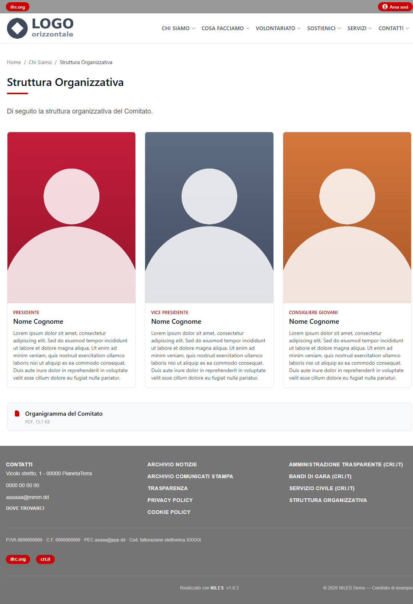

# Struttura organizzativa

In **Struttura organizzativa** (menu *Contenuti*, riservata agli amministratori) si compone la pagina pubblica con gli organi del comitato: presidente, vice
presidente, consiglieri e altri referenti, ciascuno con nome, presentazione e foto, più l'organigramma da scaricare. La pagina si
trova sul sito sotto *Chi Siamo → Struttura Organizzativa* e nel piè di pagina.

## Comporre la struttura

La pagina del pannello ha tre parti.

**Presidente e Vice Presidente** hanno un blocco fisso ciascuno:

- **Nome** e **Presentazione**: sono obbligatori per ogni blocco compilato. La presentazione è un testo libero di circa 1000 caratteri
  (il contatore sotto il campo indica lo spazio usato).
- **Foto**: facoltativa. Per sostituirla si sceglie un nuovo file; «togli foto» la rimuove.
- Svuotando nome, presentazione e foto, la carica risulta non coperta e il riquadro scompare dalla pagina.

**Altri blocchi** servono per consiglieri, consigliere giovani, referenti di attività e così via:

- **Aggiungi blocco** apre un nuovo riquadro con **Ruolo** (testo libero, per esempio «Consigliere Giovani»), **Nome**, **Presentazione**
  e **Foto**. Ruolo, nome e presentazione sono obbligatori; la foto no.
- Il cestino rosso elimina il blocco. Un blocco nuovo lasciato del tutto vuoto viene ignorato al salvataggio.

**Organigramma** (facoltativo): un file PDF, Word, Excel o PowerPoint che compare sulla pagina come documento da scaricare. Caricare un
nuovo file sostituisce quello mostrato; «togli dalla pagina» lo nasconde, ma il file resta nella [Libreria documenti](06-libreria-documenti.md),
nella categoria «Organigramma», come storico.

Il pulsante **Salva**, in fondo, registra tutto insieme.

Il testo introduttivo che compare sopra i riquadri («Di seguito la struttura organizzativa del Comitato») e le impostazioni della
pagina si modificano da *Pagine → Struttura Organizzativa*: vedi [Pagine](02-pagine.md).

## Come appare sul sito

Ogni persona è un riquadro con la foto in alto, il ruolo in rosso, il nome e la presentazione. Le schede si dispongono su tre colonne
su schermo largo, due su tablet e una sola sul telefono; l'organigramma compare sotto, con il formato e il peso del file.

## Le foto

Le foto sono mostrate in formato verticale **3:4**, ritagliate al centro: conviene caricare un'immagine verticale, per esempio
600×800 px, con il viso al centro. Il file viene ridotto a 800 px sul lato lungo e accetta fino a 8 MB; se manca la foto compare
un segnaposto grafico. Tutti i dettagli sono in [Immagini e file](../../02-configurazione-iniziale/02-immagini-e-file.md).
