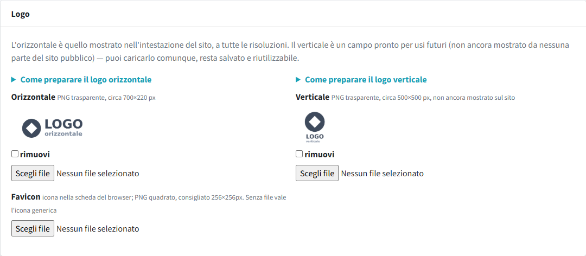
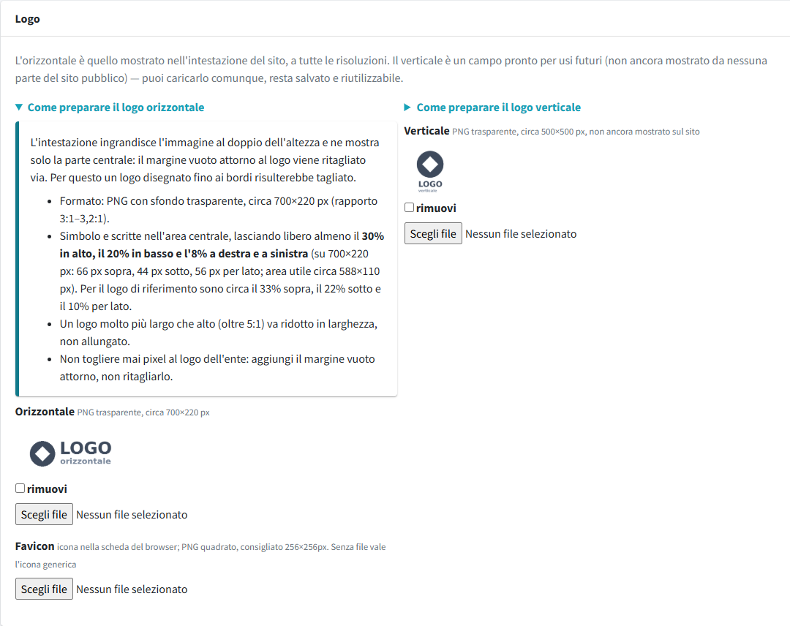
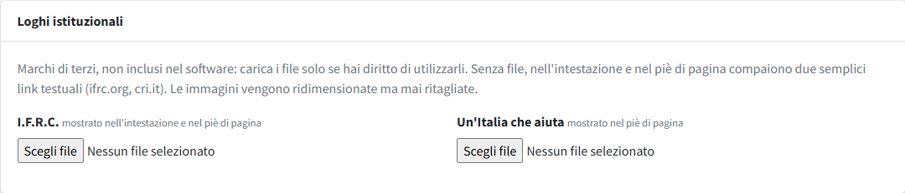
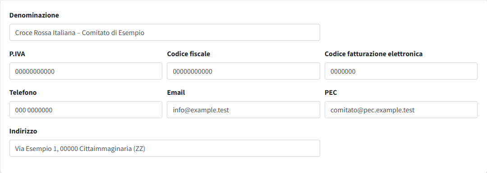
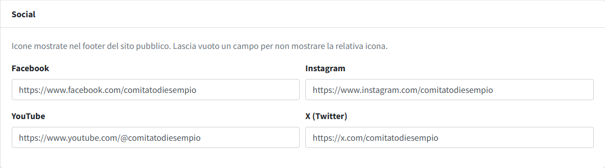
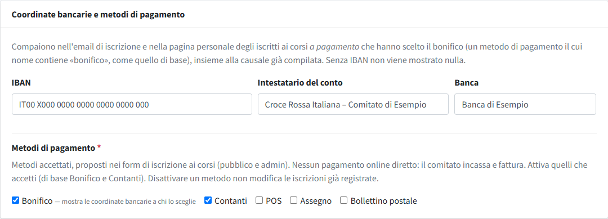
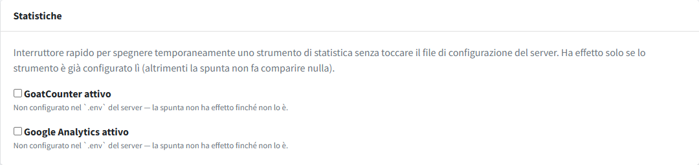
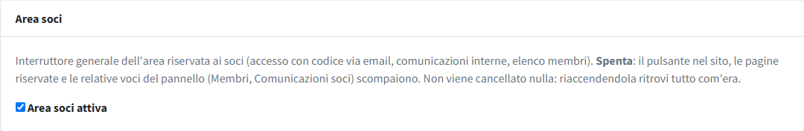

# Dati del comitato

In **Dati del comitato** (menu *Contenuti*) si inseriscono i dati che compaiono in tutto il sito: nome, contatti, loghi, coordinate
bancarie, social e alcune impostazioni generali. È la prima sezione da compilare dopo l'installazione. I campi lasciati vuoti non
vengono mostrati. In fondo alla pagina il pulsante **Salva** applica tutte le modifiche insieme.

> Il nome del sito nel titolo delle pagine (`APP_PUBLIC_NAME`) si imposta nel file `.env`, non qui: vedi
> [Configurazione del file .env](../../01-installazione/03-configurazione-env.md).

## Logo e favicon

| Campo | Dove compare | Formato consigliato |
|---|---|---|
| **Logo orizzontale** | intestazione del sito, anteprima sui social quando manca una copertina | PNG trasparente, circa 700×220 px, con margine vuoto attorno |
| **Logo verticale** | non ancora mostrato sul sito: caricalo comunque, resta salvato | PNG trasparente, circa 500×500 px |
| **Favicon** | icona nella scheda del browser; senza file vale un'icona generica | PNG quadrato, 256×256 px |

Sopra i due campi dei loghi ci sono due accordion chiusi, «Come preparare il logo orizzontale» e «Come preparare il logo
verticale»: aprendoli compaiono dimensioni e margini da rispettare.

 **Il logo orizzontale va preparato con il margine vuoto
indicato**, perché l'intestazione lo ingrandisce e ritaglia il bordo: un logo disegnato fino ai bordi verrebbe tagliato. Tutti i
dettagli, con la tabella dei formati, sono in [Immagini e file](../../02-configurazione-iniziale/02-immagini-e-file.md).

Per rimuovere un'immagine spunta **rimuovi** accanto all'anteprima e salva.

## Loghi istituzionali

**I.F.R.C.** (mostrato nell'intestazione e nel piè di pagina) e **Un'Italia che aiuta** (nel piè di pagina) sono facoltativi. Senza
file, al loro posto compare un semplice collegamento rosso al sito ufficiale. Usa immagini orizzontali con sfondo trasparente e, per
il piè di pagina che è scuro, una versione chiara. Non modificare i loghi ufficiali: ridimensionali soltanto.

## Dati anagrafici e contatti

| Campo | Uso |
|---|---|
| **Denominazione** | nome ufficiale del comitato: piè di pagina, copyright, dati per i motori di ricerca, informative ed email (segnaposto `{nome_comitato}`); se vuota si usa il nome del sito |
| **P.IVA**, **Codice fiscale**, **Codice fatturazione elettronica** | riga dei dati fiscali in fondo al piè di pagina; anche le informative |
| **Telefono**, **Email** | blocco «Contatti» del piè di pagina; segnaposto nelle informative ed email |
| **PEC** | riga dei dati fiscali in fondo al piè di pagina; segnaposto nelle informative ed email |
| **Indirizzo** | blocco «Contatti» del piè di pagina |

Questi dati alimentano anche i testi con segnaposto (`{email_comitato}`, `{telefono_comitato}` e simili) delle informative privacy e
delle email di sistema: vedi [Informative privacy ed email](../04-amministrazione/05-informative-privacy.md).

## Social

Facebook, Instagram, YouTube e X: incolla l'indirizzo completo del profilo (con `https://`). Le icone compaiono nel piè di pagina solo
per i social compilati.

## Coordinate bancarie e metodi di pagamento

Servono per i corsi a pagamento.

- **IBAN**, **Intestatario del conto** (se vuoto si usa la denominazione) e **Banca**. L'IBAN si può scrivere a gruppi di quattro: viene
  controllato nel formato e riportato senza spazi.
- **Metodi di pagamento**: scegli quali offrire a chi si iscrive a un corso (bonifico, contanti, POS, assegno, bollettino postale).
  Per impostazione predefinita sono attivi bonifico e contanti; ne serve almeno uno. Non c'è nessun pagamento online: il comitato incassa e fattura.
  A chi sceglie il **bonifico** per un corso a pagamento le coordinate (IBAN, intestatario, causale già compilata) vengono mostrate
  nell'email di iscrizione e nella pagina personale dell'iscritto, ma solo se l'IBAN è compilato. Disattivare un metodo non modifica
  le iscrizioni già registrate.

Dettagli sull'uso nei corsi in [Corsi di formazione](../02-formazione/01-corsi.md).

## Statistiche

Due interruttori rapidi, per accendere o spegnere temporaneamente le statistiche senza cookie (GoatCounter) e Google Analytics senza
toccare il file di configurazione. Funzionano solo se lo strumento è stato definito nel file `.env` del server; altrimenti la spunta
non ha effetto e il pannello lo segnala sotto la voce. Come definirli:
[Configurazione del file .env](../../01-installazione/03-configurazione-env.md#statistiche-facoltative).

## Area soci

Interruttore generale dell'area riservata ai soci. **Spento**: il pulsante «Area soci» nel sito, le pagine riservate e le voci
del pannello (Membri, Comunicazioni soci) scompaiono; non viene cancellato nulla, e riaccendendolo si ritrova tutto com'era.
Vedi [Area soci](../04-amministrazione/02-membri.md).
