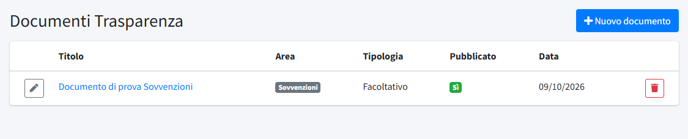
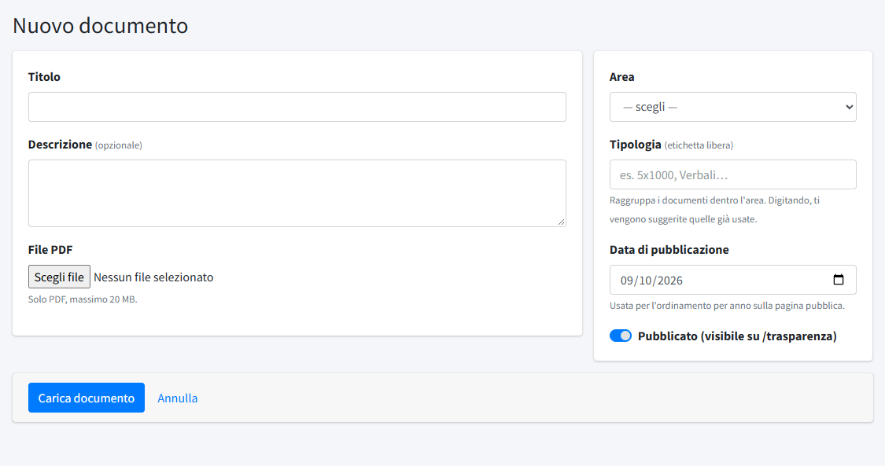
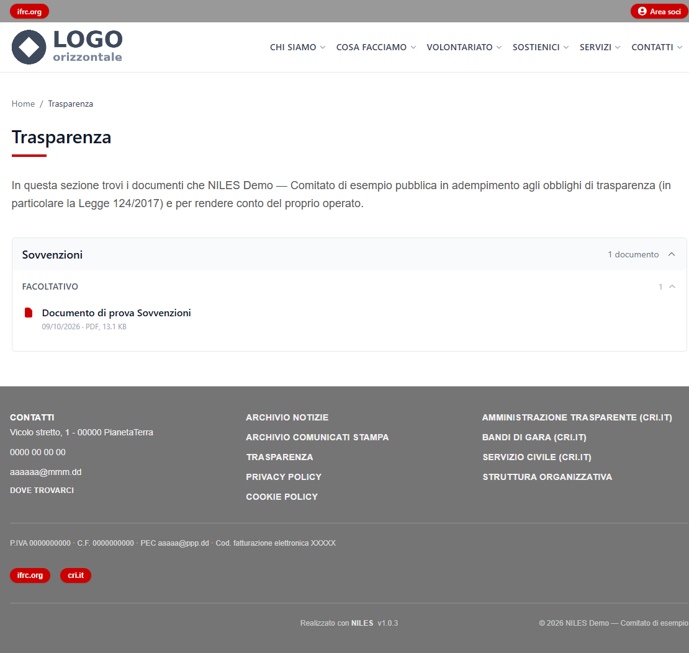

# Trasparenza

In **Trasparenza** (menu *Contenuti*) si pubblicano i documenti che il comitato rende pubblici per obbligo di legge (in particolare la
Legge 124/2017 sulle sovvenzioni) e per rendere conto del proprio operato: bilanci, verbali, sovvenzioni ricevute. La pagina pubblica
è `/trasparenza`, raggiungibile dal piè di pagina.

I documenti si organizzano in **aree** (Albo, Sovvenzioni, Consiglio Direttivo, Assemblea Soci): per creare, rinominare o riordinare le
aree vedi [Aree Trasparenza](../03-organizzazione/02-aree-trasparenza.md).

## L'elenco dei documenti

L'elenco mostra **Titolo** (apre il PDF), **Area**, **Tipologia**, se il documento è **Pubblicato** e la **Data**. A ogni riga: **Modifica** e
**Elimina**; a chi ha il solo permesso di lettura compare il pulsante per vederlo senza poterlo cambiare. **Nuovo documento** ne carica
uno.

## Caricare un documento

- **Titolo**: il nome con cui il documento compare sulla pagina.
- **Descrizione**: facoltativa, un testo breve di spiegazione.
- **File PDF**: solo PDF, fino a 20 MB. In modifica, un nuovo file sostituisce quello attuale; lasciando il campo vuoto il file
  resta com'è.
- **Area**: obbligatoria, sceglie in quale sezione della pagina compare il documento.
- **Tipologia**: un'etichetta libera che raggruppa i documenti dentro l'area (per esempio «5x1000» o «Verbali»). Digitando compaiono i
  suggerimenti delle etichette già usate: conviene riusarle per non creare gruppi quasi uguali.
- **Data di pubblicazione**: usata per ordinare i documenti sulla pagina pubblica; è precompilata con la data di oggi.
- **Pubblicato**: se spento il documento resta nel pannello ma non è visibile su `/trasparenza`.

**Carica documento** (o **Salva**, in modifica) registra il documento. Eliminarlo lo toglie definitivamente dalla pagina pubblica.

## Come appare sul sito

La pagina elenca le aree che hanno documenti, ciascuna richiudibile e con il numero di documenti; dentro l'area i documenti sono
raggruppati per tipologia e ordinati dal più recente, ognuno con il titolo, la data, il tipo di file e il peso, da scaricare.

Il testo introduttivo in cima alla pagina («In questa sezione trovi i documenti che…») è la pagina di sistema *Trasparenza*: si modifica
da [Pagine](02-pagine.md). Le aree senza documenti pubblicati non compaiono.
