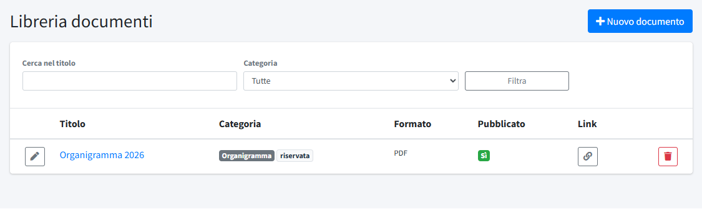
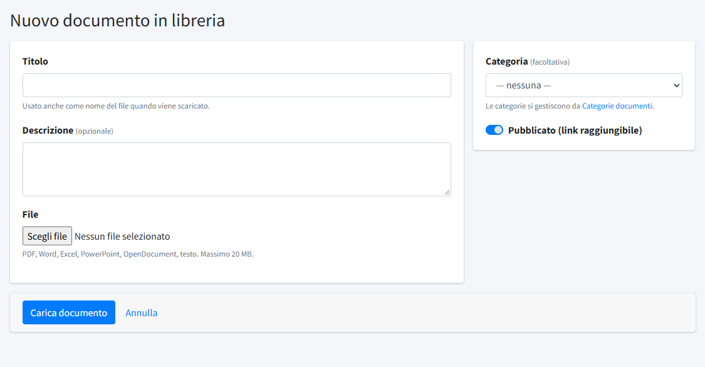
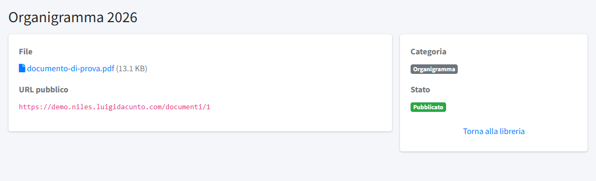

# Libreria documenti

La **Libreria documenti** (menu *Contenuti*) è l'archivio dei file del comitato: moduli, regolamenti, locandine in PDF, fogli di calcolo e
simili. Un documento caricato qui ha un indirizzo pubblico stabile e si può **allegare** a un [post](01-post.md) o a una [pagina](02-pagine.md),
oppure collegare dal testo. La libreria non è una pagina del sito con un elenco: i documenti sono
raggiungibili solo da chi ne conosce il link o da dove sono allegati.

> I documenti della sezione di legge si pubblicano invece da [Trasparenza](05-trasparenza.md), che li elenca in una pagina propria.

## L'elenco

L'elenco mostra **Titolo** (apre il file), **Categoria**, **Formato**, se il documento è **Pubblicato** e il pulsante **Link** (l'icona a catena),
che copia negli appunti l'indirizzo pubblico del documento. Le categorie segnate «riservata» (come *Organigramma*) sono riempite
dall'applicazione, per esempio dalla [Struttura organizzativa](03-struttura-organizzativa.md): non si scelgono nei nuovi caricamenti. In alto, **Cerca nel titolo** e il filtro per **Categoria** (tutte, senza categoria, oppure una
categoria precisa). **Nuovo documento** ne carica uno; a ogni riga ci sono la matita (modifica) e il cestino (elimina).

## Caricare un documento

- **Titolo**: viene usato anche come nome del file quando il documento è scaricato.
- **Descrizione**: facoltativa.
- **File**: PDF, Word, Excel, PowerPoint, OpenDocument, testo o CSV, fino a 20 MB. In modifica, un nuovo file sostituisce quello attuale; lasciando
  il campo vuoto il file resta com'è.
- **Categoria**: facoltativa. Le categorie si gestiscono da [Categorie documenti](../03-organizzazione/03-categorie-documenti.md).
- **Pubblicato (link raggiungibile)**: se spento, il documento resta nella libreria ma il suo indirizzo non funziona e non può essere
  scaricato (gli utenti del pannello lo aprono comunque, per controllarlo).

Formati e limiti di peso sono in [Immagini e file](../../02-configurazione-iniziale/02-immagini-e-file.md).

## Il dettaglio e il link pubblico

Il titolo apre direttamente il file. A chi ha il solo permesso di lettura l'occhio mostra il dettaglio, con la descrizione, il file,
l'**URL pubblico** (del tipo `https://<dominio>/documenti/1`), la categoria e lo stato. Chi può modificare trova gli stessi dati
nella pagina di modifica; l'indirizzo si copia con il pulsante **Link** dell'elenco. Si può incollare dove serve, per esempio come
collegamento nel testo di una pagina, o inviare per email: chi lo apre scarica il file.

Sostituire il file di un documento esistente mantiene lo stesso indirizzo, quindi i collegamenti già diffusi continuano a funzionare.
Eliminare un documento (cestino) cancella il file, i collegamenti diffusi smettono di funzionare e il documento sparisce anche dagli
allegati di post e pagine.

## Allegare un documento

Per allegare un documento a un post o a una pagina si apre il form corrispondente, nel riquadro **Allegati**, e si sceglie il documento
tra quelli della libreria (anche più di uno, con l'ordine in cui compaiono). Le comunicazioni ai soci hanno invece un caricamento
proprio, descritto in [Comunicazioni soci](07-comunicazioni-soci.md). Se il file non è ancora in libreria,
va caricato prima qui. Sul sito gli allegati compaiono in fondo alla pagina, con un'icona per tipo di file e il peso.
