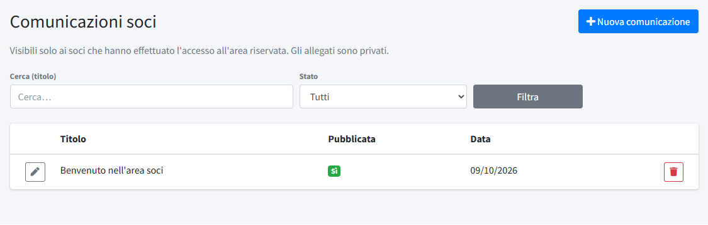
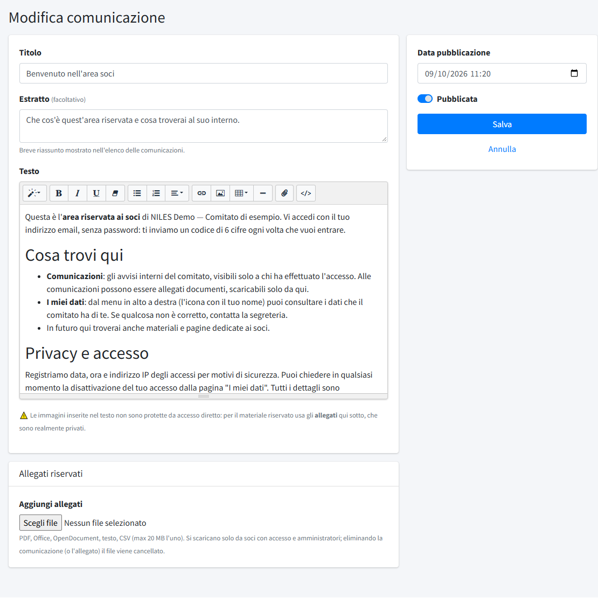

# Comunicazioni soci

In **Comunicazioni soci** (menu *Contenuti*) si scrivono gli avvisi interni del comitato, visibili **solo ai soci** che hanno fatto
l'accesso all'area riservata. A differenza dei [post](01-post.md), non sono pubbliche e non compaiono in home né negli archivi del sito.
La voce del menu c'è solo se l'**area soci** è attiva (interruttore in [Dati del comitato](04-dati-del-comitato.md#area-soci)); vedi anche
[Membri](../04-amministrazione/02-membri.md) per chi può accedere.

## L'elenco

L'elenco mostra **Titolo**, se la comunicazione è **Pubblicata** e la **Data**; in alto si cerca per titolo e si filtra per **Stato**
(tutte, solo pubblicate, solo bozze). **Nuova comunicazione** ne crea una e il cestino elimina una comunicazione con i suoi allegati. L'installazione crea una comunicazione di benvenuto,
che spiega ai soci come funziona l'area riservata: va riletta e adattata.

## Scrivere una comunicazione

- **Titolo**.
- **Estratto**: facoltativo, un breve riassunto (fino a 500 caratteri) mostrato nell'elenco delle comunicazioni.
- **Testo**: lo stesso editor dei post, con grassetto, elenchi, collegamenti, immagini, tabelle e il pulsante `</>` per il codice embed.
  ⚠️ Le immagini inserite nel testo **non sono protette** da accesso diretto: per il materiale riservato servono gli allegati.
- **Allegati riservati**: **Aggiungi allegati** carica uno o più file (fino a 20 per volta; PDF, Office, OpenDocument, testo, CSV, fino a 20 MB ciascuno). Gli
  allegati sono **privati**: si scaricano solo dai soci con l'accesso e dagli amministratori, e non compaiono nella
  [Libreria documenti](06-libreria-documenti.md). Per ogni allegato già caricato si possono cambiare l'ordine e spuntare **elimina**;
  eliminando la comunicazione o un allegato, il file viene cancellato.
- **Data pubblicazione**: la data mostrata ai soci e usata per l'ordinamento (dalla più recente).
- **Pubblicata**: se spenta, la comunicazione è una bozza e i soci non la vedono.

**Salva** (o **Crea comunicazione**) registra le modifiche.

## Come la vedono i soci

Dopo l'accesso con il codice via email, il socio trova la voce **Comunicazioni** nel menu dell'area riservata: l'elenco delle
comunicazioni pubblicate, dalla più recente, e il dettaglio con testo e allegati. Chi non ha fatto l'accesso viene mandato alla pagina
di accesso. Se l'area soci è spenta, l'intera sezione non è raggiungibile e le comunicazioni restano salvate.
