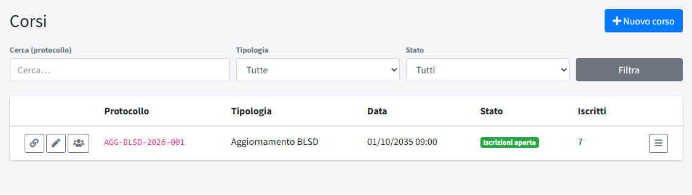
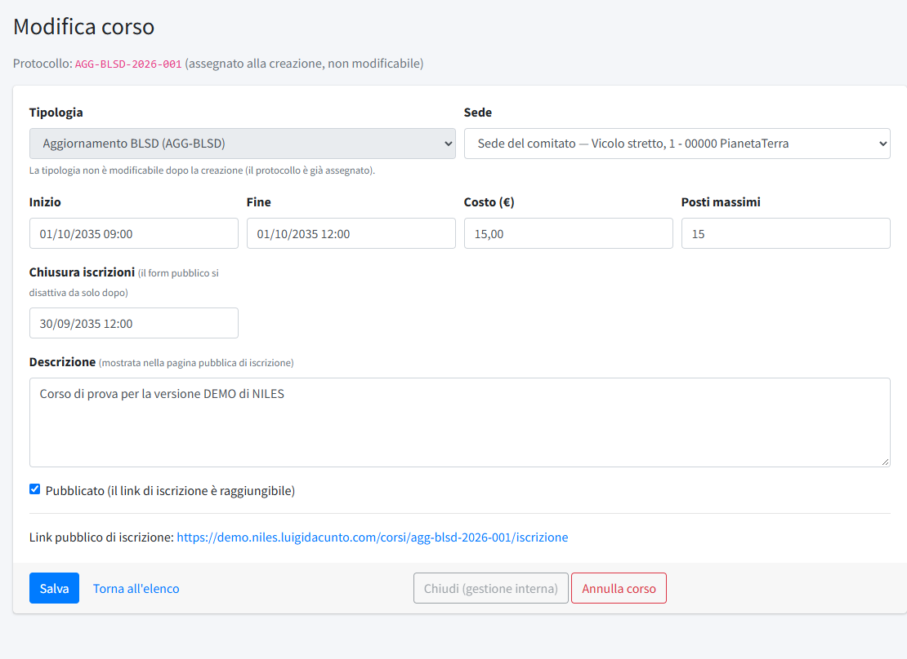
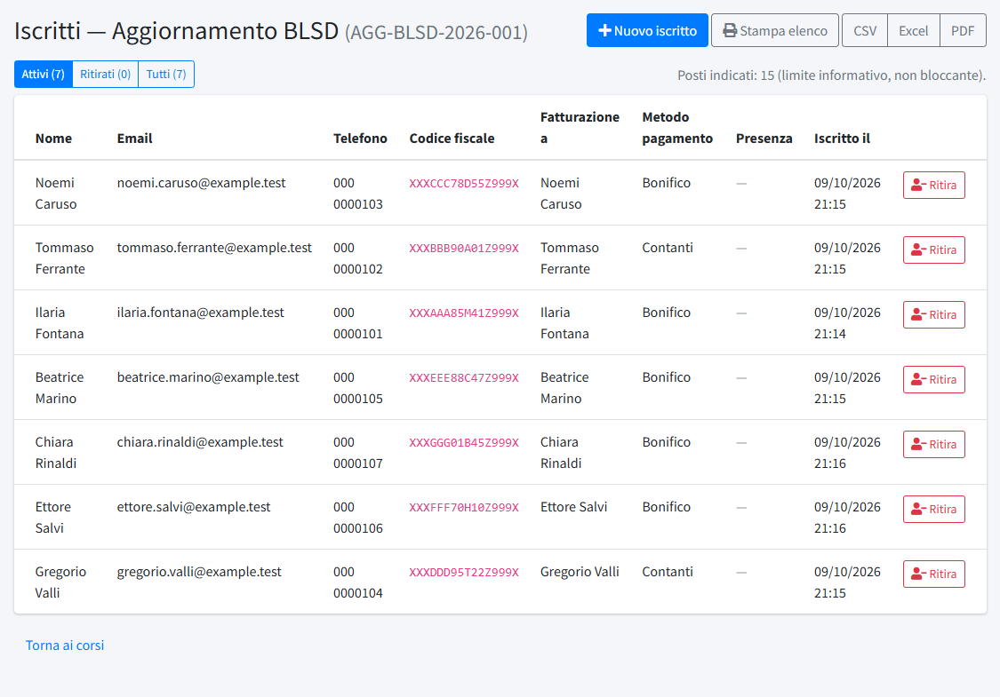
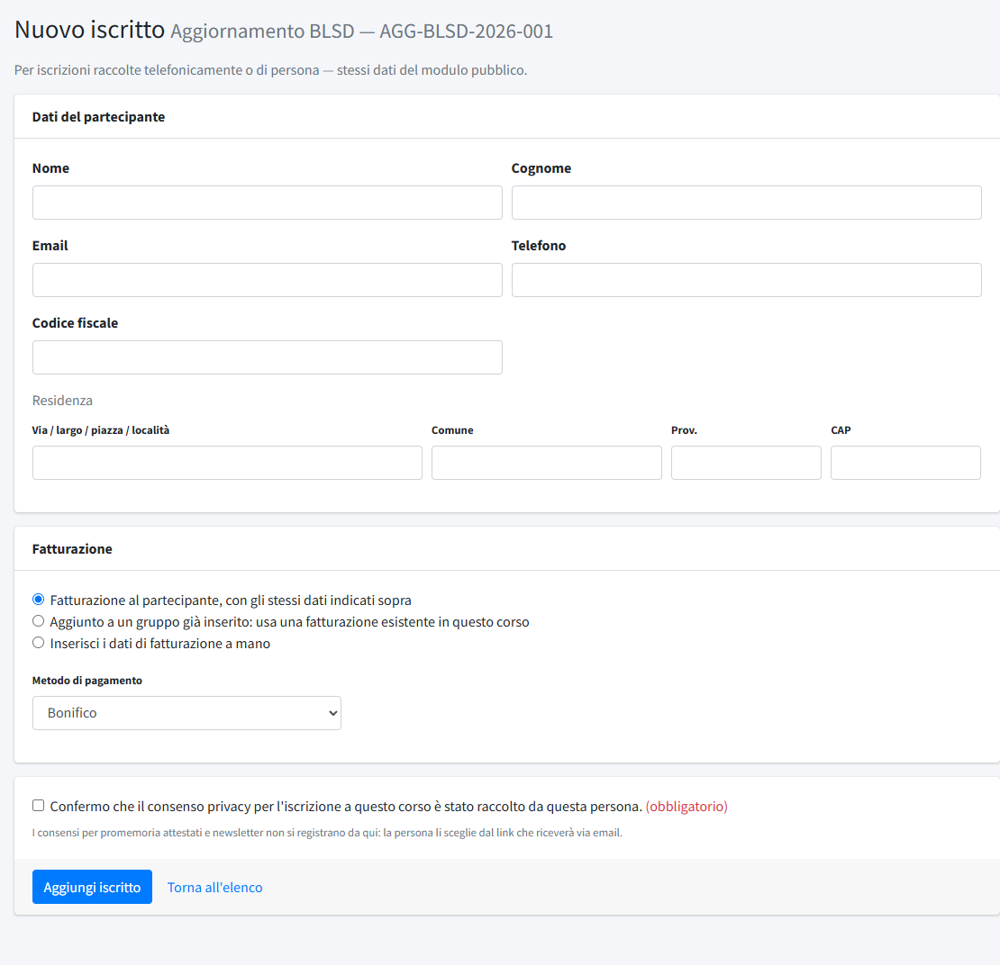
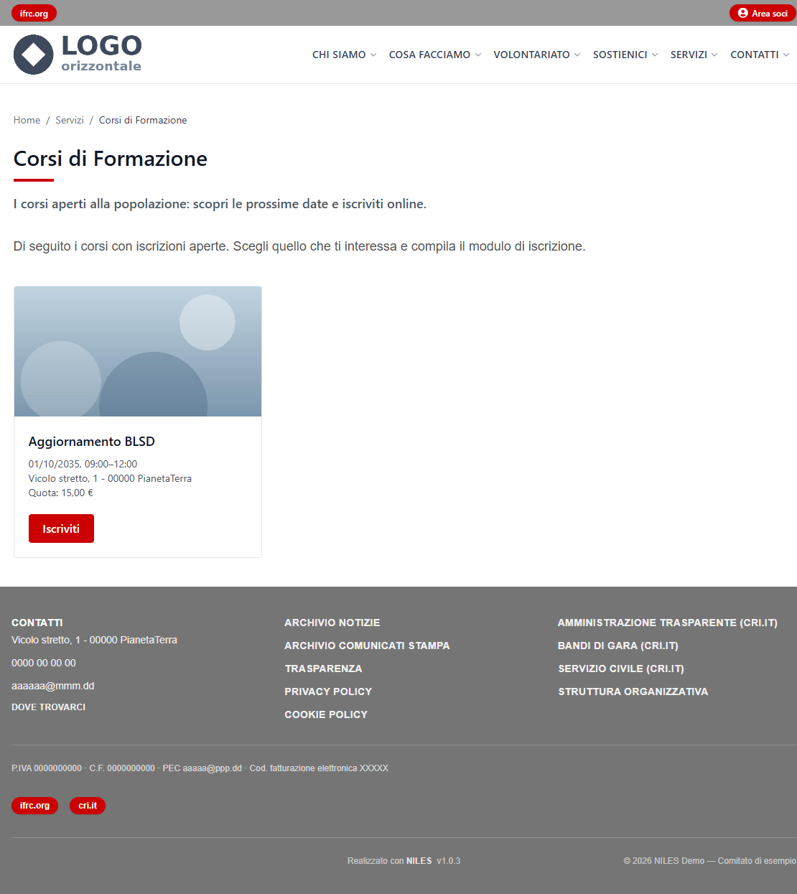
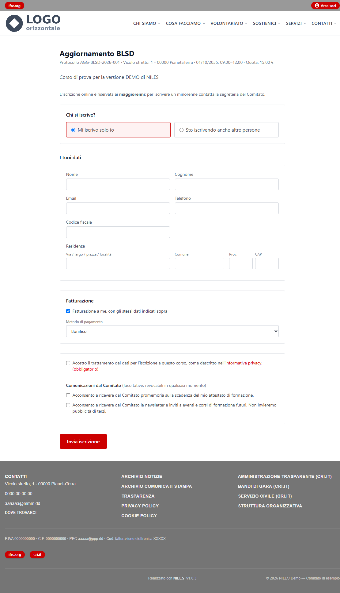
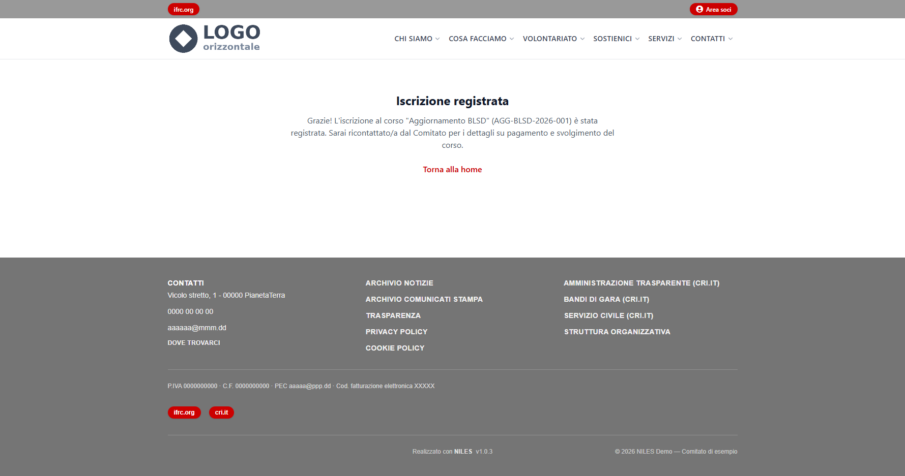

# Corsi

In **Corsi** (menu *Formazione*) si organizzano i corsi di formazione aperti alla popolazione: si crea il corso scegliendo una
[tipologia](03-tipologie-corso.md), si pubblica il link di iscrizione, si seguono gli iscritti e si esportano gli elenchi. Non c'è un
pagamento online: il comitato incassa e fattura per conto proprio, e il modulo raccoglie anche i dati di fatturazione. Per lavorare qui un
editor ha bisogno del permesso «Corsi».

## L'elenco dei corsi

L'elenco mostra **Protocollo**, **Tipologia**, **Data**, **Stato** e numero di **Iscritti**. In alto si cerca per protocollo e si filtra per
**Tipologia** e per **Stato** (tutti, attivi, annullati, chiusi). **Nuovo corso** ne crea uno.

A ogni riga:

- **Copia link**: copia negli appunti l'indirizzo pubblico di iscrizione da incollare in un post, in un'email o su un social;
- **Modifica** e **Iscritti**;
- **Azioni**: un menu con *Chiudi* o *Riapri*, *Annulla* o *Riattiva*, ed *Elimina*.

## Creare o modificare un corso

- **Tipologia**: sceglie il tipo di corso; precompila il costo con quello predefinito della tipologia. **Non si può cambiare dopo la
  creazione**, perché il protocollo è già assegnato.
- **Protocollo**: lo assegna il sistema alla creazione (`SIGLA-ANNO-NNN`, per esempio `BLSD-2026-001`, con numerazione progressiva
  annuale per tipologia) e non cambia più. È anche la parte finale dell'indirizzo di iscrizione.
- **Sede**: «Sede del comitato» (l'indirizzo di *Dati del comitato*), una sede già usata in passato oppure **+ Nuova sede…**, che
  apre i campi per nome, via, comune, provincia e CAP; la nuova sede resta poi disponibile per i corsi successivi. Non c'è una sezione
  separata per le sedi.
- **Inizio** e **Fine**: data e ora, scelte con il calendario. Il corso può durare più giorni.
- **Costo (€)**: precompilato dalla tipologia, modificabile per il singolo corso.
- **Posti massimi**: indicativo; il numero viene mostrato ma **non blocca** le iscrizioni oltre il limite.
- **Chiusura iscrizioni**: data e ora dopo le quali il modulo pubblico si disattiva da solo.
- **Descrizione**: mostrata nella pagina pubblica di iscrizione.
- **Pubblicato**: se spento, il link di iscrizione non è raggiungibile.

Sotto il form compare il **link pubblico di iscrizione** (`https://<dominio>/corsi/<protocollo>/iscrizione`), da incollare dove serve.

## Stati di un corso

Per i visitatori il corso è in uno di questi stati, in quest'ordine di priorità:

1. **Annullato**: la pagina mostra il messaggio di annullamento con il motivo.
2. **Concluso**: la data di fine è passata.
3. **Iscrizioni chiuse**: la data di chiusura delle iscrizioni è passata, ma il corso non si è ancora svolto.
4. **Aperto**: il modulo di iscrizione funziona.

Dal pannello:

- **Annulla corso** chiede il motivo, che compare anche nella pagina pubblica; si può **Riattivare** finché il corso non è concluso.
- **Chiudi (gestione interna)** è disponibile solo a corso concluso e serve a ordinare l'elenco (filtro «Chiusi»): non cambia
  nulla per i visitatori. **Riapri** annulla la chiusura. Con il corso annullato o chiuso, le date non si modificano.

## Gli iscritti

**Iscritti** apre l'elenco di un corso, con **Nome**, **Email**, **Telefono**, **Codice fiscale**, **Fatturazione a**, **Metodo di
pagamento**, **Presenza** e data di iscrizione. I pulsanti **Attivi**, **Ritirati** e **Tutti** filtrano l'elenco; sopra compare il
numero di posti indicati.

- **Presenza**: «Confermata» compare quando la persona, dalla propria pagina personale raggiunta dal link nell'email, conferma di
  partecipare.
- **Ritira**: segna l'iscritto come ritirato (con un motivo facoltativo) senza cancellarlo; **Ripristina** lo rimette tra gli attivi.
- **Stampa elenco**, **CSV**, **Excel** e **PDF** esportano l'elenco secondo il filtro scelto (attivi, ritirati o tutti).

### Iscrivere una persona a mano

**Nuovo iscritto** serve per le iscrizioni raccolte al telefono o di persona. I dati sono gli stessi del modulo pubblico: nome, cognome,
email, telefono, codice fiscale, residenza, fatturazione (agli stessi dati del partecipante, con dati inseriti a mano, o con quelli di
un'altra iscrizione dello stesso corso) e metodo di pagamento. Al posto delle caselle di consenso c'è un'unica conferma obbligatoria che
il consenso privacy è stato raccolto da quella persona. I consensi per promemoria e newsletter non si registrano da qui: la persona li
sceglie dal link che riceve via email.

## Come funziona sul sito

La pagina **Servizi → Corsi di Formazione** mostra una scheda per ogni corso con iscrizioni aperte: l'immagine della tipologia, il nome, la
data, la sede, la quota e il pulsante **Iscriviti**. Il corso è raggiungibile anche dal solo link diretto.

Il modulo di iscrizione è riservato ai maggiorenni (per un minorenne si contatta la segreteria). Chi si iscrive sceglie se lo fa **solo
lui** o **anche altre persone** (in questo caso ripete i dati per ciascuna). Compila i dati personali e quelli di fatturazione, sceglie il
metodo di pagamento tra quelli attivi in [Dati del comitato](../01-contenuti/04-dati-del-comitato.md#coordinate-bancarie-e-metodi-di-pagamento),
accetta l'informativa privacy (obbligatoria) e può dare, facoltativamente, due consensi distinti: i promemoria sulla scadenza
dell'attestato e la newsletter. Dopo l'invio compare la pagina di conferma e riceve un'email con le istruzioni di pagamento; le persone che ha iscritto
ricevono la propria. 

I moduli sono protetti contro i robot: vedi [Sicurezza moduli](../04-amministrazione/04-sicurezza-moduli.md). Le persone
iscritte e i loro consensi si consultano in [Persone](02-persone.md).

## Eliminare un corso

**Elimina**, dal menu *Azioni*, cancella il corso, ma solo se non ha iscritti: altrimenti il pannello lo rifiuta. Per togliere dal sito un
corso con iscritti basta **annullarlo** o togliere la spunta a **Pubblicato**.
