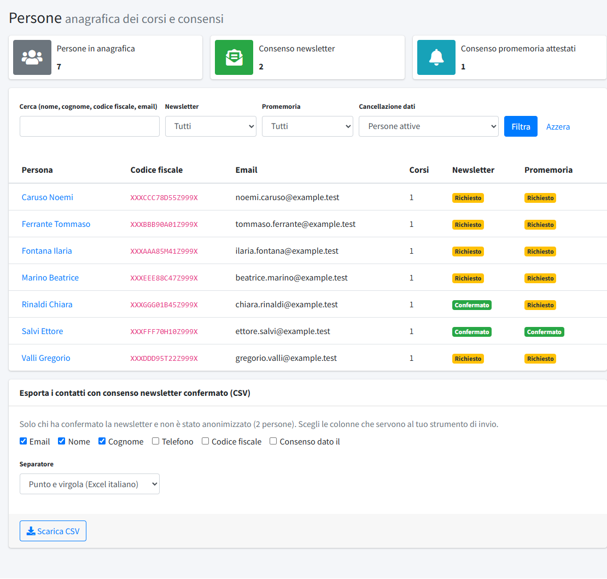
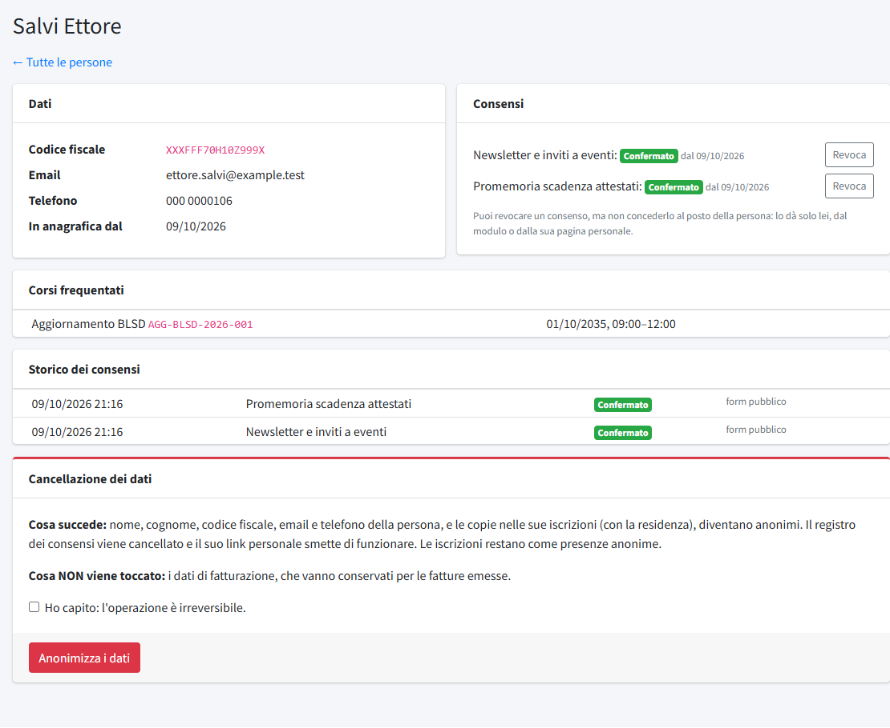

# Persone

In **Persone** (menu *Formazione*) si consulta l'anagrafica di chi si è iscritto ai [corsi](01-corsi.md), con i **consensi** che ha dato e le
**richieste di cancellazione dei dati**. Le persone non si creano da qui: nascono dalle iscrizioni (dal modulo pubblico o inserite a mano
da un operatore) e si aggiornano a ogni nuova iscrizione. La voce è visibile a chi ha il permesso «Corsi».

## L'anagrafica

In alto tre totali: persone in anagrafica, con il **consenso alla newsletter** e con il **consenso ai promemoria** degli attestati. Poi la
ricerca (nome, cognome, codice fiscale, email) e i filtri su **Newsletter**, **Promemoria** (confermato, richiesto senza risposta,
revocato, nessuna scelta) e **Cancellazione dati** (persone attive, richieste in attesa, anonimizzate; le persone anonimizzate sono nascoste
di default). La tabella mostra persona, codice fiscale, email, corsi e stato dei due consensi.

Ogni persona è identificata dal **codice fiscale**, unico: iscriversi di nuovo con lo stesso codice aggiorna email e telefono della
stessa persona, senza creare doppioni e senza toccare i consensi. Aprendo una persona si vedono i dati, i corsi a cui è iscritta (e chi l'ha
iscritta o chi ha iscritto lei), lo stato dei consensi e la **storia completa** dei consensi, con l'origine di ogni scelta e il testo mostrato
in quel momento.

Nella scheda **Consensi** ogni consenso ha lo stato (richiesto, confermato, revocato) e il pulsante **Revoca**; lo **Storico dei consensi** indica
quando e da dove è arrivata ogni scelta (per esempio «form pubblico» o «email iscrizione»); in fondo, la scheda **Cancellazione dei dati** con il
pulsante **Anonimizza i dati**, riservato agli amministratori.

## I consensi

Ci sono due consensi distinti, entrambi facoltativi e revocabili:

- **Promemoria**: avvisi sulla scadenza dell'attestato di formazione.
- **Newsletter**: inviti a eventi e corsi futuri.

Chi compila il modulo pubblico può darli per sé; le altre persone iscritte da qualcuno ricevono un'email con un link personale per scegliere. Un
consenso passa tra questi stati: nessuna scelta, richiesto (in attesa di risposta), confermato, revocato. **Si invia qualcosa solo se lo
stato è «confermato».** Gli operatori possono **revocare** un consenso (se hanno il permesso di scrittura), ma non possono mai darlo al posto
della persona.

### La pagina personale

Ogni persona ha una pagina riservata, raggiunta dal link ricevuto per email (non è indicizzata né ha statistiche). Da lì può:

- scegliere i consensi e **confermare la presenza** ai corsi non ancora svolti;
- **chiedere la cancellazione dei suoi dati**.

## Richieste di cancellazione

Una richiesta di cancellazione revoca subito i consensi attivi e compare nell'elenco in una scheda rossa, **«Richieste di cancellazione dei
dati in attesa»**, con il pulsante **Valuta**. Il comitato non riceve un'email: la richiesta si vede in questa pagina, che va controllata
periodicamente.

Per eseguirla un **amministratore** apre la persona e usa **Anonimizza** (con conferma). L'operazione è **irreversibile**:

- nome, email, telefono e codice fiscale della persona diventano anonimi, il suo link personale smette di funzionare e lo storico dei consensi viene
  cancellato;
- le sue iscrizioni restano, in forma anonima, così i conteggi dei corsi restano corretti;
- **i dati di fatturazione non vengono toccati**: le fatture emesse vanno conservate per legge.

Un'iscrizione successiva con lo stesso codice fiscale crea una persona nuova.

## Esportare i contatti per la newsletter

In fondo alla pagina, **Esporta i contatti con consenso newsletter confermato (CSV)** scarica un file con le sole persone che hanno
confermato la newsletter e non sono anonimizzate. Si scelgono le **colonne** (email, nome, cognome, telefono, codice fiscale, data del
consenso) e il **separatore** (punto e virgola per l'Excel italiano, oppure virgola). Il file si importa nello strumento di invio che il
comitato usa per le newsletter.
