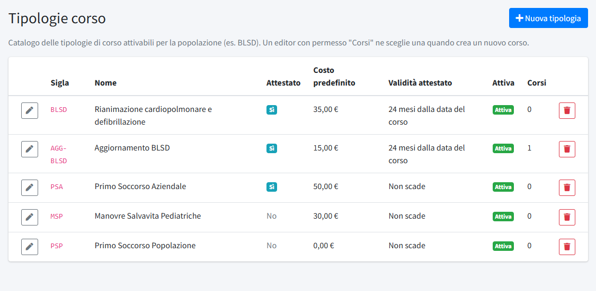
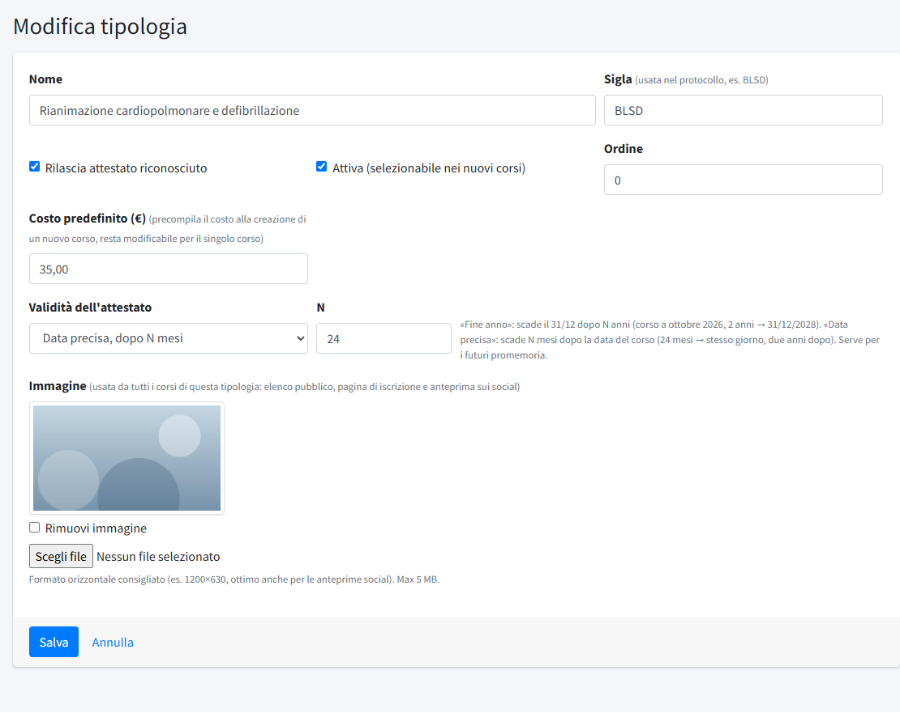

# Tipologie corso

In **Tipologie corso** (menu *Formazione*) si tiene il **catalogo** dei tipi di corso che il comitato organizza per la popolazione, per
esempio BLSD o primo soccorso aziendale. Quando si crea un [corso](01-corsi.md) si sceglie una tipologia, che ne fornisce il nome, il costo
suggerito, la durata dell'attestato e l'immagine. La sezione è riservata agli amministratori; un editor con il permesso «Corsi» si limita
a sceglierne una per ogni corso.

## L'elenco

L'installazione crea cinque tipologie comuni: **BLSD** (rianimazione cardiopolmonare e defibrillazione), **AGG-BLSD** (aggiornamento
BLSD), **PSA** (primo soccorso aziendale), **MSP** (manovre salvavita pediatriche) e **PSP** (primo soccorso alla popolazione). Vanno
adattate: si possono modificare, disattivare o eliminare, e se ne aggiungono altre con **Nuova tipologia**.

L'elenco mostra **Sigla**, **Nome**, se rilascia l'**Attestato**, il **Costo predefinito**, la **Validità** dell'attestato, se è **Attiva** e
quanti **Corsi** la usano.

## Creare o modificare una tipologia

- **Nome**: il titolo del corso, come compare sul sito.
- **Sigla**: fino a 20 caratteri tra lettere, numeri e trattini (per esempio `BLSD`), unica. Entra nel **protocollo** di ogni corso, che
  è l'identificativo del corso (per esempio `BLSD-2026-001`).
- **Rilascia attestato riconosciuto**: indica se il corso rilascia un attestato.
- **Attiva (selezionabile nei nuovi corsi)**: se spenta, la tipologia non compare più nella scelta quando si crea un corso; i corsi già
  esistenti non cambiano.
- **Ordine**: la posizione nell'elenco e nella scelta (0 = prima).
- **Costo predefinito (€)**: precompila il costo alla creazione di un corso; si può cambiare per il singolo corso. Con 0 il corso è
  gratuito.
- **Validità dell'attestato**: «Non scade» oppure una scadenza calcolata dalla data del corso. Con **Fine anno, dopo N anni** l'attestato
  scade il 31 dicembre dopo N anni (corso a ottobre 2026, 2 anni: scade il 31/12/2028). Con **Data precisa, dopo N mesi** scade N mesi dopo
  la data del corso (24 mesi: lo stesso giorno, due anni dopo). Il dato serve per i promemoria di scadenza.
- **Immagine**: usata da tutti i corsi di questa tipologia nell'elenco pubblico, nella pagina di iscrizione e come anteprima sui social.
  Formato orizzontale, consigliato 1200×630 px, fino a 5 MB; vedi [Immagini e file](../../02-configurazione-iniziale/02-immagini-e-file.md).
  «Rimuovi immagine» la toglie.

## Eliminare una tipologia

Una tipologia si elimina solo se non ha corsi collegati: altrimenti il pannello lo segnala. Per toglierla dalla scelta senza perdere i corsi
esistenti basta **disattivarla**.
