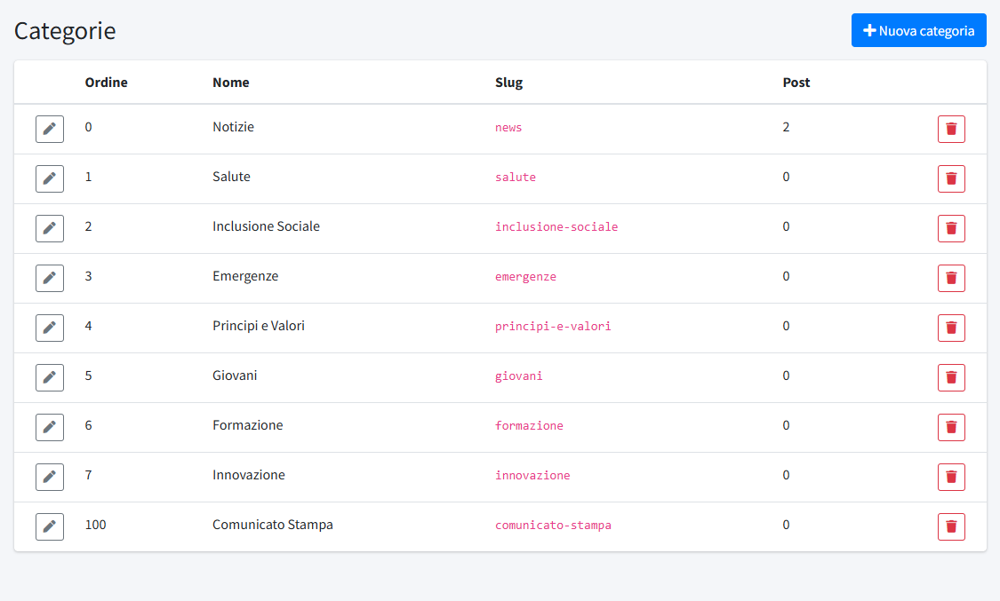

# Categorie

In **Categorie** (menu *Organizzazione*) si gestiscono le categorie delle notizie. Ogni [post](../01-contenuti/01-post.md) appartiene a una
categoria, che compare nel suo indirizzo (`/<categoria>/<titolo-del-post>`), nell'archivio e, per le sezioni di *Cosa Facciamo*, nella
pagina collegata. La sezione è riservata agli amministratori.

L'installazione crea nove categorie pensate per un comitato della Croce Rossa Italiana: **Notizie** (la categoria generica), **Salute**,
**Inclusione Sociale**, **Emergenze**, **Principi e Valori**, **Giovani**, **Formazione**, **Innovazione** e **Comunicato Stampa**.
L'elenco mostra **Ordine**, **Nome**, **Slug** e il numero di **Post** di ciascuna.

## Come si usano

- **Notizie** è la categoria di partenza per i post generici. L'archivio completo delle notizie, raggiungibile dal piè di pagina,
  elenca i post pubblicati di tutte le categorie.
- Le categorie delle attività (Salute, Inclusione Sociale, Emergenze, Principi e Valori, Giovani, Formazione, Innovazione) sono legate alle
  sezioni di **Cosa Facciamo**: ogni sezione mostra in fondo le ultime notizie della propria categoria, con il collegamento all'archivio
  completo. La sezione *Innovazione* nasce in bozza (vedi [Pagine](../01-contenuti/02-pagine.md)).
- **Comunicato Stampa** ha, oltre alla normale presenza in home e nell'archivio notizie, un archivio dedicato in forma di elenco senza
  immagini e un blocco in home con i tre comunicati più recenti. Ha un ordine alto (100) perché resti sempre in fondo all'elenco.

## Creare o modificare una categoria

**Nuova categoria** apre un form con quattro campi:

- **Nome**: come compare nel pannello e nelle pagine.
- **Slug**: la parte dell'indirizzo che identifica la categoria, in lettere minuscole, numeri e trattini; deve essere unico. **Cambiarlo
  cambia l'indirizzo di tutti i suoi post**: conviene scegliere lo slug una volta e non toccarlo.
- **Descrizione**.
- **Ordine**: la posizione nell'elenco e nel menu a tendina del form dei post (0 = prima).

Un editor vede e usa soltanto le categorie che gli sono state assegnate: vedi [Utenti](../04-amministrazione/01-utenti.md).

## Eliminare una categoria

Una categoria si elimina solo quando non ha più post: altrimenti il pannello rifiuta l'operazione e chiede di spostare prima i post in un'altra
categoria (modificandoli uno a uno).
