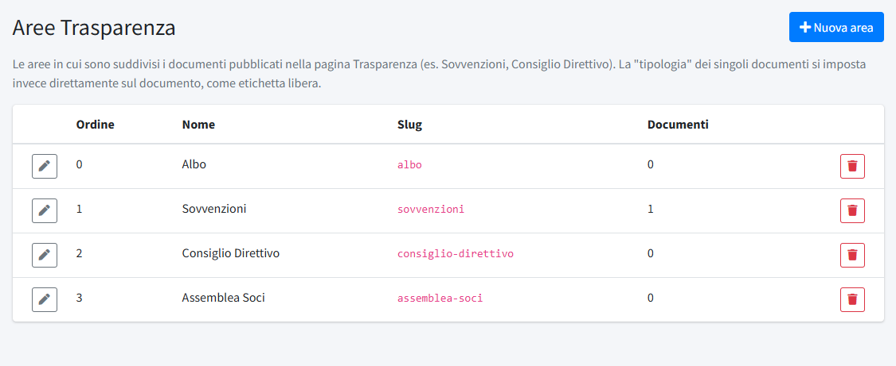

# Aree Trasparenza

In **Aree Trasparenza** (menu *Organizzazione*) si definiscono le aree in cui è suddivisa la pagina [Trasparenza](../01-contenuti/05-trasparenza.md):
ogni documento appartiene a un'area. L'installazione ne crea quattro: **Albo**, **Sovvenzioni**, **Consiglio Direttivo** e
**Assemblea Soci**.

L'elenco mostra l'**Ordine**, il **Nome**, lo **Slug** e il numero di **Documenti** di ogni area, con i pulsanti **Modifica** ed
**Elimina**. **Nuova area**, in alto a destra, ne aggiunge una. La sezione è riservata agli amministratori.

## Creare o modificare un'area

- **Nome**: il titolo dell'area sulla pagina pubblica.
- **Slug**: l'identificativo interno dell'area, in lettere minuscole, numeri e trattini (per esempio `consiglio-direttivo`). Deve essere
  unico.
- **Descrizione**: facoltativa, compare sotto il titolo dell'area.
- **Ordine**: la posizione dell'area nella pagina (0 = prima).

## Eliminare un'area

Un'area si elimina solo se è vuota: se contiene ancora documenti, il pannello lo segnala e chiede di spostarli prima in un'altra area
(modificando i singoli documenti).

## La «tipologia» dei documenti

La **tipologia** (per esempio «Verbali» o «5x1000») non è un'area: è un'etichetta libera che si imposta direttamente sul singolo
documento e raggruppa i documenti dentro l'area. Non richiede nessuna configurazione preliminare.
