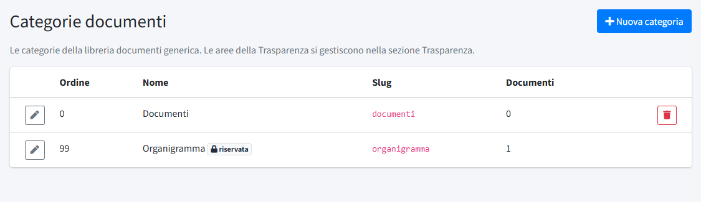

# Categorie documenti

In **Categorie documenti** (menu *Organizzazione*) si gestiscono le categorie della [Libreria documenti](../01-contenuti/06-libreria-documenti.md),
che servono a ritrovare i file nell'elenco e a filtrarli. Non sono visibili ai visitatori del sito. La sezione è riservata agli
amministratori.

L'elenco mostra l'**Ordine**, il **Nome**, lo **Slug** e il numero di **Documenti** di ogni categoria. L'installazione crea la categoria
**Documenti** (quella generica) e **Organigramma**.

## Categorie riservate

La categoria **Organigramma** è **riservata** e creata dal sistema: non si può eliminare e non compare nel menu a tendina quando si
carica un documento, perché ci finisce il file in automatico.

- **Organigramma**: contiene l'organigramma caricato dalla pagina [Struttura organizzativa](../01-contenuti/03-struttura-organizzativa.md),
  conservato come storico anche quando lo si toglie dalla pagina.

I documenti riservati ai soci (gli allegati delle [comunicazioni ai soci](../01-contenuti/07-comunicazioni-soci.md)) non passano da qui: vengono
caricati direttamente dalla comunicazione, si scaricano solo dopo l'accesso con il codice via email e non compaiono nella libreria
né in questo elenco.

## Creare o modificare una categoria

**Nuova categoria** apre il form con quattro campi:

- **Nome**: come compare nel pannello.
- **Slug**: l'identificativo interno, in lettere minuscole, numeri e trattini; deve essere unico.
- **Descrizione**: facoltativa.
- **Ordine**: la posizione nell'elenco e nel menu a tendina del form dei documenti (0 = prima).

Le aree della pagina pubblica *Trasparenza* non si gestiscono qui ma in [Aree Trasparenza](02-aree-trasparenza.md).
