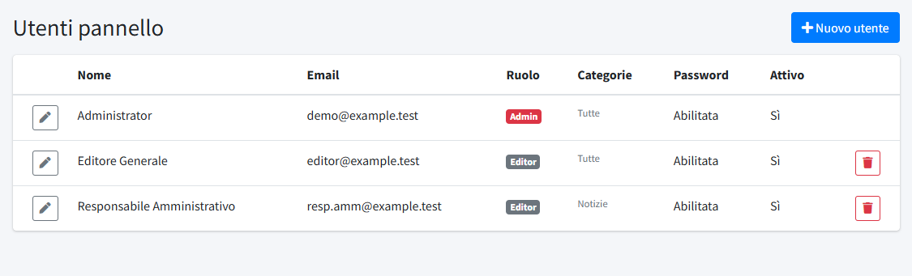
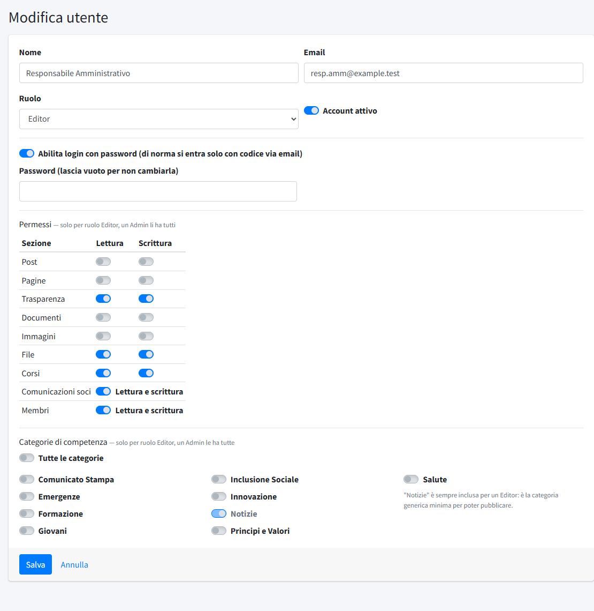

# Utenti

In **Utenti** (menu *Amministrazione*) si gestiscono le persone che accedono al pannello: **amministratori** ed **editor**. La sezione è
riservata agli amministratori.

## Amministratori ed editor

- **Amministratore**: accesso completo a tutte le sezioni del pannello.
- **Editor**: vede e modifica solo ciò che gli viene assegnato, tramite i **permessi** per sezione e le **categorie di competenza** (vedi
  sotto). Non vede le sezioni di configurazione: Struttura organizzativa, Dati del comitato, Categorie, Aree Trasparenza, Categorie
  documenti, Tipologie corso, Utenti, Sicurezza moduli, Informative privacy e Template email.

Non c'entrano con gli utenti dell'**area soci**, che sono i soci e accedono con il codice via email dopo essere stati inseriti in
[Membri](02-membri.md).

## L'elenco

Per ogni utente l'elenco mostra **Nome**, **Email**, **Ruolo**, le **Categorie** di competenza, se l'accesso con **Password** è abilitato e se
l'account è **Attivo**. **Nuovo utente** ne crea uno. Il primo amministratore, creato dall'installazione, è l'**amministratore protetto**:
non si può eliminare e il suo ruolo non si può cambiare (nome, email e password sì), perché ci sia sempre almeno un accesso completo.

## Creare o modificare un utente

- **Nome** ed **Email**: l'email è anche l'indirizzo a cui arriva il codice di accesso.
- **Ruolo**: Editor o Admin.
- **Account attivo**: se spento l'utente non può più entrare, ma l'account resta e si può riattivare.
- **Abilita login con password**: di norma si entra solo con il **codice via email**. Con questa opzione l'utente può accedere anche da
  `/admin/login/password`; in questo caso va impostata una **Password** (in modifica, lasciare il campo vuoto la lascia invariata). Senza
  un server di posta configurato l'accesso con la password è l'unico possibile: vedi [Configurazione del file .env](../../01-installazione/03-configurazione-env.md).

### Permessi

Solo per gli editor (un amministratore ha tutto). Per ogni sezione si sceglie **Lettura** (vede ma non cambia) e/o **Scrittura** (crea,
modifica, elimina):

| Permesso | Cosa consente |
|---|---|
| Post | i [post](../01-contenuti/01-post.md), limitatamente alle categorie di competenza |
| Pagine | le [pagine](../01-contenuti/02-pagine.md): testo, estratto, ordine e pubblicazione (struttura e codice embed restano agli amministratori) |
| Trasparenza | i documenti della sezione [Trasparenza](../01-contenuti/05-trasparenza.md) |
| Documenti | la [libreria documenti](../01-contenuti/06-libreria-documenti.md) |
| Corsi | i [corsi](../02-formazione/01-corsi.md), i loro iscritti e le [persone](../02-formazione/02-persone.md) |
| Comunicazioni soci, Membri | un unico permesso «Lettura e scrittura» per ciascuna delle due sezioni dell'area soci (le voci compaiono solo con l'area attiva) |

Le righe **Immagini** e **File** sono previste per usi futuri e oggi non controllano nessuna funzione.

### Categorie di competenza

Solo per gli editor. Decidono su quali **post** può lavorare: **Tutte le categorie** oppure un elenco preciso. La categoria **Notizie** è sempre
inclusa, perché è la categoria generica minima per poter pubblicare. Vedi [Categorie](../03-organizzazione/01-categorie.md).

## Eliminare un utente

L'eliminazione è definitiva. Il pannello la rifiuta per l'amministratore protetto, per il proprio account e per l'ultimo amministratore
rimasto. Per sospendere qualcuno senza perdere l'account basta disattivarlo.

Gli accessi di ogni utente sono registrati nel [Registro accessi](03-registro-accessi.md).
