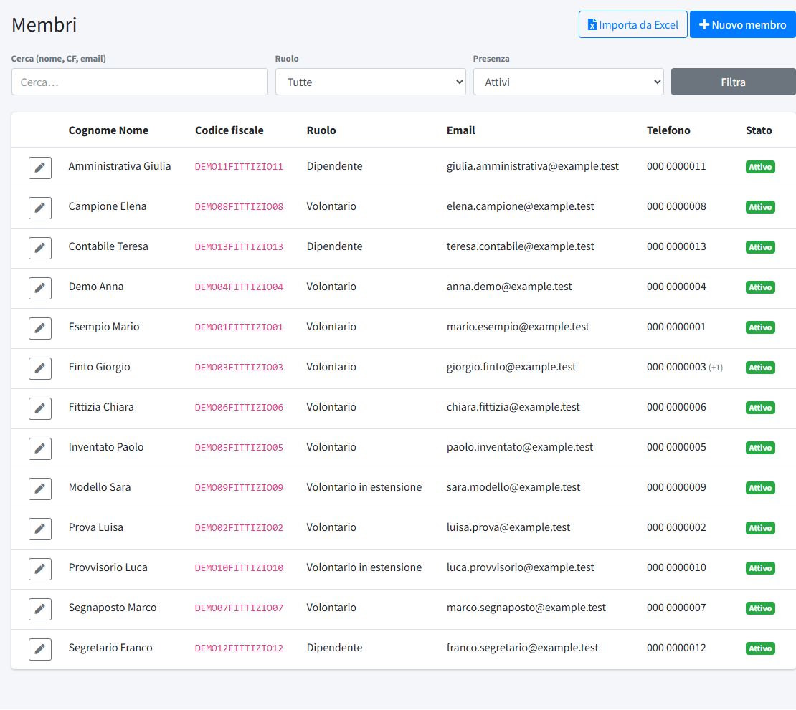
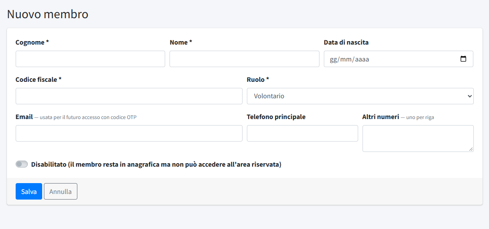
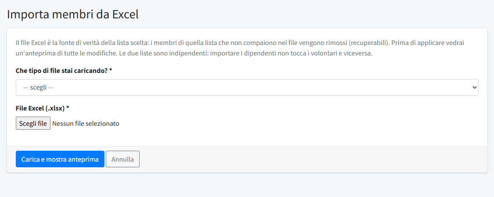

# Membri

In **Membri** (menu *Amministrazione*) si tiene l'elenco dei soci del comitato: volontari, volontari in estensione e dipendenti. La voce
compare solo se l'**area soci** è attiva (interruttore in [Dati del comitato](../01-contenuti/04-dati-del-comitato.md#area-soci)) e a chi ha il
permesso «Membri» (vedi [Utenti](01-utenti.md)).

L'elenco ha due scopi: è l'anagrafica del comitato, e decide **chi può accedere all'area riservata**: ogni socio con un indirizzo email e
non disabilitato riceve un **codice via email** per entrare e leggere le [comunicazioni](../01-contenuti/07-comunicazioni-soci.md). Non ci sono
password per i soci.

## L'elenco

L'elenco mostra **Cognome Nome**, **Codice fiscale**, **Ruolo**, **Email**, **Telefono** e **Stato**. In alto si cerca per nome, codice fiscale o
email e si filtra per **Ruolo** (volontario, volontario in estensione, dipendente) e per **Presenza**:

- **Attivi**: i membri in elenco e con accesso (è la vista di partenza);
- **Richiesta di disattivazione**: i soci che, dalla pagina «I miei dati» dell'area riservata, hanno chiesto di disattivare il proprio
  accesso: la richiesta va confermata da un amministratore;
- **Disabilitati**: restano in anagrafica ma non possono accedere;
- **Rimossi**: tolti dall'elenco, recuperabili con **Ripristina**;
- **Tutti**.

I membri non si cancellano mai definitivamente: «rimosso» vuol dire nascosto e senza accesso, e si può sempre ripristinare.

## Aggiungere o modificare un membro

**Nuovo membro** apre il form con **Cognome**, **Nome**, **Data di nascita**, **Codice fiscale** (unico, obbligatorio), **Ruolo**, **Email** (usata
per il codice di accesso; unica), **Telefono principale** e **Altri numeri** (uno per riga). **Disabilitato** lascia il membro in anagrafica ma
gli toglie l'accesso all'area riservata.

## Importare l'elenco da Excel

Il modo normale di popolare l'elenco è **Importa da Excel**, con i file esportati dal gestionale della Croce Rossa Italiana. Ci sono due
elenchi indipendenti: **Elenco dipendenti** ed **Elenco volontari (e volontari in estensione)**. Importare uno non tocca mai l'altro.

Il file deve essere un `.xlsx` (fino a 5 MB) con queste colonne, riconosciute dal nome dell'intestazione:

| Colonna | Obbligatoria | Note |
|---|---|---|
| Codice Fiscale | sì | 16 caratteri; le righe con codice non valido o duplicato nel file vengono saltate |
| Cognome, Nome | sì | |
| Tipo Attuale | sì | `Dipendente`, `Volontario` o `Volontario in estensione`; deve essere coerente con l'elenco scelto |
| Data di Nascita | no | nel formato `gg/mm/aaaa` |
| Email | no | se già usata da un altro membro, il membro viene creato senza email e l'anteprima lo segnala |
| Numeri di telefono | no | separati da virgola: il primo è il principale |

Le altre colonne vengono ignorate. Dopo aver scelto l'elenco e il file, **Carica e mostra anteprima** non salva nulla: mostra tutte le
operazioni che verrebbero eseguite, con filtri per tipo di operazione:

- **Nuovo**: il codice fiscale non esiste e il membro viene creato;
- **Cambio ruolo**: il membro esiste con un ruolo diverso, che viene aggiornato (nome, email e telefoni di un membro esistente **non** vengono
  mai sovrascritti dall'importazione: si cambiano a mano);
- **Ripristino**: un membro rimosso riappare nel file e torna attivo;
- **Rimosso**: un membro attivo dell'elenco scelto che **non compare più nel file** viene rimosso (recuperabile);
- **Invariato** ed **Errore**.

Dopo aver controllato l'anteprima si conferma. **Il file è la fonte di verità dell'elenco scelto**: chi manca viene rimosso. Per questo
l'importazione si ferma, senza modificare nulla, se il file è vuoto, se non ha righe valide o se contiene un «Tipo Attuale» che non appartiene
all'elenco scelto (per esempio un volontario nel file dei dipendenti): così un file sbagliato non può svuotare un elenco. Il file caricato
viene cancellato dal server dopo la conferma.
