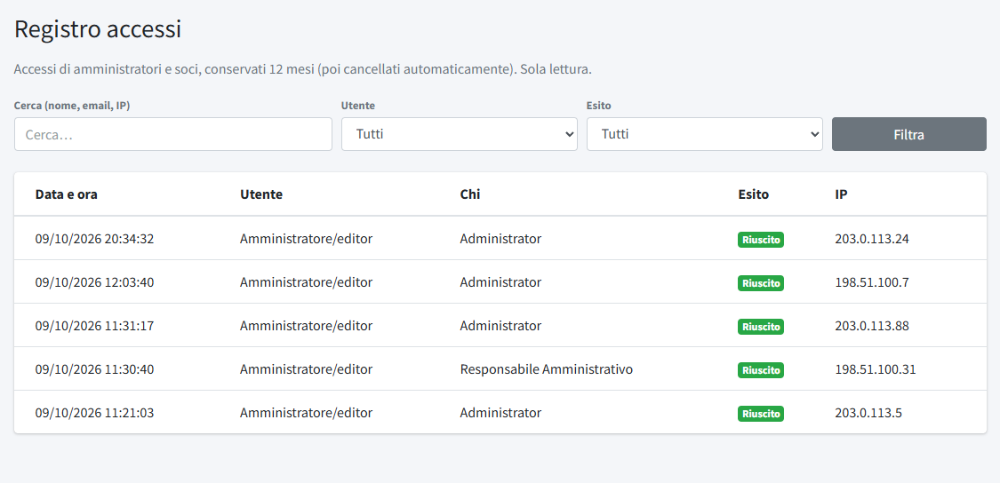

# Registro accessi

Il **Registro accessi** (menu *Amministrazione*) elenca gli accessi al pannello e all'area soci, riusciti e falliti. Serve a controllare chi è
entrato e a notare tentativi sospetti. È in **sola lettura** e i dati sono conservati per **12 mesi**, poi cancellati automaticamente.

*Gli indirizzi IP mostrati nell'immagine sono fittizi: appartengono agli intervalli riservati alla documentazione (203.0.113.0/24 e
198.51.100.0/24) e non corrispondono ad accessi reali.*

Ogni riga riporta la **data e ora**, il tipo di **utente** (amministratore o editor, oppure socio), **chi** è, l'**esito** (riuscito o
fallito) e l'**indirizzo IP** da cui è arrivata la richiesta. In alto si può cercare per nome, email o indirizzo IP, e filtrare per **Utente**
(tutti, amministratori/editor, soci) e per **Esito** (tutti, riusciti, falliti).

L'indirizzo IP è un dato personale: per questo il registro è accessibile solo agli amministratori, ha una durata limitata e il suo trattamento
è descritto nelle [informative privacy](05-informative-privacy.md).
