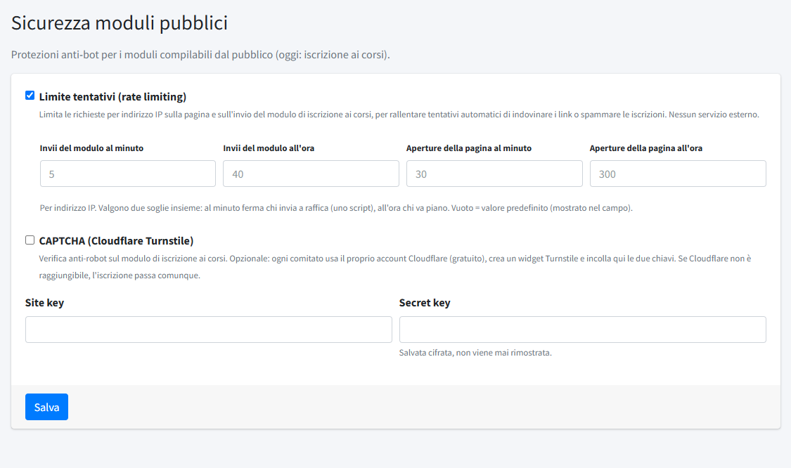

# Sicurezza moduli

In **Sicurezza moduli** (menu *Amministrazione*) si regolano le protezioni anti-bot dei moduli che il pubblico può compilare. Oggi il modulo
pubblico è quello di [iscrizione ai corsi](../02-formazione/01-corsi.md). La sezione è riservata agli amministratori.

NILES usa tre difese insieme. Le prime due non richiedono nessun servizio esterno.

## Campo trappola

Il modulo contiene un campo nascosto che un visitatore umano non vede e non compila, ma che i robot spesso riempiono: un invio con quel campo
compilato viene scartato. È sempre attivo e non ha impostazioni.

## Limite tentativi (rate limiting)

Limita le richieste per **indirizzo IP** sulla pagina di iscrizione e sull'invio del modulo, per rallentare chi prova a indovinare i link dei
corsi o a riempire le iscrizioni di spam. Si accende e si spegne con la spunta **Limite tentativi**. Valgono **due soglie insieme** per
ciascuna azione: quella al minuto ferma chi invia a raffica (uno script), quella all'ora chi procede lentamente.

| Campo | Valore predefinito |
|---|---|
| Invii del modulo al minuto | 5 |
| Invii del modulo all'ora | 40 |
| Aperture della pagina al minuto | 30 |
| Aperture della pagina all'ora | 300 |

I campi accettano valori da 1 a 1000; lasciandoli vuoti vale il predefinito (che il campo mostra in grigio). Ogni invio conta, anche quelli
respinti perché incompleti. Un visitatore che supera il limite vede una pagina che lo invita a riprovare tra qualche minuto, con i recapiti del
comitato. I valori predefiniti vanno bene per quasi tutti i comitati: conviene alzarli solo se più persone iscritte dalla stessa rete (una scuola, un'azienda)
vengono bloccate.

## CAPTCHA (Cloudflare Turnstile)

Una verifica anti-robot facoltativa e gratuita sul modulo di iscrizione. Ogni comitato usa il **proprio account Cloudflare**:

1. Nel pannello di Cloudflare, nella sezione *Turnstile*, si crea un **widget** per il dominio del sito.
2. Cloudflare fornisce due chiavi: la **Site key** (pubblica) e la **Secret key** (riservata).
3. Si incollano qui nei campi **Site key** e **Secret key**, si spunta **CAPTCHA (Cloudflare Turnstile)** e si salva.

La Secret key viene salvata **cifrata** e non viene mai rimostrata nel pannello: per cambiarla si incolla di nuovo. Se Cloudflare non è
raggiungibile al momento dell'invio, l'iscrizione passa comunque, per non bloccare chi vuole iscriversi.

Per capire quando conviene attivarlo: il campo trappola e il limite tentativi bastano per la maggior parte dei casi; il CAPTCHA serve se compaiono
iscrizioni false nonostante queste difese.
