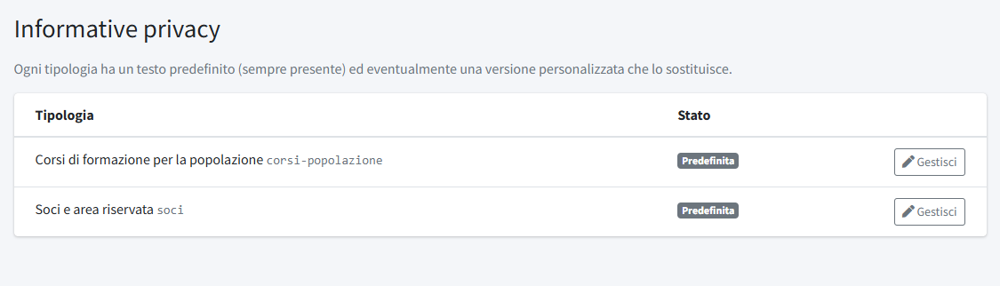
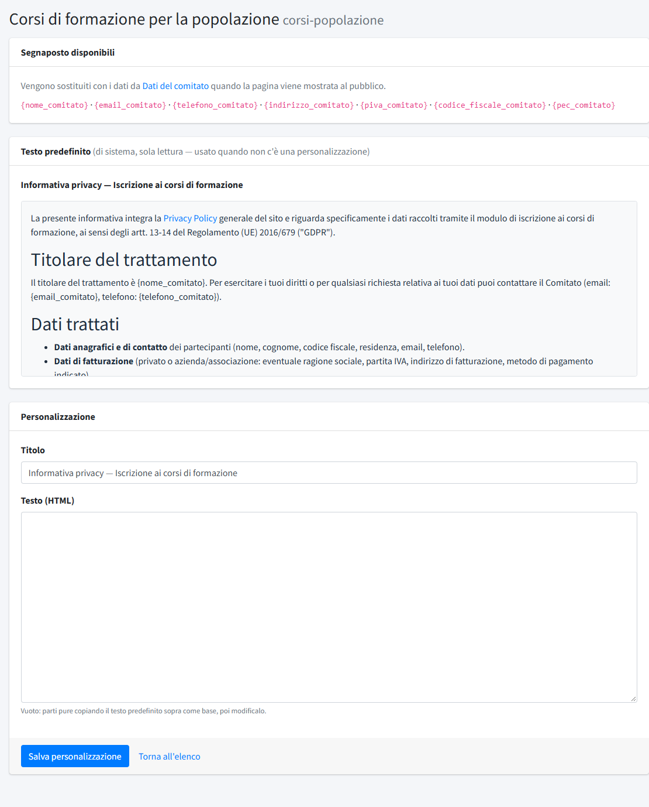

# Informative privacy

In **Informative privacy** (menu *Amministrazione*) si gestiscono i testi delle informative sul trattamento dei dati che il sito mostra a chi
compila un modulo o usa un servizio. La sezione è riservata agli amministratori.

> Le pagine generali **Privacy Policy** e **Cookie Policy**, linkate nel piè di pagina, sono invece normali pagine di sistema: si modificano
> da [Pagine](../01-contenuti/02-pagine.md).

L'installazione crea due informative, una per ciascuna tipologia di trattamento:

- **Corsi di formazione per la popolazione**: mostrata nel modulo di iscrizione ai [corsi](../02-formazione/01-corsi.md);
- **Soci e area riservata**: riguarda i dati dei soci e l'accesso all'area riservata (vedi [Membri](02-membri.md)).

Ogni tipologia ha un **testo predefinito**, sempre presente, e può avere una **versione personalizzata** che lo sostituisce. La colonna
**Stato** indica quale è in uso («Predefinita» o «Personalizzata»); **Gestisci** apre la tipologia.

> I testi predefiniti sono una **bozza**: non sono stati rivisti da un legale. Vanno letti e adattati prima di aprire i moduli al pubblico
> (titolare del trattamento, destinatari reali, tempi di conservazione).

## Personalizzare un'informativa

La pagina mostra tre blocchi:

1. **Segnaposto disponibili**: parole tra graffe che il sito sostituisce con i dati di [Dati del comitato](../01-contenuti/04-dati-del-comitato.md)
   quando la pagina viene mostrata: `{nome_comitato}`, `{email_comitato}`, `{telefono_comitato}`, `{indirizzo_comitato}`, `{piva_comitato}`,
   `{codice_fiscale_comitato}` e `{pec_comitato}`. Conviene usarli al posto dei dati scritti a mano, così un cambio di indirizzo si riflette
   da solo.
2. **Testo predefinito**: il testo di sistema, in sola lettura. Serve come base: lo si può copiare nel campo sotto.
3. **Personalizzazione**: **Titolo** e **Testo (HTML)** della versione del comitato. **Salva personalizzazione** la attiva al posto del
   predefinito; **Rimuovi personalizzazione** (con conferma) la elimina e torna al testo di sistema, che non viene mai toccato.

Con la personalizzazione attiva, il sito mostra quella; il predefinito resta come riferimento e per tornare indietro.
