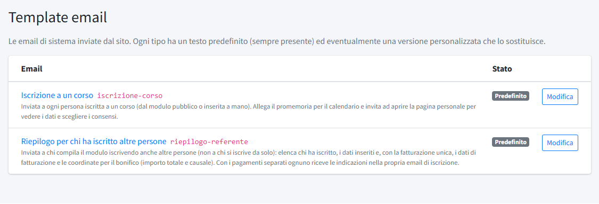
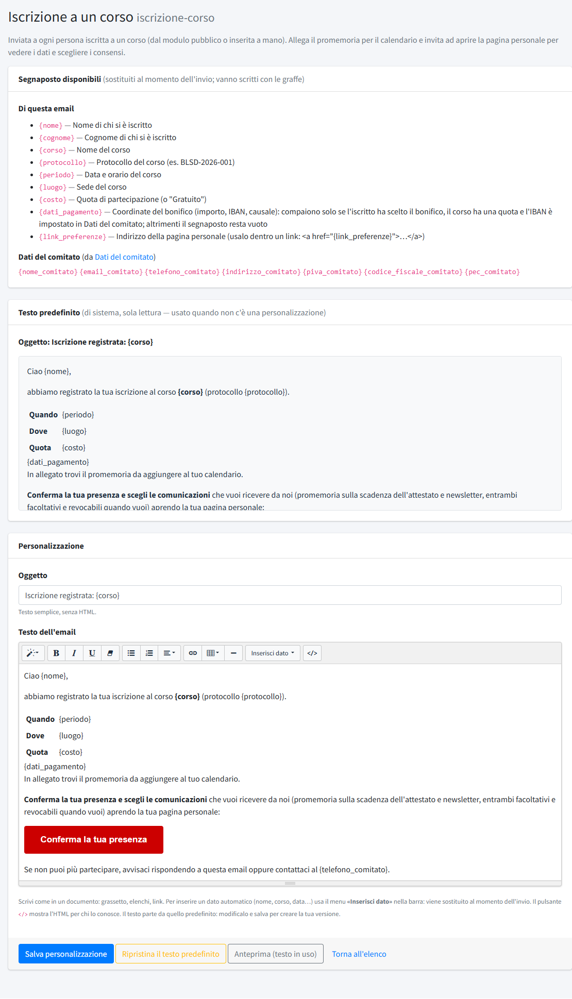

# Template email

In **Template email** (menu *Amministrazione*) si modificano i testi delle email di sistema che il sito invia a nome del comitato. La
sezione è riservata agli amministratori. Perché le email partano davvero serve un server di posta configurato: vedi
[Configurazione del file .env](../../01-installazione/03-configurazione-env.md#posta-in-uscita).

Le email di sistema sono due, entrambe legate alle iscrizioni ai [corsi](../02-formazione/01-corsi.md):

- **Iscrizione a un corso**: inviata a ogni persona iscritta (dal modulo pubblico o inserita a mano). Allega il promemoria per il
  calendario e invita ad aprire la pagina personale per vedere i dati e scegliere i consensi.
- **Riepilogo per chi ha iscritto altre persone**: inviata a chi compila il modulo iscrivendo anche altri (non a chi si iscrive da solo).
  Elenca chi ha iscritto, i dati inseriti e, con la fatturazione unica, i dati di fatturazione e le coordinate per il bonifico.

Per ogni email l'elenco indica se è in uso il testo **Predefinito** o uno **Personalizzato**. Il testo predefinito è sempre disponibile e non
viene mai perso.

## Modificare un'email

La pagina di una email mostra, dall'alto:

- **Segnaposto disponibili**: i dati che il sito inserisce al momento dell'invio, scritti **con le graffe**. Per l'iscrizione al corso:
  `{nome}`, `{cognome}`, `{corso}`, `{protocollo}`, `{periodo}` (data e orario), `{luogo}`, `{costo}` (o «Gratuito»), `{dati_pagamento}` e
  `{link_preferenze}`; più i dati del comitato (`{nome_comitato}`, `{email_comitato}`, `{telefono_comitato}`, `{indirizzo_comitato}`,
  `{piva_comitato}`, `{codice_fiscale_comitato}`, `{pec_comitato}`), presi da [Dati del comitato](../01-contenuti/04-dati-del-comitato.md).
  `{dati_pagamento}` compare solo se l'iscritto ha scelto il bonifico, il corso ha una quota e l'IBAN è impostato; altrimenti resta vuoto.
  `{link_preferenze}` è l'indirizzo della pagina personale e va usato dentro un collegamento.
- **Testo predefinito**: il testo di sistema, in sola lettura.
- **Personalizzazione**: l'**Oggetto** (testo semplice) e il **Testo dell'email**, scritto in un editor come un documento (grassetto, elenchi,
  collegamenti). Per inserire un dato automatico si usa il menu **Inserisci dato** nella barra dell'editor; il pulsante `</>` mostra
  l'HTML per chi lo conosce.

I pulsanti in fondo:

- **Salva personalizzazione**: attiva il testo scritto al posto del predefinito.
- **Ripristina il testo predefinito**: carica nell'editor il testo originale; non salva nulla finché non si preme «Salva personalizzazione».
- **Anteprima (testo in uso)**: apre in una nuova scheda l'email come viene composta con il testo in uso.
- **Rimuovi personalizzazione**: elimina subito la versione del comitato e torna al predefinito.
