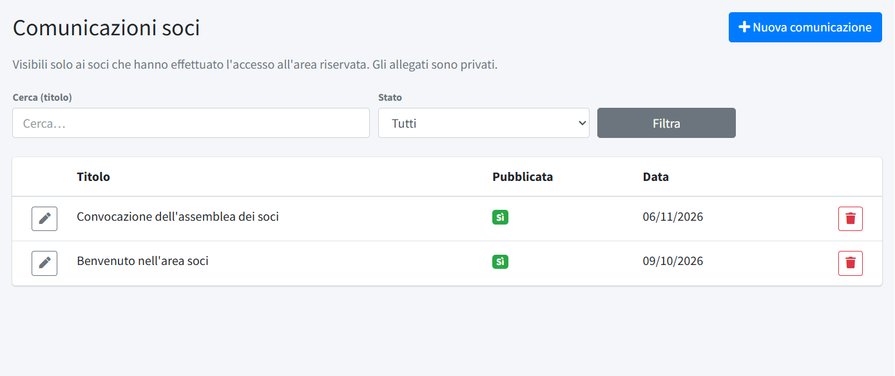
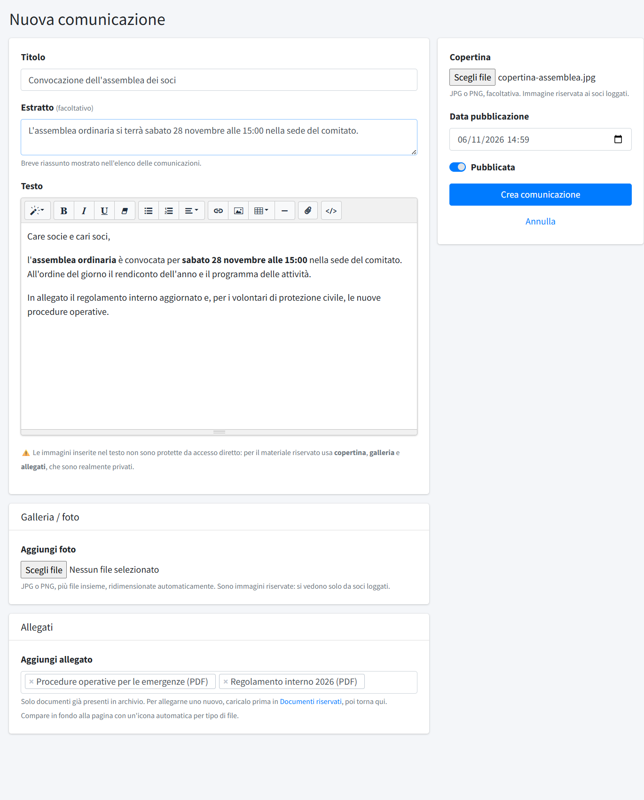

# Comunicazioni soci

In **Comunicazioni soci** (menu *Area soci*) si scrivono gli avvisi interni del comitato, visibili **solo ai soci** che hanno fatto
l'accesso all'area riservata. A differenza dei [post](../02-contenuti/01-post.md) non sono pubbliche: non compaiono in home, negli
archivi, nella mappa del sito né nei motori di ricerca. La voce del menu c'è solo se l'**area soci** è attiva (interruttore in
*Configurazione → Funzioni attive*) e per chi ha il permesso «Comunicazioni soci», che comprende anche
[documenti](03-documenti-riservati.md) e [categorie riservate](04-categorie-riservate.md). Chi può accedere è deciso in
[Membri](01-membri.md).

## L'elenco

L'elenco mostra **Titolo**, se la comunicazione è **Pubblicata** e la **Data**; in alto si cerca per titolo e si filtra per **Stato**
(tutte, solo pubblicate, solo bozze). **Nuova comunicazione** ne crea una e il cestino la elimina. L'installazione crea una comunicazione
di benvenuto, che spiega ai soci come funziona l'area riservata: va riletta e adattata.

## Scrivere una comunicazione

- **Titolo** ed **Estratto** (facoltativo): l'estratto è un breve riassunto mostrato nell'elenco delle comunicazioni.
- **Testo**: lo stesso editor dei post. ⚠️ Le immagini inserite nel testo **non sono protette**: chi conosce il loro indirizzo le apre
  anche senza accesso. Per le immagini riservate si usano copertina e galleria.
- **Copertina** (facoltativa, JPG o PNG): compare in cima alla comunicazione. È un'immagine **privata**: la vedono solo i soci che hanno
  fatto l'accesso. **Rimuovi copertina** la toglie.
- **Galleria / foto**: **Aggiungi foto** carica più immagini insieme, ridimensionate automaticamente e anche queste private. Per le foto
  già caricate si cambiano l'ordine o si spunta «elimina».
- **Allegati**: si scelgono tra i [documenti riservati](03-documenti-riservati.md) già caricati; per allegarne uno nuovo lo si carica
  prima in *Documenti riservati* e poi si torna qui. Ogni socio vede **solo gli allegati che il suo accesso consente**: un documento di
  una categoria che non gli è assegnata non compare nella sua pagina, anche se è allegato. Togliere un allegato o eliminare la
  comunicazione non cancella il documento.
- **Data pubblicazione**: la data mostrata ai soci e usata per l'ordinamento (dalla più recente). Una data futura rende la
  comunicazione visibile solo da quel momento.
- **Pubblicata**: se spenta, la comunicazione è una bozza e i soci non la vedono.

**Salva** (o **Crea comunicazione**) registra le modifiche.

## Come la vedono i soci

Dopo l'accesso il socio trova **Comunicazioni** nel menu *Area Soci* del sito: l'elenco delle comunicazioni pubblicate, dalla più
recente, e il dettaglio con copertina, testo, galleria e allegati. Le pagine sono descritte in
[L'area soci vista dal socio](05-area-soci-dal-socio.md). Se l'area soci viene spenta, la sezione non è più raggiungibile ma le
comunicazioni restano salvate.
