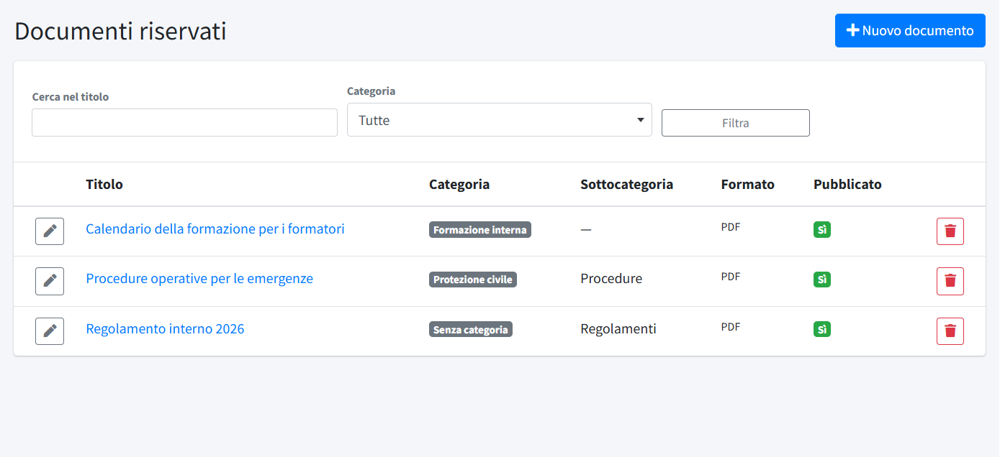
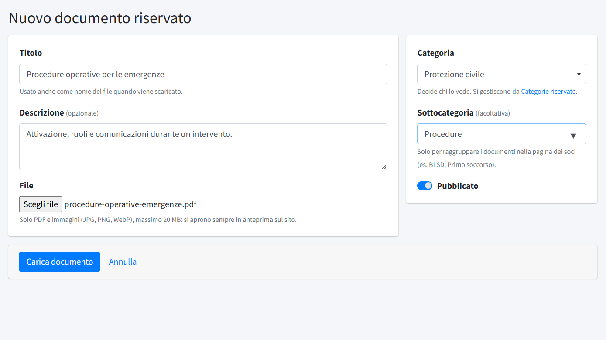

# Documenti riservati

In **Documenti riservati** (menu *Area soci*) si caricano i documenti che solo i soci possono consultare: regolamenti, procedure,
materiali dei gruppi. Non sono pubblici: non compaiono nella [Libreria documenti](../02-contenuti/05-libreria-documenti.md), in
Trasparenza né nei motori di ricerca, e i file stanno in una cartella del server non raggiungibile dal web. Serve il permesso
«Comunicazioni soci».

**Chi vede un documento lo decide la sua categoria:**

- i documenti **«Senza categoria»** sono visibili a **tutti** i soci con accesso;
- quelli di un'altra [categoria riservata](04-categorie-riservate.md) solo ai soci a cui quella categoria è assegnata (scheda del socio
  in [Membri](01-membri.md)).

## L'elenco

L'elenco mostra **Titolo**, **Categoria**, **Sottocategoria**, **Formato** e se il documento è **Pubblicato**; in alto si cerca nel titolo e si
filtra per categoria. **Nuovo documento** ne carica uno; a ogni riga la matita lo modifica e il cestino lo elimina (con il file e i
collegamenti alle comunicazioni).

## Caricare un documento

- **Titolo**: usato anche come nome del file quando il socio lo scarica.
- **Descrizione**: facoltativa, mostrata sotto il titolo.
- **File**: **solo PDF e immagini** (JPG, PNG, WebP), fino a 20 MB, perché i documenti riservati si aprono sempre in anteprima. In
  modifica, un nuovo file sostituisce quello attuale.
- **Categoria**: decide chi lo vede (vedi sopra).
- **Sottocategoria** (facoltativa): un'etichetta libera che raggruppa i documenti dentro la categoria nella pagina dei soci, per esempio
  «Procedure» o «Regolamenti». Mentre si scrive vengono proposte quelle già usate. Non cambia chi vede il documento.
- **Pubblicato**: se spento, il documento resta nel pannello ma i soci non lo vedono.

Un documento riservato si può anche **allegare a una comunicazione** (vedi [Comunicazioni soci](02-comunicazioni-soci.md)): ogni socio vede
l'allegato solo se la categoria del documento gli è consentita.

## Consultazione e registro

Il socio apre i documenti dalla pagina **Documenti** dell'area riservata, sempre prima in **anteprima**; per salvarlo usa il pulsante
**Scarica** (vedi [L'area soci vista dal socio](05-area-soci-dal-socio.md)). Ogni anteprima e ogni download vengono annotati nel
[Registro download](../08-utenti-e-controllo/03-registro-download.md), con il socio, il documento e l'ora.
