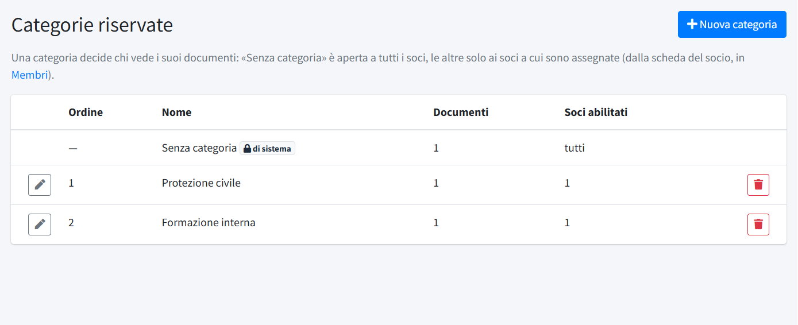
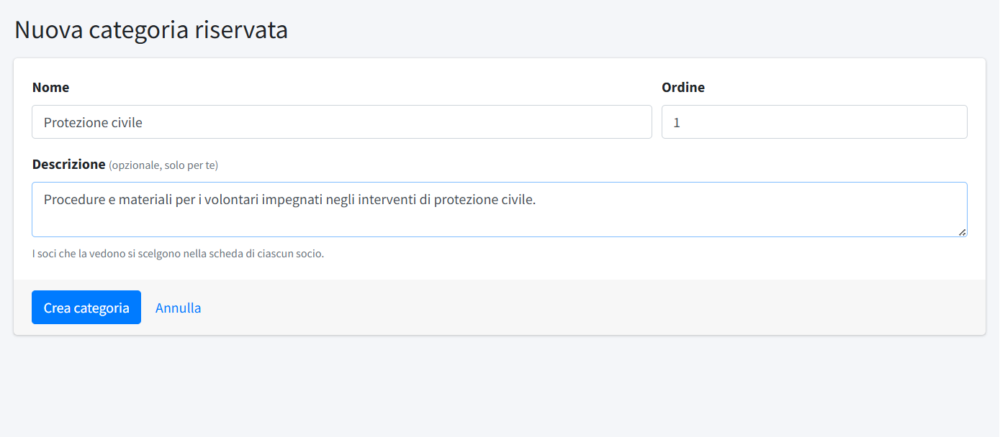

# Categorie riservate

In **Categorie riservate** (menu *Area soci*) si creano i gruppi che decidono **quali soci vedono quali documenti riservati**: per
esempio «Protezione civile» per i volontari di quel settore, «Formazione interna» per istruttori e formatori. Serve il permesso
«Comunicazioni soci».

Il meccanismo è semplice:

1. si crea la categoria qui;
2. si caricano i [documenti riservati](03-documenti-riservati.md) in quella categoria;
3. nella scheda di ogni socio interessato, in [Membri](01-membri.md), si spunta la categoria.

Un socio vede i documenti **«Senza categoria»**, visibili a tutti, più quelli delle categorie che gli sono assegnate. Il ruolo del socio
(volontario, dipendente) non conta.

## L'elenco

L'elenco mostra **Ordine**, **Nome**, numero di **Documenti** e di **Soci abilitati**. La prima riga è **Senza categoria**, la categoria di
sistema per i documenti visibili a tutti: non si modifica, non si elimina e non si assegna (vale per tutti i soci).

## Creare o modificare una categoria

- **Nome**: come compare ai soci nella pagina dei documenti.
- **Ordine**: la posizione nella pagina dei documenti (le categorie si mostrano in quest'ordine, dopo «Senza categoria»).
- **Descrizione**: facoltativa, una nota per chi gestisce il pannello; i soci non la vedono.

I soci che vedono la categoria si scelgono nella scheda di ciascun socio, non da qui.

## Eliminare una categoria

Una categoria si elimina solo quando non contiene più documenti: prima si spostano o si eliminano. Eliminandola, le assegnazioni ai soci
vengono tolte.
