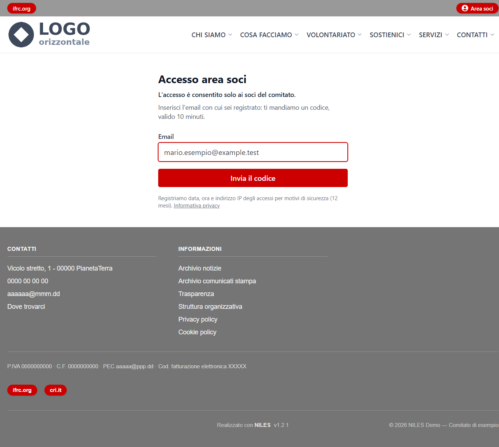
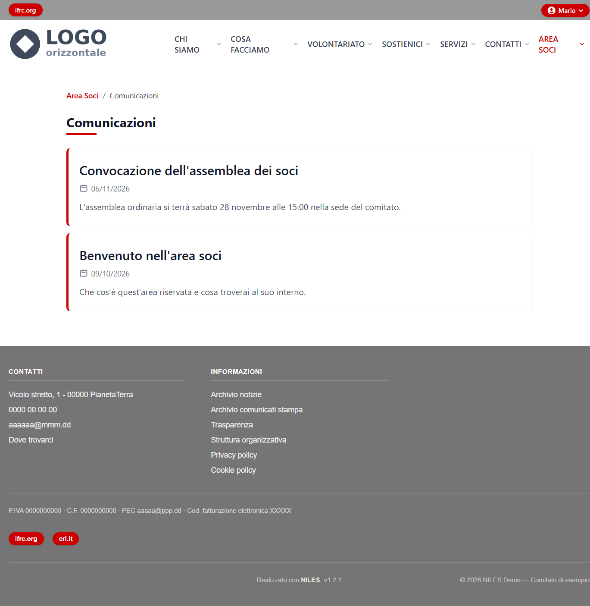
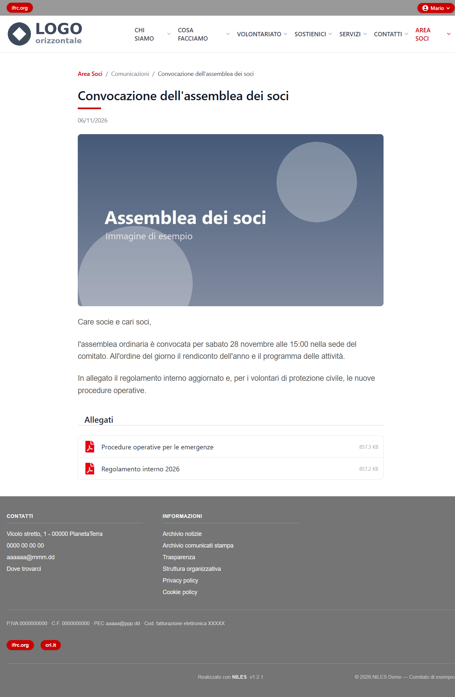
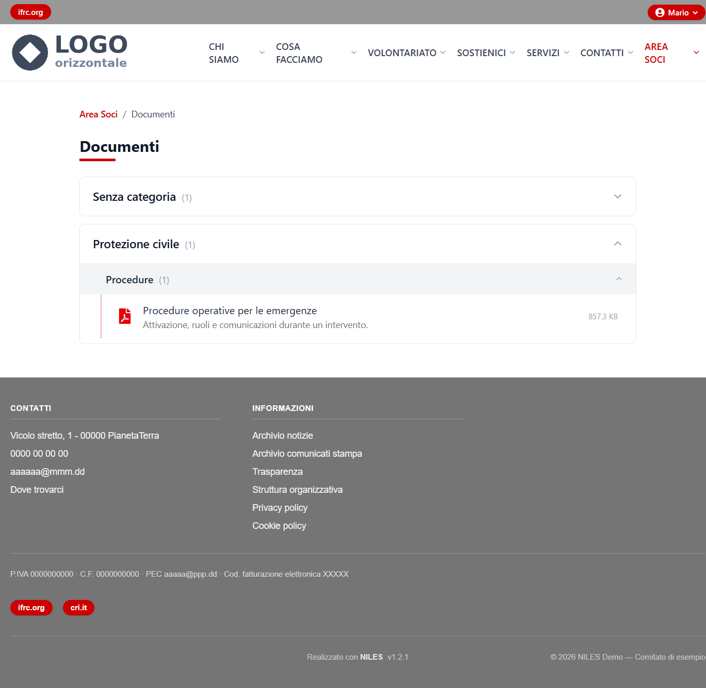
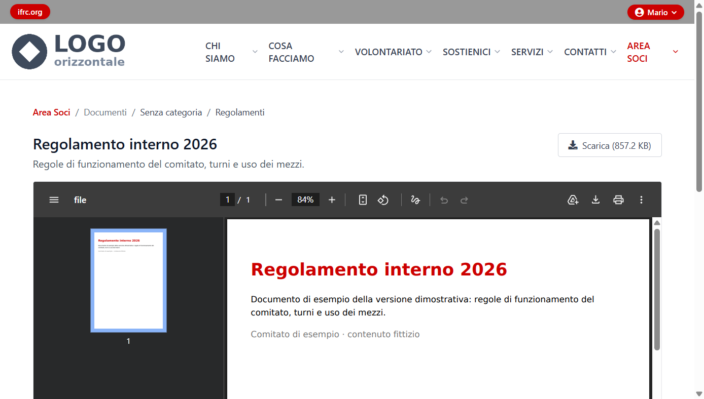
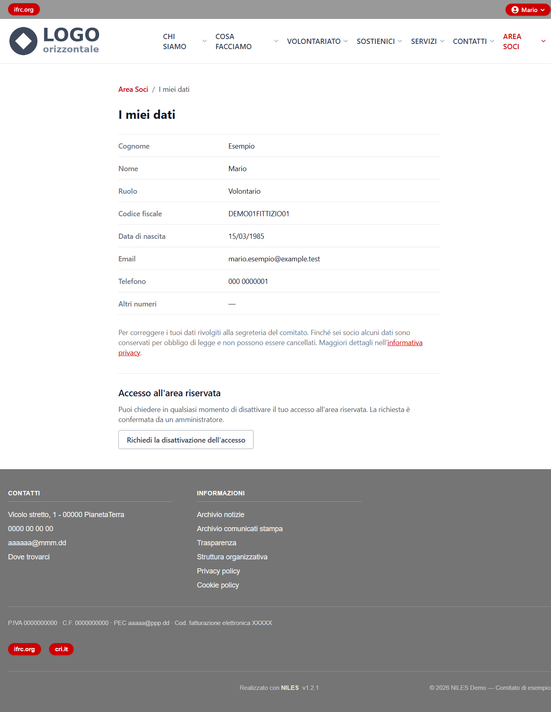

# L'area soci vista dal socio

Che cosa vede un socio nell'area riservata del sito e come la usa. Serve a chi gestisce il pannello per rispondere ai soci che chiedono
aiuto. L'area esiste solo se è attiva (*Configurazione → Funzioni attive*); chi può entrare è deciso in [Membri](01-membri.md).

## Entrare

Il pulsante **Area soci**, in alto a destra in ogni pagina del sito, porta alla pagina di accesso (`https://<dominio>/soci/accedi`).

1. Il socio scrive la propria email, quella registrata in *Membri*, e preme **Invia il codice**.

   

2. Riceve un codice di **6 cifre**, valido **10 minuti**, lo scrive e preme **Accedi**.

   

Dopo l'accesso torna sul sito: in alto a destra compare il suo nome, con **I miei dati** ed **Esci**, e nel menu del sito la voce
**Area Soci** con *Comunicazioni* e *Documenti*. Non ci sono password.

Come per il pannello, la pagina risponde allo stesso modo anche se l'email non corrisponde a nessun socio: così non rivela chi è
iscritto.

## Comunicazioni

L'elenco delle [comunicazioni](02-comunicazioni-soci.md) pubblicate, dalla più recente, con l'estratto. Aprendone una si vedono
copertina, testo, galleria e allegati: tra gli allegati compaiono solo i documenti che quel socio può vedere.

## Documenti

I [documenti riservati](03-documenti-riservati.md) visibili al socio, divisi per categoria (prima «Senza categoria», poi quelle che gli
sono assegnate) e, dentro, per sottocategoria. Le categorie si aprono una alla volta con un clic. Ogni socio vede soltanto le categorie
che contengono documenti per lui: due soci con categorie diverse vedono elenchi diversi.

Un documento si apre sempre in **anteprima**, con titolo, descrizione e il pulsante **Scarica** per salvarlo.

## I miei dati

La pagina mostra in sola lettura i dati del socio: cognome, nome, ruolo, codice fiscale, data di nascita, email e telefoni. Per correggerli
il socio si rivolge alla segreteria, che li modifica in *Membri*. Da qui può anche **chiedere di disattivare il proprio accesso**: la
richiesta compare in *Membri* con il filtro «Richiesta di disattivazione» e la conferma un amministratore.

## Domande frequenti dei soci

| Il socio dice… | Cosa controllare |
|---|---|
| «Non mi arriva il codice» | Che l'email in *Membri* sia proprio quella che usa e che il socio non sia **disabilitato** o **rimosso**; poi la posta indesiderata. Il codice vale 10 minuti: dopo se ne chiede uno nuovo. Se non arriva a nessuno, la [posta in uscita](../06-configurazione/02-posta-in-uscita.md) del sito non funziona. |
| «Codice non valido» | È sbagliato, scaduto o già usato: si richiede un nuovo codice, vale sempre l'ultimo. |
| «Non vedo un documento» | Che sia **pubblicato** e che la sua categoria sia assegnata al socio nella scheda in *Membri* (i documenti «Senza categoria» li vedono tutti). |
| «Non vedo l'area soci» | Che l'area sia attiva in *Funzioni attive*. |
| «I miei dati sono sbagliati» | Si correggono in *Membri*; l'importazione da Excel non sovrascrive nome, email e telefoni di un socio già presente. |
