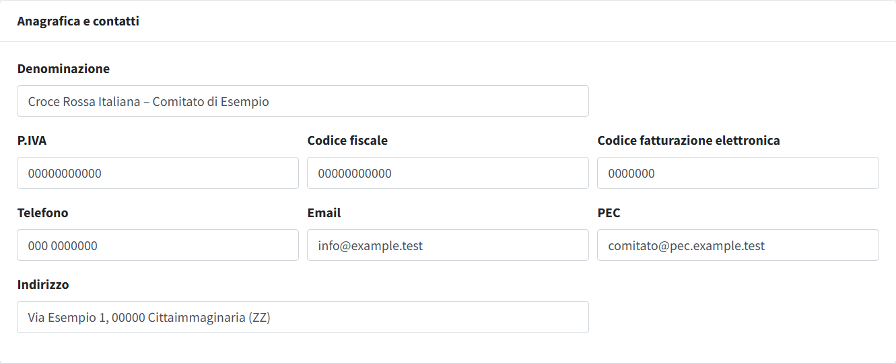
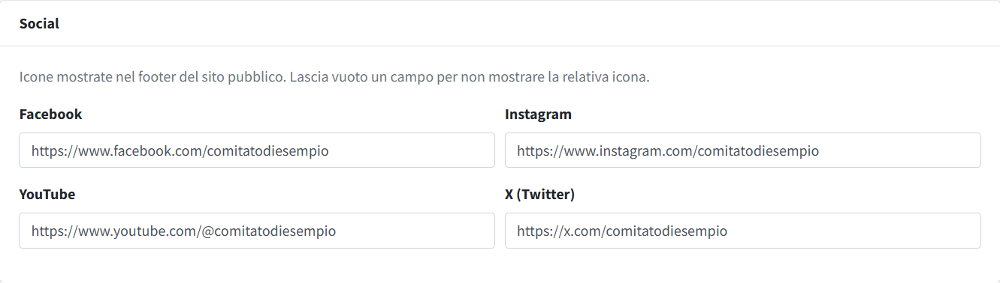

# Dati del comitato

In **Dati del comitato** (menu *Comitato e sito*, riservato agli amministratori) si inseriscono nome, contatti e profili social del
comitato, che compaiono in tutto il sito. È la prima pagina da compilare dopo l'installazione. I campi lasciati vuoti non vengono
mostrati. **Salva** registra solo i campi di questa pagina.

Gli altri dati del comitato sono in pagine proprie dello stesso gruppo: [Loghi e immagini](02-loghi-e-immagini.md),
[Coordinate e pagamenti](03-coordinate-e-pagamenti.md) e [Link del footer](04-link-del-footer.md); le funzioni facoltative (area soci,
pagamenti dei corsi, statistiche) si accendono in [Funzioni attive](../06-configurazione/01-funzioni-attive.md).

> Il nome del sito nel titolo delle pagine (`APP_PUBLIC_NAME`) si imposta nel file `.env`, non qui: vedi
> [Configurazione del file .env](../00-installazione/03-configurazione-env.md).

## Anagrafica e contatti

| Campo | Uso |
|---|---|
| **Denominazione** | nome ufficiale del comitato: piè di pagina, copyright, dati per i motori di ricerca, informative ed email (segnaposto `{nome_comitato}`); se vuota si usa il nome del sito |
| **P.IVA**, **Codice fiscale**, **Codice fatturazione elettronica** | riga dei dati fiscali in fondo al piè di pagina; anche le informative |
| **Telefono**, **Email** | blocco «Contatti» del piè di pagina; segnaposto nelle informative ed email |
| **PEC** | riga dei dati fiscali in fondo al piè di pagina; segnaposto nelle informative ed email |
| **Indirizzo** | blocco «Contatti» del piè di pagina; è anche la «Sede del comitato» proposta nei [corsi](../03-formazione/01-corsi.md) |

Questi dati alimentano i testi con segnaposto (`{email_comitato}`, `{telefono_comitato}` e simili) delle
[informative privacy](05-informative-privacy.md) e dei [template email](06-template-email.md).

## Social

Facebook, Instagram, YouTube e X: incolla l'indirizzo completo del profilo (con `https://`). Le icone compaiono nel piè di pagina solo
per i social compilati.
