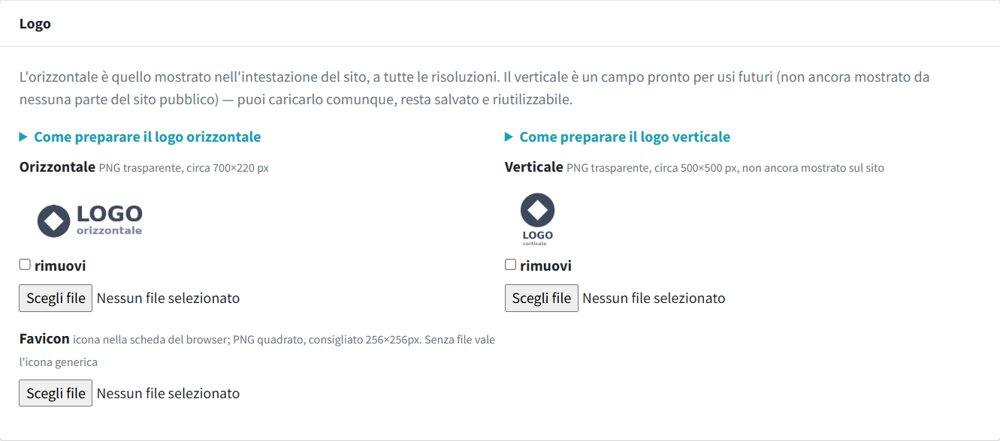
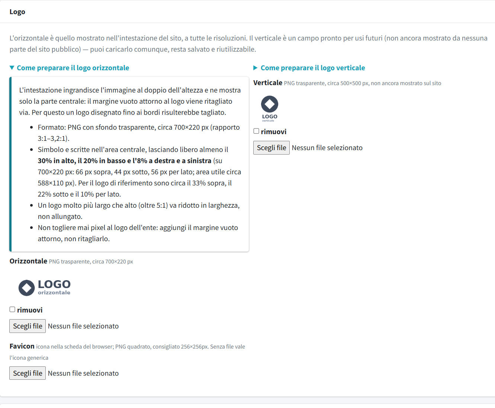
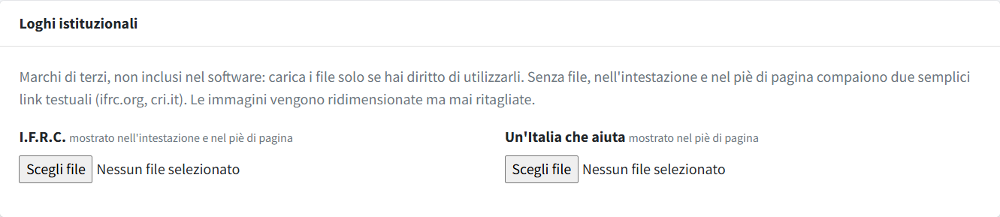

# Loghi e immagini

In **Loghi e immagini** (menu *Comitato e sito*, riservato agli amministratori) si caricano il logo del comitato, la favicon e i loghi
istituzionali. **Salva** registra solo le immagini di questa pagina. Formati, dimensioni e pesi di tutte le immagini del sito sono in
[Immagini e file](../01-primi-passi/03-immagini-e-file.md).

## Logo e favicon

| Campo | Dove compare | Formato consigliato |
|---|---|---|
| **Logo orizzontale** | intestazione del sito, anteprima sui social quando manca una copertina | PNG trasparente, circa 700×220 px, con margine vuoto attorno |
| **Logo verticale** | non ancora mostrato sul sito: caricalo comunque, resta salvato | PNG trasparente, circa 500×500 px |
| **Favicon** | icona nella scheda del browser; senza file vale un'icona generica | PNG quadrato, 256×256 px |

Sopra i due campi dei loghi ci sono due sezioni chiuse, «Come preparare il logo orizzontale» e «Come preparare il logo verticale»:
aprendole compaiono dimensioni e margini da rispettare.

**Il logo orizzontale va preparato con il margine vuoto indicato**, perché l'intestazione lo ingrandisce e ritaglia il bordo: un logo
disegnato fino ai bordi verrebbe tagliato.

Per rimuovere un'immagine spunta **rimuovi** accanto all'anteprima e salva.

## Loghi istituzionali

**I.F.R.C.** (mostrato nell'intestazione e nel piè di pagina) e **Un'Italia che aiuta** (nel piè di pagina) sono facoltativi. Senza
file, al loro posto compare un semplice collegamento rosso al sito ufficiale. Usa immagini orizzontali con sfondo trasparente e, per
il piè di pagina che è scuro, una versione chiara. Non modificare i loghi ufficiali: ridimensionali soltanto.
