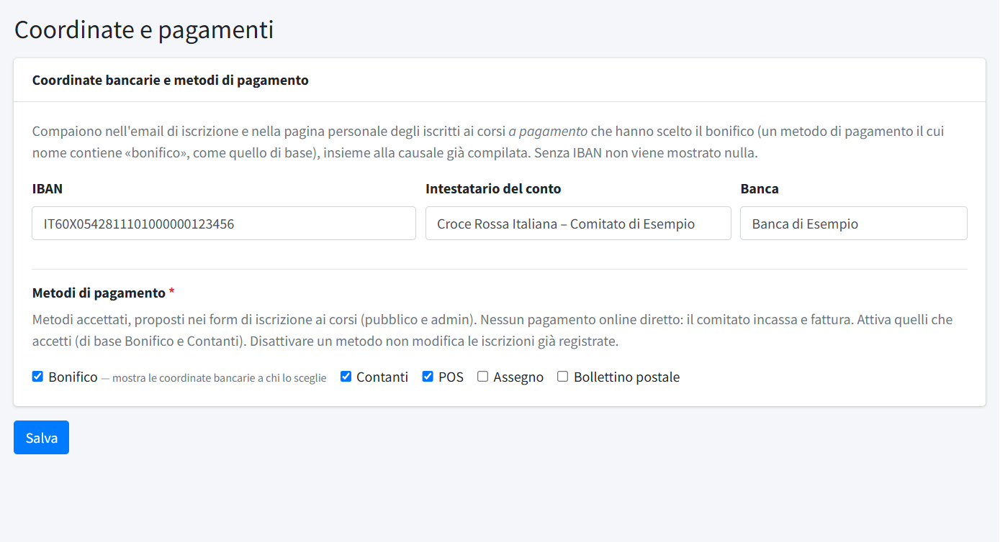

# Coordinate e pagamenti

In **Coordinate e pagamenti** (menu *Comitato e sito*, riservato agli amministratori) si indicano il conto del comitato e i metodi di
pagamento accettati per i [corsi](../03-formazione/01-corsi.md) a pagamento. **Salva** registra solo i campi di questa pagina.

- **IBAN**, **Intestatario del conto** (se vuoto si usa la denominazione) e **Banca**. L'IBAN si può scrivere a gruppi di quattro: viene
  controllato nel formato e salvato senza spazi.
- **Metodi di pagamento**: quali offrire a chi si iscrive a un corso (bonifico, contanti, POS, assegno, bollettino postale). Di partenza
  sono attivi bonifico e contanti; ne serve almeno uno. Non c'è nessun pagamento online: il comitato incassa e fattura.

A chi sceglie il **bonifico** per un corso a pagamento le coordinate (IBAN, intestatario, banca e causale già compilata) vengono mostrate
nell'email di iscrizione e nella pagina personale dell'iscritto, ma solo se l'IBAN è compilato (vedi
[Iscrizione dal sito](../03-formazione/05-iscrizione-dal-sito.md)). Disattivare un metodo non modifica le iscrizioni già registrate.

Fatture e incassi si registrano in [Pagamenti corsi](../03-formazione/03-pagamenti-corsi.md).
