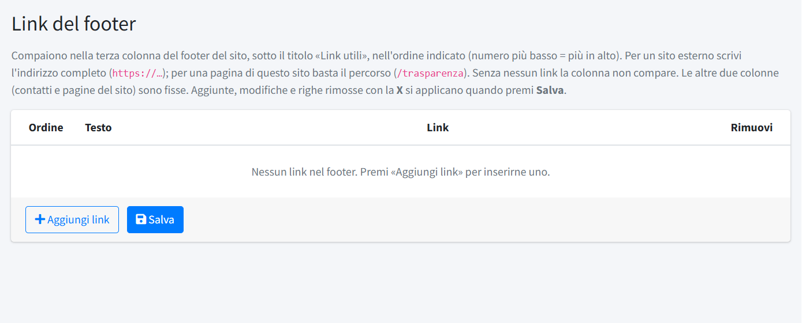

# Link del footer

In **Link del footer** (menu *Comitato e sito*, riservato agli amministratori) si compone la terza colonna del piè di pagina del sito,
**«Link utili»**: collegamenti a siti esterni (la Croce Rossa nazionale, il comitato regionale, servizi del territorio) o a pagine del
sito.

Il piè di pagina ha tre colonne: **Contatti** (dai [dati del comitato](01-dati-del-comitato.md)), **Informazioni** (archivi, Trasparenza,
Struttura organizzativa, privacy e cookie: fisse) e **Link utili**, l'unica personalizzabile. Senza link la terza colonna non compare.

Per ogni link:

- **Testo**: quello mostrato nel piè di pagina;
- **Link**: un sito esterno completo (`https://…`) oppure una pagina del sito che inizia con `/` (per esempio `/trasparenza`). Non
  sono accettati indirizzi incompleti come `www.esempio.it`. I link esterni si aprono in una nuova scheda;
- **Ordine**: la posizione nella colonna.

**Aggiungi link** inserisce una riga vuota; **Rimuovi** toglie una riga. Le modifiche, comprese le righe tolte, valgono solo dopo **Salva**.
