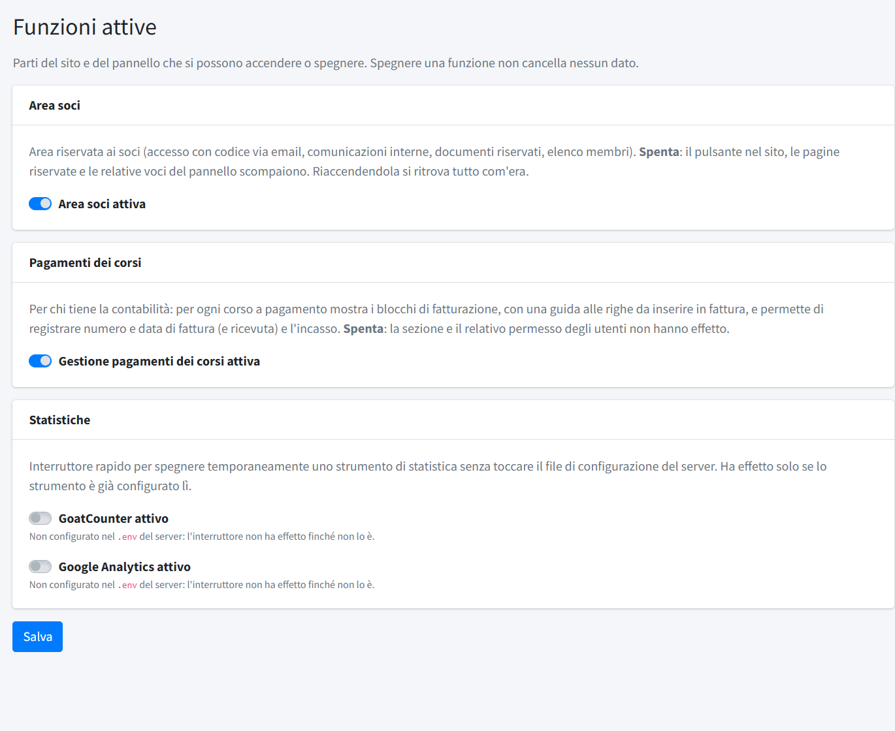

# Funzioni attive

In **Funzioni attive** (menu *Configurazione*, riservato agli amministratori) si accendono e si spengono le parti facoltative del sito e
del pannello. **Spegnere una funzione non cancella nessun dato**: riaccendendola si ritrova tutto com'era.

## Area soci

L'area riservata ai soci: accesso con codice via email, [comunicazioni](../04-area-soci/02-comunicazioni-soci.md),
[documenti riservati](../04-area-soci/03-documenti-riservati.md) ed elenco dei [membri](../04-area-soci/01-membri.md). Spenta, il pulsante
«Area soci» del sito, le pagine riservate e le voci del gruppo *Area soci* del pannello scompaiono, e i soci collegati vengono fatti uscire.
Restano consultabili il [Registro accessi](../08-utenti-e-controllo/02-registro-accessi.md), il
[Registro download](../08-utenti-e-controllo/03-registro-download.md) e l'informativa privacy per i soci.

## Pagamenti dei corsi

Per chi tiene la contabilità: per ogni corso a pagamento mostra i blocchi di fatturazione, con i dati da copiare e la guida alle righe
della fattura, e permette di registrare fattura, ricevuta e incasso (vedi [Pagamenti corsi](../03-formazione/03-pagamenti-corsi.md)).
Spenta, la voce *Pagamenti corsi* scompare e il relativo permesso degli utenti non ha effetto.

## Statistiche

Due interruttori rapidi, per spegnere temporaneamente le statistiche senza cookie (GoatCounter) e Google Analytics senza toccare il file
di configurazione. Funzionano solo se lo strumento è stato definito nel file `.env` del server; altrimenti la spunta non ha effetto e la
pagina lo segnala. Come definirli: [Configurazione del file .env](../00-installazione/03-configurazione-env.md#statistiche-facoltative).
