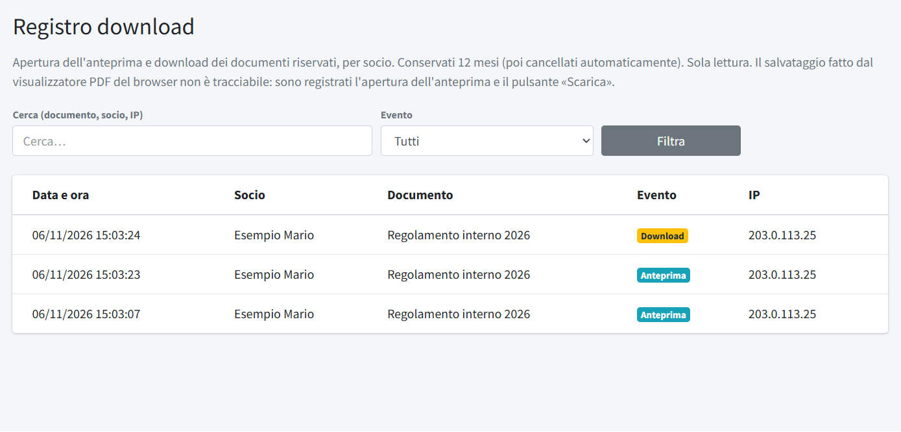

# Registro download

Il **Registro download** (menu *Utenti e controllo*, riservato agli amministratori) elenca chi ha aperto o scaricato i
[documenti riservati](../04-area-soci/03-documenti-riservati.md) dell'area soci. È in **sola lettura** e i dati sono conservati per
**12 mesi**, poi cancellati automaticamente.

Per ogni evento: **Data e ora**, **Socio**, **Documento**, **Evento** e **IP** di provenienza. Gli eventi sono due:

- **Anteprima**: il socio ha aperto il documento (i documenti riservati si aprono sempre prima in anteprima);
- **Download**: il socio ha premuto **Scarica**.

In alto si cerca per documento, socio o IP e si filtra per tipo di evento.

> Il salvataggio fatto con il pulsante del visualizzatore PDF del browser non è tracciabile: risulta solo l'anteprima. Il registro
> dice quindi con certezza chi ha aperto un documento, non sempre chi lo ha salvato.

Gli accessi all'area soci (e al pannello) sono invece nel [Registro accessi](02-registro-accessi.md).
